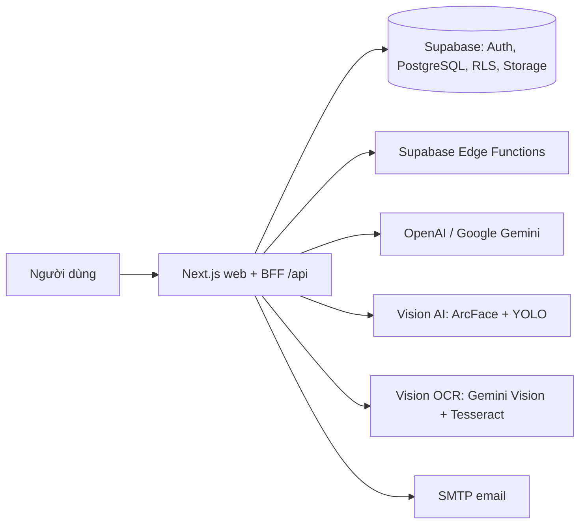

# Town Hown — Tài liệu hệ thống HRMS tích hợp AI

> **Bản chạy thử (staging):** <https://staging.wpcteam.shop/>

Town Hown là hệ thống quản lý nhân sự (HRMS) B2B tích hợp AI có kiểm soát. AI
trích xuất, so khớp, tóm tắt và soạn thảo; mọi quyết định nhân sự đều do người
có thẩm quyền xác nhận và được lưu vết.

Repository này chỉ chứa **tài liệu** của hệ thống: tổng quan sản phẩm, kiến
trúc, danh mục tính năng, đặc tả chi tiết (URD/SRS/ERD) cho 39 tính năng, các
module AI, công nghệ, triển khai, bảo mật và quy trình phát triển. Mã nguồn ứng
dụng nằm ở repository riêng.

## Truy cập hệ thống

| Môi trường | Địa chỉ | Nhánh nguồn |
| --- | --- | --- |
| Staging (bản chạy thử) | <https://staging.wpcteam.shop/> | `develop` |
| Health check | <https://staging.wpcteam.shop/api/health> | trả `{"ok":true}` |

Staging dùng dữ liệu thử nghiệm. Tài khoản đăng nhập do quản trị viên cấp; trang
đăng ký và đăng nhập Face ID có sẵn trên giao diện.

## Mục lục

| # | Tài liệu | Nội dung |
| --- | --- | --- |
| 1 | [Tổng quan sản phẩm](docs/01-tong-quan.md) | Vấn đề, giá trị, mục tiêu, phạm vi v1, chỉ số thành công |
| 2 | [Kiến trúc hệ thống](docs/02-kien-truc.md) | Ranh giới, các tầng, luồng dữ liệu, trust boundary |
| 3 | [Danh mục tính năng](docs/03-tinh-nang.md) | 39 tính năng theo 7 nhóm, mức ưu tiên, liên kết đặc tả |
| 4 | [Vai trò và hành trình người dùng](docs/04-vai-tro-va-hanh-trinh.md) | Vai trò, quyền, pipeline tuyển dụng, màn hình chính |
| 5 | [Các module AI](docs/05-module-ai.md) | Vision OCR + Nghị định 30, Face ID chống giả mạo, giám sát hành vi |
| 6 | [Công nghệ sử dụng](docs/06-cong-nghe.md) | Stack, thư viện chính, nhóm API |
| 7 | [Triển khai và vận hành](docs/07-trien-khai-va-van-hanh.md) | Docker, môi trường, CI/CD, smoke test, rollback |
| 8 | [Bảo mật và AI an toàn](docs/08-bao-mat-va-ai-an-toan.md) | Phân quyền, secret, dữ liệu nhạy cảm, nguyên tắc AI |
| 9 | [Quy trình phát triển](docs/09-quy-trinh-phat-trien.md) | GitFlow, quy tắc code, kiểm thử, review |
| — | [PRD đầy đủ](docs/product/prd.md) | Tài liệu yêu cầu sản phẩm gốc |
| — | [Đặc tả theo tính năng](docs/features/README.md) | Brainstorm, URD, SRS, ERD cho từng tính năng |

## Tóm tắt nhanh

- **Tuyển dụng đầu-cuối:** tiếp nhận CV, bóc tách dữ liệu, so khớp có giải
  thích, pipeline trạng thái có kiểm soát, lịch phỏng vấn, offer, onboarding.
- **Đánh giá năng lực:** ngân hàng câu hỏi, sinh câu hỏi bằng AI, bài test
  public hoặc được giao, chấm điểm và phân tích có người review.
- **Document AI:** OCR ảnh/PDF, trích chủ đề, soạn thảo và thẩm định văn bản
  hành chính theo Nghị định 30/2020/NĐ-CP, xuất Word.
- **Chấm công sinh trắc học:** đăng ký khuôn mặt nhiều góc, đăng nhập Face ID,
  chống giả mạo, tổng hợp công.
- **Giám sát hành vi:** phát hiện sự kiện tại khu vực đã công bố bằng computer
  vision; mọi sự kiện chỉ là cảnh báo cho đến khi quản lý xác nhận.
- **Nền tảng:** phân quyền theo vai trò, email nghiệp vụ, thông báo, nhật ký
  hoạt động, theo dõi mức dùng AI, công bố phiên bản.

## Nguyên tắc cốt lõi

1. **Human-in-the-loop:** AI chỉ đề xuất, không tự tuyển, loại hay kỷ luật.
2. **Có evidence và provenance:** mỗi kết quả AI truy được về dữ liệu nguồn.
3. **Phân quyền là ràng buộc sản phẩm:** kiểm tra ở API và RLS, không dựa vào
   việc UI ẩn nút.
4. **Bảo vệ dữ liệu nhân sự:** secret chỉ ở server, dữ liệu tối thiểu, có audit.

## Đội ngũ

Dự án do nhóm WPC Team phát triển: Dat, Hieu, Kien, Thanh.

## Giấy phép

Tài liệu phát hành theo [MIT License](LICENSE).
