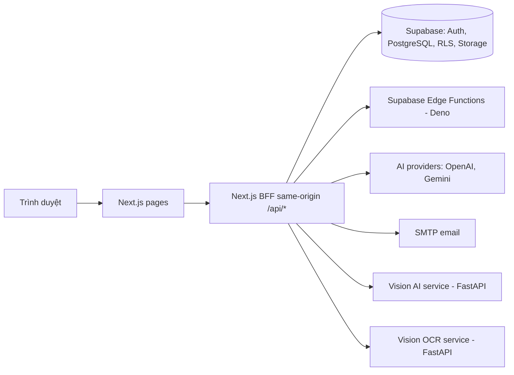

# 2. Kiến trúc hệ thống

Bản triển khai staging: <https://staging.wpcteam.shop/>.

## Bức tranh tổng thể



```text
Ứng viên / Nhân viên / HR / Interviewer / Quản lý / Admin
                         |
                    Trình duyệt web
                         |
            Next.js pages + route handlers (BFF)
                         |
        Domain helpers / provider boundaries
          |              |               |               |
     Supabase       AI providers    SMTP/tích hợp     Vision services
 Auth/DB/RLS/Storage  sinh/OCR      email/lịch/webhook  Face ID, hành vi, OCR
```

## Thành phần triển khai

| Thành phần | Vai trò |
| --- | --- |
| **Web (Next.js)** | Một deployable duy nhất gồm giao diện và BFF `/api/*`. BFF giữ cookie SSR, upload, streaming và che giấu secret khỏi trình duyệt. Build dạng standalone. |
| **Supabase** | Nền dữ liệu: PostgreSQL, Auth, Row Level Security, Storage, RPC. Schema thay đổi qua migration. |
| **Edge Functions** | Xử lý nền bằng Deno: xử lý CV, trích chủ đề tài liệu, sinh câu hỏi từ tài liệu. |
| **Vision AI** | FastAPI chạy ArcFace/InsightFace (nhận diện khuôn mặt) và YOLO (phát hiện hành vi). |
| **Vision OCR** | FastAPI chạy Gemini Vision với dự phòng Pytesseract, phục vụ OCR và Nghị định 30 Studio. |

Ba service `web`, `vision-ai-api`, `vision-ocr-api` chạy cùng nhau bằng Docker
Compose. Chỉ `web` mở cổng ra ngoài; hai service vision chỉ nhận request nội bộ
từ BFF.

## Các tầng

### Presentation

Pages và layouts dưới `src/app` ghép các component theo domain. Mặc định là
Server Component; chỉ dùng `use client` khi cần tương tác, browser API hoặc
state cục bộ. UI ẩn nút không phải là phân quyền.

### HTTP / Application (BFF)

Mỗi route handler thực hiện theo thứ tự:

1. Parse body, params, query.
2. Xác định auth context.
3. Kiểm tra vai trò, quyền sở hữu và phạm vi.
4. Gọi helper của domain.
5. Trả response/lỗi mà không lộ chi tiết nội bộ.
6. Ghi audit hoặc usage khi nghiệp vụ yêu cầu.

### Domain

| Domain | Phạm vi |
| --- | --- |
| Recruitment | Application, chuyển trạng thái, phỏng vấn, offer, onboarding |
| Assessment | Bài test, câu hỏi, bài nộp, chấm điểm, phân tích |
| Talent / CRM | Persons, positions, skills, groups, điểm suy diễn |
| Document AI | File nguồn, văn bản trích xuất, chủ đề, job, sản phẩm sinh ra |
| Meetings / Tasks | Cuộc họp, biên bản, action item, nguồn gốc công việc |
| Communication | Thông báo, mẫu email, nhà cung cấp, bằng chứng gửi |

Quy tắc quan trọng có một nơi sở hữu duy nhất. Ví dụ, các bước chuyển trạng
thái tuyển dụng nằm trong một state machine dùng chung cho cả UI và API.

### Data

Supabase client được tách theo ngữ cảnh:

- **Browser:** dùng anon key và session của người dùng.
- **Server:** dùng cookie/session để hành động dưới danh tính người dùng.
- **Admin (service role):** chỉ ở server, cho hành động đã được phân quyền cụ thể
  cần vượt RLS.

## Luồng dữ liệu theo domain

### Tuyển dụng

```text
Nhu cầu tuyển dụng / vị trí
  -> CV nguồn + dữ liệu trích xuất đã xác nhận
  -> application + so khớp có giải thích
  -> chuyển trạng thái có kiểm soát
  -> phỏng vấn / đánh giá
  -> offer
  -> onboarding + hồ sơ nhân viên
```

Điểm suy diễn không thay thế dữ liệu nguồn. Kết quả AI, override của HR và lịch
sử chuyển trạng thái được lưu riêng để truy nguyên.

### Đánh giá năng lực

```text
Nguồn câu hỏi / ngân hàng câu hỏi
  -> cấu hình bài đánh giá
  -> truy cập public hoặc được giao
  -> câu trả lời / bài nộp
  -> chấm tự động hoặc thủ công
  -> phân tích đã được reviewer xác nhận
```

Token public chỉ cấp quyền tối thiểu cho đúng bài được chia sẻ; không mở dữ liệu
của nhà tuyển dụng hay đáp án.

### Document AI

```text
Tài liệu thô
  -> bản ghi nguồn đã kiểm tra
  -> trích xuất / OCR
  -> chủ đề / dữ liệu có cấu trúc đề xuất
  -> con người review
  -> công bố vào domain sở hữu
```

Mỗi bước giữ provenance và trạng thái riêng. Retry không tạo bản trùng; độ tin
cậy (confidence) không biến thành sự thật trước khi được review.

### Từ cuộc họp đến công việc

```text
Cuộc họp / bản ghi âm
  -> transcript
  -> biên bản và action do AI đề xuất
  -> người chủ trì xác nhận
  -> công việc có liên kết nguồn
  -> tiến độ / bàn giao / phê duyệt
```

AI không tự giao việc khi người nhận và hạn chưa được xác nhận.

## Trust boundary

- Request body, query, token public và file upload là dữ liệu không tin cậy.
- Output của AI provider là không tin cậy cho đến khi được parse và validate.
- Trình duyệt không bao giờ nhận service-role key, mật khẩu SMTP hay AI key.
- RLS là lớp bảo vệ dữ liệu cuối; phân quyền ở route và RLS không thay thế nhau.
- Bản ghi âm, CV, transcript, bài đánh giá và email là dữ liệu nhạy cảm.

## Quan sát và audit

- Log vận hành: request, hành động, kết quả, thời gian, trạng thái; đã che
  secret và PII.
- Audit: người thực hiện, đối tượng, trạng thái trước/sau, lý do, thời điểm.
- AI usage, nhật ký email, hoạt động tuyển dụng và log đăng nhập phục vụ mục đích
  khác nhau và được lưu riêng.

## Quy tắc mở rộng

1. Tính năng mới gắn với đúng capability và domain đang sở hữu.
2. Chỉ tạo module mới khi có vòng đời và hợp đồng riêng.
3. Dữ liệu chưa biết được parse tại biên trước khi đi sâu vào hệ thống.
4. Thay đổi public/schema/security contract cần validation và cập nhật tài liệu.
5. Thư mục hay route tồn tại không chứng minh tính năng đã sẵn sàng production.
