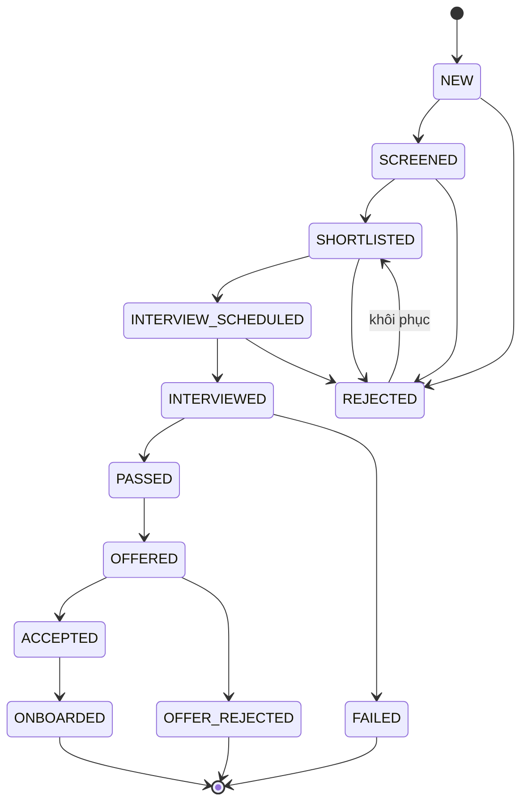

# 4. Vai trò và hành trình người dùng

Đăng nhập tại <https://staging.wpcteam.shop/login>.

## Vai trò trong hệ thống

| Vai trò | Mã | Phạm vi chính |
| --- | --- | --- |
| Super admin | `super_admin` | Toàn quyền nền tảng, cấu hình hệ thống |
| Admin | `admin` | Người dùng, quyền, cấu hình, nhà cung cấp AI/email, phiên bản |
| HR | `hr` | Hồ sơ, tuyển dụng, đánh giá, onboarding, email nghiệp vụ |
| Recruiter | `recruiter` | Tiếp nhận CV, pipeline ứng viên, lịch phỏng vấn |
| Interviewer | `interviewer` | Phiên phỏng vấn được giao, ghi nhận đánh giá |
| Leader / Quản lý | `leader` | Phê duyệt, báo cáo và tiến độ trong phạm vi quản lý |
| Nhân viên | — | Hồ sơ cá nhân, chấm công, bài đánh giá và công việc của mình |
| Ứng viên | — | Làm bài đánh giá qua liên kết được chia sẻ, theo dõi quy trình |

Quyền được kiểm tra ở ba lớp: middleware (bảo vệ route), BFF (vai trò, quyền sở
hữu, phạm vi) và RLS trong cơ sở dữ liệu. Các thao tác nhạy cảm của admin có thể
yêu cầu xác thực lại bằng khuôn mặt (Face re-auth).

## Pipeline tuyển dụng

Trạng thái ứng viên chỉ được chuyển theo các bước cho phép:

| Trạng thái | Ý nghĩa |
| --- | --- |
| `NEW` | CV vừa được tiếp nhận |
| `SCREENED` | Đã sàng lọc sơ bộ |
| `SHORTLISTED` | Vào danh sách ngắn |
| `INTERVIEW_SCHEDULED` | Đã xếp lịch phỏng vấn |
| `INTERVIEWED` | Đã phỏng vấn, chờ kết luận |
| `PASSED` / `FAILED` | Kết luận phỏng vấn do người có thẩm quyền đưa ra |
| `OFFERED` | Đã gửi offer |
| `ACCEPTED` / `OFFER_REJECTED` | Ứng viên nhận hoặc từ chối offer |
| `ONBOARDED` | Đã onboarding, chuyển thành hồ sơ nhân viên |
| `REJECTED` | Bị loại; có thể khôi phục về `SHORTLISTED` |

Mỗi lần chuyển trạng thái được ghi vào lịch sử hoạt động tuyển dụng.

## Hành trình theo vai trò

### HR / Recruiter

1. Lập nhu cầu tuyển dụng và mô tả công việc (JD); AI hỗ trợ phân tích JD.
2. Tải CV lên; Edge Function bóc tách thông tin, HR xác nhận dữ liệu.
3. Xem điểm so khớp có giải thích giữa ứng viên và vị trí.
4. Chuyển trạng thái trong pipeline, giao bài đánh giá, xếp lịch phỏng vấn.
5. Tổng hợp đánh giá, ra quyết định, gửi offer và email nghiệp vụ.
6. Onboarding ứng viên đã nhận offer thành nhân viên.

### Interviewer

1. Xem lịch phỏng vấn được giao kèm CV, JD và câu hỏi gợi ý.
2. Vào phòng phỏng vấn, ghi chú; AI có thể sinh câu hỏi bổ sung.
3. Ghi nhận đánh giá theo tiêu chí; kết quả được tổng hợp cho HR.

### Ứng viên

1. Nhận liên kết bài đánh giá (public hoặc được giao).
2. Làm bài với autosave và thời hạn rõ ràng.
3. Nộp bài và nhận biên nhận; điểm chỉ có hiệu lực sau khi reviewer xác nhận.

### Nhân viên

1. Đăng ký khuôn mặt nhiều góc tại `/dashboard/my-face`.
2. Đăng nhập bằng Face ID và điểm danh qua webcam.
3. Xem hồ sơ, bài đánh giá năng lực và công việc của mình.

### Quản lý / Lãnh đạo

1. Xem dashboard và báo cáo trong phạm vi quản lý.
2. Phê duyệt nhu cầu tuyển dụng, theo dõi tiến độ và rủi ro.
3. Xác nhận hoặc bác bỏ cảnh báo từ hệ thống giám sát hành vi.

### Admin

1. Quản lý người dùng, vai trò và cấu hình nền tảng.
2. Cấu hình nhà cung cấp AI, SMTP và mẫu email.
3. Theo dõi mức sử dụng AI, nhật ký hoạt động, công bố phiên bản mới.
4. Cấu hình mô hình Vision AI (ngưỡng, nhãn, lưu trữ).

Đặc tả chi tiết từng hành trình: [PRD mục 7](product/prd.md).
