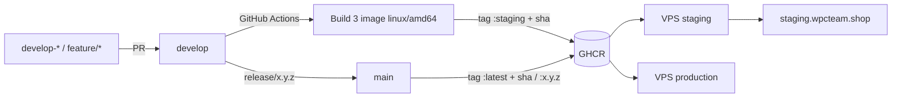

# 7. Triển khai và vận hành

## Môi trường

| Môi trường | Địa chỉ | Kích hoạt |
| --- | --- | --- |
| Local | `http://localhost:3000` | `npm run dev` hoặc `docker compose up` |
| Staging | <https://staging.wpcteam.shop/> | push nhánh `develop` |
| Production | `https://production.wpcteam.shop` | push nhánh `main` hoặc tag `v*` |

Staging và production dùng hai Supabase project riêng và hai image riêng, vì
biến `NEXT_PUBLIC_*` được in vào bundle lúc build.

## Luồng CI/CD



Mỗi lần publish tạo ba image cùng tag: web, vision-ai, vision-ocr. Secret runtime
nằm trong file `.env` trên máy chủ, không đi qua GitHub; GitHub Environment chỉ
giữ các biến public.

## Đường đi của request

```text
Trình duyệt -> Cloudflare (HTTPS, SSL Full strict) -> reverse proxy :443
            -> cổng host của môi trường -> container web :3000 -> Next.js standalone
```

## Chạy local

### Chỉ web

```bash
cd Frontend
cp .env.example .env.local   # điền giá trị qua kênh nội bộ của đội
npm ci
npm run dev
```

### Đủ stack bằng Docker Compose

```bash
cp .env.example .env
docker compose config
docker compose up --build -d
curl -fsS http://127.0.0.1:3000/api/health   # {"ok":true}
docker compose logs --tail=200 web
```

Image web chạy non-root; `/api/health` không gọi Supabase nên phản ánh đúng tình
trạng tiến trình.

## Smoke test sau triển khai

- Container `web`, `vision-ai-api`, `vision-ocr-api` healthy, không restart lặp.
- `GET /api/health` trả 200.
- Trang chủ và CSS/JS tĩnh tải được.
- Đăng nhập và làm mới session hoạt động.
- Một lần đọc dữ liệu được bảo vệ trả đúng theo RLS.
- API lỗi không lộ stack trace hay secret.
- Log không chứa credential hay PII bất thường.

## Chẩn đoán nhanh

| Triệu chứng | Nơi cần kiểm tra |
| --- | --- |
| Origin lỗi | Container, biến môi trường, migration |
| Origin ổn, domain lỗi | Reverse proxy, Cloudflare, DNS, TLS |
| HTML ổn, CSS/JS lỗi | Bước build/copy static hoặc rewrite `_next/static` |
| Trang ổn, API lỗi | Auth, secret runtime, RLS hoặc AI provider |

## Migration cơ sở dữ liệu

1. Xác minh đúng Supabase project của môi trường.
2. Sao lưu trước mọi thay đổi schema hoặc dữ liệu hàng loạt.
3. Thêm migration mới; không sửa migration đã áp dụng.
4. Review SQL phá hủy, rủi ro khóa bảng, chuyển đổi dữ liệu và RLS.
5. Áp dụng trên staging trước production.
6. Kiểm tra các đường truy cập hợp lệ, trái phép và đặc quyền.
7. Chuẩn bị forward-fix hoặc rollback và tiêu chí dừng.

## Rollback

- **Chỉ ứng dụng:** chọn tag hoặc digest đã chạy ổn (không dùng `:latest`), pull
  lại, `docker compose up -d --remove-orphans`, smoke test origin rồi domain.
- **Có migration:** ưu tiên forward-fix nếu traffic đã dùng schema mới; khôi phục
  backup là hành động có tác động lớn, cần phê duyệt.

## Phát hành phiên bản

```text
develop-<tên> -> PR -> develop -> release/x.y.z -> main -> tag vx.y.z
```

Chỉ tag khi manifest và lockfile đồng bộ, kiểm tra đã pass và image đã được
smoke test. Ghi chú phát hành được công bố trong ứng dụng qua tính năng
release-announcements.
