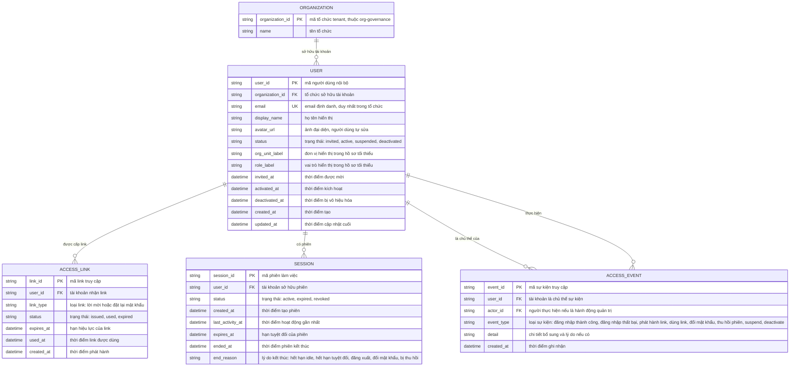

# account-access — Entity Relationship Diagram

> Scope: danh tính và phiên làm việc của người dùng nội bộ — tài khoản,
> link truy cập một lần dùng, phiên và sự kiện truy cập tối thiểu.
> `USER` là entity nền của toàn sản phẩm (feature khác tham chiếu tối thiểu);
> `ORGANIZATION` là tham chiếu sang `org-governance`.

## Diagram

## Entity Reference

| Entity | Purpose | Key attributes |
|--------|---------|----------------|
| USER | Tài khoản + hồ sơ tối thiểu của người dùng nội bộ — entity nền được mọi feature khác tham chiếu | email, status, display_name, organization_id |
| ACCESS_LINK | Link mời/khôi phục mật khẩu một lần dùng có hạn; link mới cùng loại vô hiệu link cũ | link_type, status, expires_at, used_at |
| SESSION | Phiên làm việc sau xác thực — hết hạn theo idle/tuyệt đối, bị thu hồi khi đổi mật khẩu hoặc vô hiệu tài khoản | status, last_activity_at, expires_at, end_reason |
| ACCESS_EVENT | Vết truy cập tối thiểu phục vụ điều tra — không thay nhật ký audit nghiệp vụ của `org-governance` | event_type, user_id, actor_id, created_at |
| ORGANIZATION | Tenant sở hữu tài khoản — entity ngoài do `org-governance` sở hữu, chỉ tham chiếu | organization_id, name |

## Notes & Assumptions

- `USER` là entity căn bản của sản phẩm: các feature khác (assignment, câu
  hỏi, tài liệu, audit...) tham chiếu bằng `user_id` và chỉ khai báo tối
  thiểu trong ERD của chúng. `USER.org_unit_label`/`role_label` là thông
  tin hiển thị trong hồ sơ tối thiểu — nguồn quyền thật nằm ở `ASSIGNMENT`
  của `org-governance`, không trùng nguồn sự thật ở đây.
- `USER.email` duy nhất trong phạm vi một `organization_id` (UK tổ hợp logic);
  cùng một email có thể là tài khoản khác ở tổ chức khác (OQ-7 của spec).
- `ACCESS_LINK` không lưu token dạng đọc được — giá trị link là bí mật một
  chiều; ERD chỉ mô hình vòng đời (issued → used/expired).
- `SESSION` là khái niệm nghiệp vụ; khi `org-governance` kết thúc gán hoặc
  admin suspend/deactivate, các phiên `active` chuyển `revoked` với
  `end_reason` tương ứng.
- `ACCESS_EVENT.actor_id` rỗng khi sự kiện do chính chủ thể hoặc hệ thống
  tạo (vd đăng nhập thất bại, phiên hết hạn); có giá trị khi admin thực
  hiện (suspend/deactivate/gửi lại lời mời).
- Retention của `SESSION`/`ACCESS_EVENT`: đề xuất 12 tháng rolling, chờ
  DPO duyệt (OQ-5 spec, liên quan OQ-6 PRD).

## develop-hieu physical additions

The biometric account-access slice adds these physical structures around the
base account model.

### USER_FACE_EMBEDDING

Stores ArcFace enrollment data for one user and one capture angle.

- `user_id`: references the application user/profile.
- `profile_name`: display name used for human-readable local storage folders.
- `angle_label` / `angle_index`: capture slot, including the six registration
  angles used by the implemented flow.
- `embedding`: 512-dimension ArcFace vector stored as JSON/array data.
- `storage_path`: local face image path under `FACE_DATA_DIR`.
- `model_name` / `model_version`: face model metadata.
- `created_at`, `updated_at`: audit timestamps.

### FACE_AUDIT_LOG

Records biometric account events without storing raw passwords or secrets.

- `user_id`: affected user.
- `action`: enroll, update, delete, login_match, login_mismatch, check_in, or
  check_out.
- `result`: success/failure outcome.
- `similarity`: optional face similarity score.
- `metadata`: model, route, or local fallback context.
- `created_at`: event time.

### Local face-store registry

Local development can persist fallback user/profile metadata in the face-store
registry when Supabase service-role credentials are absent. It is a development
fallback only; production account identity remains Supabase-backed.
