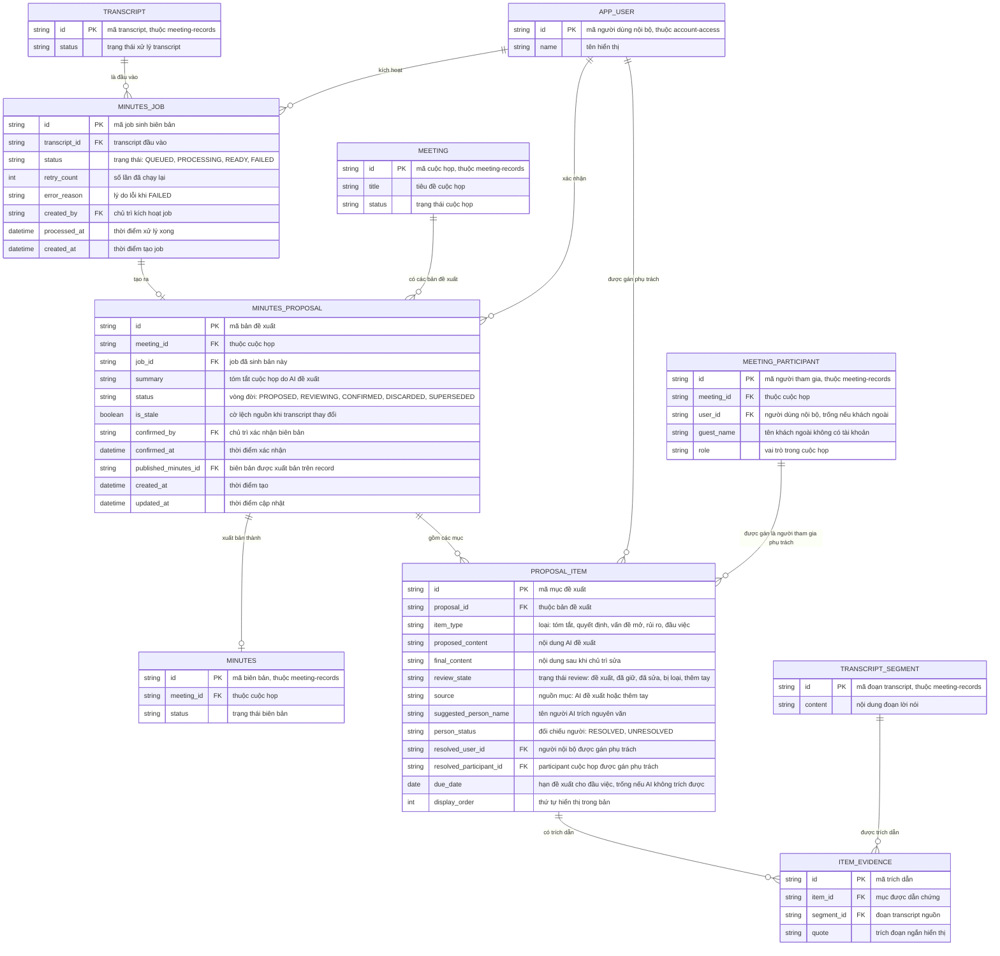

# ai-meeting-minutes — Entity Relationship Diagram

> Scope: job sinh biên bản AI, bản đề xuất biên bản, các mục đề xuất kèm
> trích dẫn transcript và đối chiếu người phụ trách (PRD Mục 7.14).
> `TRANSCRIPT`, `TRANSCRIPT_SEGMENT`, `MEETING`, `MEETING_PARTICIPANT`,
> `MINUTES` thuộc `meeting-records`; `APP_USER` thuộc `account-access` —
> chỉ khai tối thiểu để tham chiếu.

## Diagram

## Entity Reference

| Entity | Purpose | Key attributes |
|--------|---------|----------------|
| MINUTES_JOB | Một lần sinh biên bản AI từ transcript — trạng thái và retry | transcript_id, status, retry_count, created_by |
| MINUTES_PROPOSAL | Bản đề xuất biên bản của một job — vòng đời review đến publish | meeting_id, job_id, summary, status, is_stale, confirmed_by, published_minutes_id |
| PROPOSAL_ITEM | Một mục trong bản đề xuất — nội dung AI vs nội dung đã sửa, người và hạn đề xuất | item_type, proposed_content, final_content, review_state, suggested_person_name, person_status, resolved_user_id, due_date |
| ITEM_EVIDENCE | Trích dẫn từ một mục tới đoạn transcript nguồn (provenance) | item_id, segment_id, quote |
| TRANSCRIPT | Transcript cuộc họp — entity ngoài feature (`meeting-records`), là đầu vào job | id, status |
| TRANSCRIPT_SEGMENT | Đoạn transcript làm trích dẫn — ngoài feature (`meeting-records`) | id, content |
| MEETING | Cuộc họp sở hữu các bản đề xuất — ngoài feature (`meeting-records`) | id, title, status |
| MEETING_PARTICIPANT | Participant làm đích gán phụ trách — ngoài feature (`meeting-records`) | id, user_id/guest_name, role |
| MINUTES | Biên bản đích khi xác nhận publish — ngoài feature (`meeting-records`) | id, meeting_id, status |
| APP_USER | Người dùng nội bộ — ngoài feature (`account-access`): kích hoạt job, xác nhận, được gán phụ trách | id, name |

## Notes & Assumptions

- `MINUTES_JOB` tách riêng khỏi `MINUTES_PROPOSAL` vì một job có thể FAILED
  không tạo bản nào; mỗi job thành công tạo đúng một bản đề xuất (`||--o|`).
- Một cuộc họp chỉ có tối đa 1 bản đề xuất đang mở (PROPOSED/REVIEWING) —
  ràng buộc nghiệp vụ BR-006, không thể hiện trên ERD; các bản DISCARDED/
  SUPERSEDED giữ vết để đối chiếu provenance (OQ-2 spec).
- `PROPOSAL_ITEM` giữ song song `proposed_content` (gốc AI) và
  `final_content` (sau sửa) để đo tỷ lệ đề xuất được giữ lại (đo thành công
  PRD Mục 7.14); mục thêm tay có `source = thêm tay` và không bắt buộc
  ITEM_EVIDENCE (BR-010).
- `person_status = UNRESOLVED` giữ `suggested_person_name` nguyên văn và cờ
  chưa resolve — `meeting-to-tasks` chặn tạo task từ đầu việc chưa resolve
  (BR-008, PRD Mục 7.15). `resolved_user_id` và `resolved_participant_id`
  chỉ một trong hai được điền tùy đích gán (người danh bạ hoặc participant).
- `is_stale` bật khi transcript thay đổi sau khi bản đề xuất tồn tại; xác
  nhận publish khi cờ bật phải qua hỏi xác nhận (BR-011).
- `published_minutes_id` trỏ MINUTES được tạo/cập nhật khi publish — biên
  bản và revision tiếp theo thuộc `meeting-records`, không nhân bản ở đây.
- Audit các quyết định review và xác nhận nằm ở audit log của
  `org-governance`, không tạo entity riêng trong feature này.
