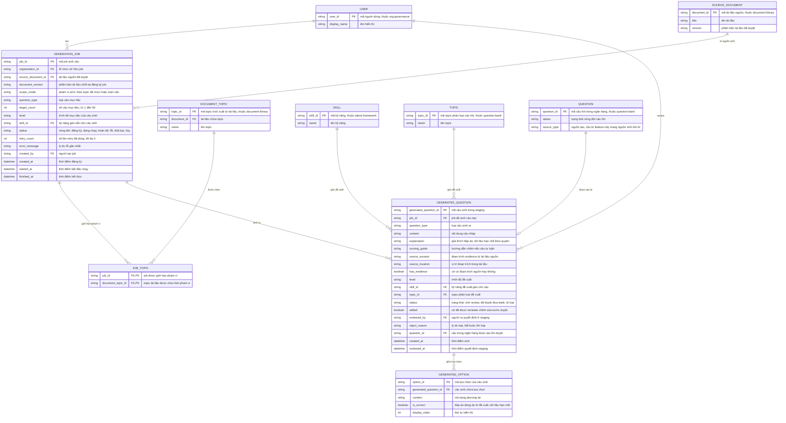

# ai-question-generation — Entity Relationship Diagram

> Scope: job sinh câu hỏi bằng AI từ tài liệu đã duyệt và staging câu nháp
> chờ review của một tổ chức. `SOURCE_DOCUMENT`, `DOCUMENT_TOPIC` thuộc
> `document-library`; `SKILL` thuộc `talent-framework`; `TOPIC`, `QUESTION`
> thuộc `question-bank`; `USER` thuộc `org-governance` — đều là tham chiếu
> tối thiểu, không sao chép cấu trúc.

## Diagram

## Entity Reference

| Entity | Purpose | Key attributes |
|--------|---------|----------------|
| GENERATION_JOB | Một lần chạy sinh câu từ tài liệu — cấu hình, phiên bản nguồn chốt, trạng thái và retry | source_document_id, document_version, scope_mode, question_type, target_count, status, retry_count |
| JOB_TOPIC | Phạm vi topic tài liệu được chọn cho job (nhiều-nhiều) | job_id, document_topic_id |
| GENERATED_QUESTION | Câu nháp AI trong staging — nội dung, evidence đoạn trích, phân loại đề xuất, quyết định review | content, source_excerpt, has_evidence, status, edited, reject_reason, question_id |
| GENERATED_OPTION | Lựa chọn của câu trắc nghiệm sinh ra — đáp án đúng là đề xuất của AI, hạn chế theo quyền | content, is_correct, display_order |
| SOURCE_DOCUMENT | Tài liệu nguồn đã duyệt — tham chiếu từ `document-library`, chốt phiên bản vào job | document_id, title, version |
| DOCUMENT_TOPIC | Topic trích xuất từ tài liệu — tham chiếu từ `document-library`, là phạm vi sinh | topic_id, document_id, name |
| SKILL | Kỹ năng trong taxonomy chung — tham chiếu từ `talent-framework` | skill_id, name |
| TOPIC | Topic phân loại câu hỏi của bank — tham chiếu từ `question-bank` | topic_id, name |
| QUESTION | Câu trong ngân hàng được tạo khi staging duyệt — tham chiếu từ `question-bank`, vào ở "Chờ review" | question_id, status, source_type |
| USER | Người dùng nội bộ — tham chiếu từ `org-governance` | user_id, display_name |

## Notes & Assumptions

- `GENERATION_JOB.document_version` là chốt provenance theo R-11: job luôn
  sinh trên đúng phiên bản tài liệu đã duyệt tại thời điểm đăng ký; khi
  tài liệu có bản mới, câu trỏ bản cũ được cờ "cần rà soát" (FR-013) thay
  vì tự đồng bộ.
- `JOB_TOPIC` là junction nhiều-nhiều giữa job và `DOCUMENT_TOPIC` (topic
  trích xuất từ tài liệu — khác với `TOPIC` phân loại của ngân hàng); khi
  `scope_mode` là "toàn văn" thì không có dòng nào.
- `GENERATED_QUESTION.status` chỉ quản vòng đời staging (chờ review → đã
  duyệt đưa bank / bị loại). "Đã duyệt đưa bank" tạo `QUESTION` ở "Chờ
  review" trong `question-bank` — bank review là cổng duy nhất tạo câu
  "Đã duyệt" (BR-004, đề xuất OQ-1).
- `GENERATED_QUESTION.question_id` rỗng tới khi câu được duyệt; khi có giá
  trị nó là liên kết provenance từ câu bank về câu sinh gốc (NFR-002).
- `has_evidence` = false khi provider không trả được đoạn trích — câu vẫn
  vào staging nhưng reviewer được khuyến nghị loại hoặc gán đoạn trích
  (đề xuất OQ-4).
- `GENERATED_OPTION.is_correct` và `GENERATED_QUESTION.explanation`/
  `scoring_guide` là đáp án do AI đề xuất — vùng dữ liệu hạn chế, chỉ lộ
  cho vai trò được cấp như đáp án trong `question-bank`.
- `SOURCE_DOCUMENT`, `DOCUMENT_TOPIC`, `SKILL`, `TOPIC`, `QUESTION`,
  `USER` là entity tối thiểu tham chiếu chéo — bản đầy đủ thuộc ERD của
  `document-library`, `talent-framework`, `question-bank` và
  `org-governance`; không sao chép cấu trúc.
