# Giám sát mức dùng AI — Entity Relationship Diagram

> Scope: dữ liệu vận hành của ai-usage-monitoring — usage record (chỉ
> metadata), tổng hợp ngày, đơn giá, ngưỡng và cảnh báo, đối chiếu kỳ.
> `USER_ACCOUNT` và `ORG_UNIT` là entity neo thuộc `account-access`/
> `org-governance` — chỉ tham chiếu, không sở hữu.

## Diagram

```mermaid
erDiagram
    ORG_UNIT ||--o{ AI_USAGE_LOG : "phát sinh usage"
    USER_ACCOUNT ||--o{ AI_USAGE_LOG : "thực hiện request"
    ORG_UNIT ||--o{ AI_USAGE_DAILY : "tổng hợp theo ngày"
    ORG_UNIT ||--o{ AI_PRICING : "đặt đơn giá"
    USER_ACCOUNT ||--o{ AI_PRICING : "cập nhật giá"
    ORG_UNIT ||--o{ AI_USAGE_THRESHOLD : "đặt ngưỡng"
    USER_ACCOUNT ||--o{ AI_USAGE_THRESHOLD : "điều chỉnh ngưỡng"
    AI_USAGE_THRESHOLD ||--o{ AI_USAGE_ALERT : "vi phạm tạo cảnh báo"
    ORG_UNIT ||--o{ AI_USAGE_ALERT : "phát sinh cảnh báo"
    USER_ACCOUNT ||--o{ AI_USAGE_ALERT : "xử lý cảnh báo"
    ORG_UNIT ||--o{ AI_RECONCILE_PERIOD : "đối chiếu theo kỳ"
    USER_ACCOUNT ||--o{ AI_RECONCILE_PERIOD : "xác nhận đối chiếu"

    ORG_UNIT {
        string id PK "định danh đơn vị tổ chức"
        string name "tên đơn vị"
    }
    USER_ACCOUNT {
        string id PK "định danh người dùng nội bộ"
        string display_name "tên hiển thị"
    }
    AI_USAGE_LOG {
        string id PK "định danh usage record, bất biến sau khi ghi"
        string org_unit_id FK "đơn vị phát sinh request"
        string user_id FK "người thực hiện request"
        string feature_code "feature nguồn: cv-intake, ai-question-generation, ai-meeting-minutes..."
        string operation "loại thao tác AI: trích xuất, sinh nội dung, tóm tắt, đối chiếu, ocr"
        string provider "nhà cung cấp AI"
        string model "mã model được gọi"
        int tokens_input "số token đầu vào provider trả về"
        int tokens_output "số token đầu ra provider trả về"
        decimal cost_estimate "chi phí ước tính chốt tại thời điểm ghi"
        string cost_currency "tiền tệ của chi phí ước tính"
        string status "trạng thái: thành công, lỗi, không đo được"
        string request_ref "tham chiếu nghiệp vụ tối thiểu, không chứa payload"
        string env_flag "cờ nguồn: môi trường thật hoặc test, loại khỏi đối chiếu"
        datetime occurred_at "thời điểm request hoàn tất"
    }
    AI_USAGE_DAILY {
        string id PK "định danh dòng tổng hợp ngày"
        string org_unit_id FK "đơn vị được tổng hợp"
        date day "ngày tổng hợp"
        string feature_code "feature nguồn được gộp"
        string operation "loại thao tác được gộp"
        string model "model được gộp"
        int request_count "tổng số request trong ngày"
        int tokens_input "tổng token đầu vào"
        int tokens_output "tổng token đầu ra"
        decimal cost_estimate "tổng chi phí ước tính đã chốt"
        int unmeasured_count "số request không đo được token"
    }
    AI_PRICING {
        string id PK "định danh dòng đơn giá"
        string org_unit_id FK "đơn vị áp dụng đơn giá"
        string provider "nhà cung cấp AI"
        string model "mã model áp giá"
        decimal price_per_input_token "giá trên một token đầu vào"
        decimal price_per_output_token "giá trên một token đầu ra"
        string currency "tiền tệ của đơn giá"
        date effective_from "ngày bắt đầu hiệu lực"
        date effective_to "ngày hết hiệu lực, trống nghĩa là đang áp dụng"
        string updated_by FK "người cập nhật đơn giá gần nhất"
        datetime updated_at "thời điểm cập nhật"
    }
    AI_USAGE_THRESHOLD {
        string id PK "định danh ngưỡng cảnh báo"
        string org_unit_id FK "đơn vị đặt ngưỡng"
        string metric "metric đo: chi phí, số request, token"
        string period "kỳ đo: ngày, tuần, tháng"
        decimal threshold_value "giá trị ngưỡng"
        string scope_feature_code "feature bị giới hạn; trống nghĩa là toàn tổ chức"
        boolean is_active "ngưỡng đang bật hay đã tắt"
        string updated_by FK "người điều chỉnh ngưỡng gần nhất"
        datetime updated_at "thời điểm điều chỉnh"
    }
    AI_USAGE_ALERT {
        string id PK "định danh cảnh báo"
        string threshold_id FK "ngưỡng bị vi phạm"
        string org_unit_id FK "đơn vị phát sinh cảnh báo"
        string metric "metric đã vi phạm"
        string period_label "kỳ bị vi phạm"
        decimal measured_value "giá trị đo được khi vi phạm"
        decimal threshold_value "giá trị ngưỡng tại thời điểm vi phạm"
        string status "vòng đời: mở, đang xem, đã đóng"
        datetime opened_at "thời điểm tạo cảnh báo"
        string reviewed_by FK "người đóng cảnh báo"
        datetime reviewed_at "thời điểm đóng"
        string review_note "ghi chú xử lý bắt buộc khi đóng"
    }
    AI_RECONCILE_PERIOD {
        string id PK "định danh kỳ đối chiếu"
        string org_unit_id FK "đơn vị đối chiếu"
        string period_month "tháng được đối chiếu"
        string status "trạng thái: chưa đối chiếu, đã đối chiếu, lệch cần điều tra"
        string decided_by FK "người xác nhận đối chiếu"
        datetime decided_at "thời điểm xác nhận"
        string note "ghi chú nguyên nhân khi lệch"
    }
```

## Entity Reference

| Entity | Purpose | Key attributes |
|--------|---------|----------------|
| AI_USAGE_LOG | Một lượt AI request — metadata kỹ thuật, bất biến, không payload | feature_code, operation, provider, model, tokens_input/output, cost_estimate, status, env_flag |
| AI_USAGE_DAILY | Tổng hợp theo ngày × feature × thao tác × model — nguồn cho dashboard và kiểm tra ngưỡng | day, request_count, tokens, cost_estimate, unmeasured_count |
| AI_PRICING | Đơn giá theo provider+model với khoảng hiệu lực — chi phí chốt theo giá tại thời điểm ghi | price_per_input/output_token, currency, effective_from/to |
| AI_USAGE_THRESHOLD | Ngưỡng cảnh báo do admin đặt tay theo metric/kỳ/phạm vi | metric, period, threshold_value, scope_feature_code, is_active |
| AI_USAGE_ALERT | Một lần vi phạm ngưỡng — vòng đời mở → đang xem → đã đóng kèm ghi chú | measured_value, threshold_value, status, reviewed_by, review_note |
| AI_RECONCILE_PERIOD | Quyết định đối chiếu của admin trên một tháng — reconcile hoặc lệch | period_month, status, decided_by, note |
| ORG_UNIT | Đơn vị tổ chức — entity neo ngoài feature (org-governance) | id, name |
| USER_ACCOUNT | Người dùng nội bộ — entity neo ngoài feature (account-access) | id, display_name |

## Notes & Assumptions

- `AI_USAGE_LOG` tuyệt đối chỉ chứa metadata whitelist — không cột
  payload/prompt/response và không field text tự do; `request_ref` là
  tham chiếu nghiệp vụ tối thiểu (vd mã job) để drill mà không lộ nội
  dung (BR-001).
- `cost_estimate` chốt bất biến tại thời điểm ghi theo `AI_PRICING`
  hiệu lực — đổi giá không tính lại record cũ (BR-004); model chưa có
  giá thì `cost_estimate` trống, token vẫn ghi.
- `status = "không đo được"` khi provider không trả token — đếm vào
  `unmeasured_count` của tổng hợp để đo coverage (BR-007).
- `AI_USAGE_LOG.env_flag` loại dữ liệu test/synthetic khỏi đối chiếu và
  ngưỡng (BR-008).
- `AI_USAGE_DAILY` là bảng gộp idempotent do tác vụ chu kỳ duy trì —
  có thể tính lại từ `AI_USAGE_LOG`, không phải nguồn sự thật.
- `AI_USAGE_ALERT.threshold_value` lưu snapshot ngưỡng tại thời điểm vi
  phạm để truy vết khi ngưỡng sau đó bị sửa.
- Audit chi tiết từng action (đổi giá/ngưỡng, export, xem theo người)
  nằm ở audit log của `org-governance`; các cột `updated_by`/`reviewed_
  by`/`decided_by` chỉ giữ provenance nghiệp vụ tối thiểu.
- `USER_ACCOUNT`, `ORG_UNIT` khai tối thiểu theo quy ước cross-feature:
  bản đầy đủ thuộc `account-access`/`org-governance`.
