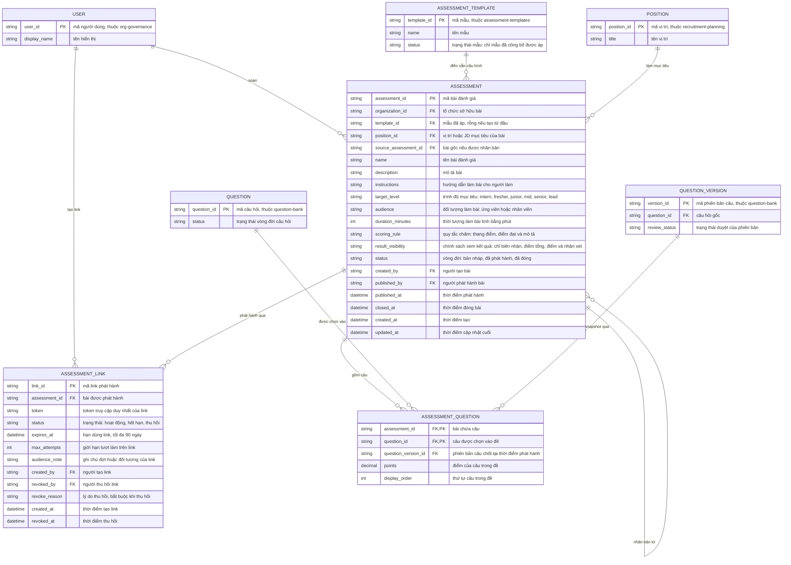

# assessment-authoring — Entity Relationship Diagram

> Scope: bài đánh giá của một tổ chức — cấu hình, câu trong đề (snapshot
> theo phiên bản câu), link phát hành và vòng đời. `QUESTION`,
> `QUESTION_VERSION`, `ASSESSMENT_TEMPLATE`, `POSITION`, `USER` là tham
> chiếu sang feature khác (`question-bank`, `assessment-templates`,
> `recruitment-planning`, `org-governance`).

## Diagram

## Entity Reference

| Entity | Purpose | Key attributes |
|--------|---------|----------------|
| ASSESSMENT | Bài đánh giá của tổ chức — cấu hình nghiệp vụ, chính sách hiển thị kết quả và vòng đời phát hành | name, target_level, audience, duration_minutes, scoring_rule, result_visibility, status, template_id, position_id |
| ASSESSMENT_QUESTION | Câu trong đề — tham chiếu câu + phiên bản chốt tại phát hành, điểm và thứ tự | question_id, question_version_id, points, display_order |
| ASSESSMENT_LINK | Link/token phát hành một bài — hạn, giới hạn lượt, trạng thái và lý do thu hồi | token, status, expires_at, max_attempts, revoke_reason |
| QUESTION | Câu hỏi trong ngân hàng — tham chiếu từ `question-bank`, chỉ "Đã duyệt" được chọn | question_id, status |
| QUESTION_VERSION | Phiên bản câu được chốt vào đề — tham chiếu từ `question-bank`, bất biến sau phát hành | version_id, question_id, review_status |
| ASSESSMENT_TEMPLATE | Mẫu cấu hình tái sử dụng — tham chiếu từ `assessment-templates`, chỉ mẫu "Đã công bố" được áp | template_id, name, status |
| POSITION | Vị trí/JD mục tiêu của bài — tham chiếu từ `recruitment-planning` | position_id, title |
| USER | Người dùng nội bộ (author/admin) — tham chiếu từ `org-governance` | user_id, display_name |

## Notes & Assumptions

- `ASSESSMENT.status` là vòng đời nghiệp vụ (bản nháp → đã phát hành → đã
  đóng). Bài "Đã phát hành" chỉ sửa được field không ảnh hưởng đề; đổi đề
  tạo bài mới qua quan hệ tự tham chiếu `source_assessment_id` (nhân bản).
- `ASSESSMENT_QUESTION.question_version_id` là chốt snapshot theo PRD Mục
  7.22: tại thời điểm phát hành, mỗi câu trong đề trỏ đúng
  `QUESTION_VERSION` hiệu lực — phiên bản đó bất biến nên đề không bị sửa
  ngầm khi đã có người làm. Trong lúc nháp, cột này trỏ phiên bản được
  chọn và có thể cập nhật khi câu có bản mới (cảnh báo FR-004).
- Khóa chính của `ASSESSMENT_QUESTION` là cặp (assessment_id, question_id):
  một câu chỉ xuất hiện một lần trong một đề; cùng câu ở phiên bản khác
  vẫn là cùng `question_id`.
- `ASSESSMENT_LINK.token` duy nhất trên toàn hệ thống; `expires_at` và
  `max_attempts` bắt buộc theo BR-004 (giải OQ-AS-01 của reverse spec).
  Attempt và enforcement (timer, autosave, submit) thuộc
  `candidate-assessment` — ERD này chỉ khai báo chính sách link mà bên đó
  đối chiếu.
- `result_visibility` và `scoring_rule` là chính sách author công bố theo
  PRD Mục 7.22; `assessment-grading`/`candidate-assessment` thực thi việc
  hiển thị kết quả dựa trên chính sách này.
- `ASSESSMENT_TEMPLATE`, `QUESTION`, `QUESTION_VERSION`, `POSITION`,
  `USER` là entity tối thiểu tham chiếu chéo — bản đầy đủ thuộc ERD của
  `assessment-templates`, `question-bank`, `recruitment-planning` và
  `org-governance`; không sao chép cấu trúc.
- Quan hệ tự tham chiếu `ASSESSMENT ||--o{ ASSESSMENT : "nhân bản từ"`
  biểu diễn bài được tạo bằng nhân bản — mỗi bài phát hành là bản ghi độc
  lập (đề xuất OQ-7 của spec: không cần versioning hiển thị trong v1).
