# assessment-grading — Entity Relationship Diagram

> Scope: chấm submission đã chốt — kết quả và trạng thái, mục chấm từng câu
> (có phiên bản regrade), breakdown theo kỹ năng, AI insight đề xuất, quyết
> định review/override có lý do, phát hành, follow-up và audit xuất.
> `SUBMISSION`, `SNAPSHOT_QUESTION`, `SKILL`, `USER` là tham chiếu tối thiểu
> sang `candidate-assessment`, `talent-framework` và `org-governance`.

## Diagram

```mermaid
erDiagram
    SUBMISSION ||--|| GRADING_RESULT : "tạo kết quả"
    GRADING_RESULT ||--o{ GRADE_ITEM : "gồm mục chấm"
    SNAPSHOT_QUESTION ||--o{ GRADE_ITEM : "được chấm trong"
    GRADING_RESULT ||--o{ SKILL_SCORE : "phân rã theo"
    SKILL ||--o{ SKILL_SCORE : "được đo trong"
    GRADING_RESULT ||--o{ AI_INSIGHT : "sinh insight"
    GRADING_RESULT ||--o{ REVIEW_ACTION : "chịu quyết định"
    GRADE_ITEM ||--o{ REVIEW_ACTION : "bị tác động"
    USER ||--o{ GRADE_ITEM : "chấm"
    USER ||--o{ REVIEW_ACTION : "thực hiện"
    GRADING_RESULT ||--o{ RESULT_RELEASE : "được phát hành"
    USER ||--o{ RESULT_RELEASE : "phát hành"
    GRADING_RESULT ||--o{ REVIEW_NOTE : "có ghi chú"
    USER ||--o{ REVIEW_NOTE : "viết"
    SUBMISSION ||--o{ FOLLOW_UP : "dẫn tới"
    GRADING_RESULT ||--o{ FOLLOW_UP : "sinh từ kết quả"
    USER ||--o{ FOLLOW_UP : "sở hữu"
    GRADING_RESULT ||--o{ EXPORT_LOG : "được xuất"
    USER ||--o{ EXPORT_LOG : "xuất"

    SUBMISSION {
        string submission_id PK "mã bài nộp, thuộc candidate-assessment"
        string snapshot_id "snapshot đề của attempt"
        datetime submitted_at "thời điểm nộp theo giờ server"
    }
    SNAPSHOT_QUESTION {
        string snapshot_question_id PK "câu trong snapshot, thuộc candidate-assessment"
        string source_version_id "phiên bản câu nguồn trong question-bank"
    }
    GRADING_RESULT {
        string result_id PK "mã kết quả chấm"
        string submission_id FK "submission được chấm, một kết quả mỗi submission"
        string status "trạng thái: chờ-chấm-tay, đang-chấm, đã-chấm, đã-review, đã-phát-hành"
        decimal auto_score "điểm phần câu khách quan sau recompute"
        decimal manual_score "điểm phần câu chấm tay sau recompute"
        decimal total_score "điểm tổng sau recompute"
        boolean changed_after_publish "cờ kết quả đã phát hành bị thay đổi sau regrade hoặc override"
        datetime computed_at "thời điểm recompute gần nhất"
    }
    GRADE_ITEM {
        string grade_item_id PK "mã mục chấm một câu"
        string result_id FK "kết quả chứa mục chấm"
        string snapshot_question_id FK "câu trong snapshot được chấm"
        string grading_mode "hình thức: auto hoặc manual"
        string status "trạng thái mục: chờ-chấm, đã-chấm"
        decimal score "điểm được chấm"
        decimal max_score "điểm tối đa của câu theo snapshot"
        string comment "nhận xét của grader"
        string user_id FK "grader thực hiện, rỗng với auto"
        datetime graded_at "thời điểm chấm"
        int version_no "số phiên bản chấm, regrade tăng dần"
        boolean is_current "phiên bản đang hiệu lực của mục chấm"
    }
    SKILL_SCORE {
        string result_id FK "kết quả được phân rã"
        string skill_id FK "kỹ năng của câu trong snapshot"
        decimal score "điểm đạt trên kỹ năng sau recompute"
        decimal max_score "điểm tối đa trên kỹ năng"
    }
    AI_INSIGHT {
        string insight_id PK "mã phân tích đề xuất"
        string result_id FK "kết quả được phân tích"
        string insight_type "loại: điểm mạnh, điểm cần kiểm tra, gợi ý follow-up"
        string content "nội dung đề xuất của AI"
        string model_version "model và phiên bản sinh insight, provenance"
        string status "trạng thái: đề-xuất, được-dùng, lỗi-sinh"
        int retry_count "số lần tạo lại sau lỗi provider"
        datetime created_at "thời điểm sinh"
    }
    REVIEW_ACTION {
        string action_id PK "mã quyết định của reviewer"
        string result_id FK "kết quả bị tác động"
        string grade_item_id FK "mục chấm bị tác động nếu ở mức câu"
        string user_id FK "reviewer thực hiện"
        string action_type "loại: xác-nhận, override, regrade"
        string reason "lý do bắt buộc với override và regrade"
        string previous_value "giá trị trước thao tác"
        string new_value "giá trị sau thao tác"
        datetime created_at "thời điểm quyết định"
    }
    RESULT_RELEASE {
        string release_id PK "mã lần phát hành"
        string result_id FK "kết quả được phát hành"
        string scope "phần kết quả và đối tượng được phát hành theo công bố"
        string user_id FK "người phát hành"
        boolean superseded "đã bị phát hành lần sau thay thế"
        datetime released_at "thời điểm phát hành"
    }
    REVIEW_NOTE {
        string note_id PK "mã ghi chú"
        string result_id FK "kết quả được ghi chú"
        string user_id FK "người viết"
        string content "nội dung ghi chú"
        datetime created_at "thời điểm viết"
    }
    FOLLOW_UP {
        string followup_id PK "mã follow-up"
        string submission_id FK "submission nguồn"
        string result_id FK "kết quả đã review dẫn tới"
        string followup_type "loại: vòng đánh giá bổ sung, yêu cầu làm lại, chuyển bước"
        string user_id FK "owner của follow-up"
        string status "trạng thái theo dõi: mở, đang làm, xong, hủy"
        date due_date "hạn xử lý nếu có"
        datetime created_at "thời điểm tạo"
    }
    EXPORT_LOG {
        string export_id PK "mã lượt xuất"
        string result_id FK "kết quả được xuất, rỗng với xuất hàng loạt"
        string user_id FK "người xuất"
        string format "định dạng: pdf hoặc csv"
        string scope "phạm vi dữ liệu đã xuất"
        datetime created_at "thời điểm xuất"
    }
    SKILL {
        string skill_id PK "mã kỹ năng, thuộc talent-framework"
        string name "tên kỹ năng"
    }
    USER {
        string user_id PK "mã người dùng, thuộc org-governance"
        string display_name "tên hiển thị"
    }
```

## Entity Reference

| Entity | Purpose | Key attributes |
|--------|---------|----------------|
| SUBMISSION | Bài nộp đã chốt — tham chiếu tối thiểu từ `candidate-assessment` | submission_id, snapshot_id, submitted_at |
| SNAPSHOT_QUESTION | Câu trong snapshot đề — tham chiếu tối thiểu từ `candidate-assessment` | snapshot_question_id, source_version_id |
| GRADING_RESULT | Kết quả chấm của một submission — trạng thái, điểm tổng recompute một nguồn, cờ đổi sau phát hành | status, auto_score, manual_score, total_score, changed_after_publish |
| GRADE_ITEM | Mục chấm một câu (auto/manual) — mỗi regrade tạo phiên bản mới, `is_current` đánh dấu bản hiệu lực | grading_mode, score, max_score, version_no, is_current, graded_at |
| SKILL_SCORE | Breakdown điểm theo kỹ năng của câu trong snapshot — skill evidence | skill_id, score, max_score |
| AI_INSIGHT | Phân tích đề xuất của AI — có provenance model/version, không tự ghi điểm hay quyết định | insight_type, content, model_version, status |
| REVIEW_ACTION | Vết quyết định của reviewer — xác nhận/override/regrade có lý do và giá trị trước/sau | action_type, reason, previous_value, new_value, user_id |
| RESULT_RELEASE | Lần phát hành kết quả theo phần author công bố | scope, user_id, released_at, superseded |
| REVIEW_NOTE | Ghi chú của reviewer/HR kèm kết quả | content, user_id |
| FOLLOW_UP | Hành động tiếp theo từ kết quả đã review — có owner và trạng thái | followup_type, status, due_date |
| EXPORT_LOG | Audit lượt xuất PDF/CSV | format, scope, user_id, created_at |
| SKILL | Kỹ năng — tham chiếu từ `talent-framework` | skill_id, name |
| USER | Người dùng nội bộ (grader, reviewer, HR) — tham chiếu từ `org-governance` | user_id, display_name |

## Notes & Assumptions

- `GRADING_RESULT` có quan hệ 1:1 với `SUBMISSION`: mỗi submission đã chốt
  sinh đúng một bản ghi kết quả; submission bị hủy sau đó chỉ đổi trạng thái
  ("không cần chấm"), không xóa bản ghi.
- `GRADE_ITEM.version_no` + `is_current` hiện thực regrade: mỗi lần chấm lại
  tạo hàng mới cùng `snapshot_question_id`, hàng cũ chuyển `is_current =
  false` — lịch sử chấm không bao giờ bị ghi đè (BR-assessment-grading-003).
- `REVIEW_ACTION.previous_value/new_value` giữ giá trị trước/sau cho mọi
  override/regrade theo contract PRD Mục 7.22; `grade_item_id` rỗng khi thao
  tác ở mức cả kết quả (vd override điểm tổng, xác nhận).
- `AI_INSIGHT.status` chỉ đi "đề-xuất → được-dùng" khi reviewer xác nhận kết
  quả — insight không có cột điểm vì không được phép ghi điểm (invariant).
- `GRADE_ITEM.user_id` rỗng với `grading_mode = auto` (hệ thống chấm); mọi
  mục manual luôn có grader.
- Kỹ năng của câu suy ra qua `SNAPSHOT_QUESTION.source_version_id` trỏ về
  `QUESTION_VERSION` và `QUESTION_SKILL` của `question-bank` — quan hệ vật lý
  nằm ngoài scope ERD này.
- `EXPORT_LOG.result_id` rỗng khi xuất hàng loạt nhiều kết quả; `scope` ghi
  lại phạm vi lọc của lượt xuất.
