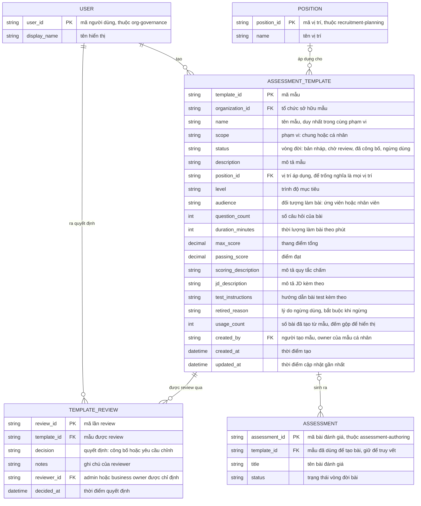

# assessment-templates — Entity Relationship Diagram

> Scope: mẫu cấu hình bài đánh giá tái sử dụng và review công bố mẫu chung
> của một tổ chức. `ASSESSMENT` thuộc `assessment-authoring` (ghi
> `template_id` khi tạo bài từ mẫu), `POSITION` thuộc
> `recruitment-planning`, `USER` thuộc `org-governance` — đều là tham
> chiếu tối thiểu, không sao chép cấu trúc.

## Diagram

## Entity Reference

| Entity | Purpose | Key attributes |
|--------|---------|----------------|
| ASSESSMENT_TEMPLATE | Mẫu cấu hình khung của bài đánh giá — vị trí, trình độ, đối tượng, số câu, thời lượng, quy tắc chấm; phạm vi chung/cá nhân và vòng đời có review | name, scope, status, position_id, level, audience, question_count, duration_minutes, max_score, passing_score |
| TEMPLATE_REVIEW | Quyết định review trên một lần gửi duyệt mẫu chung — công bố hoặc yêu cầu chỉnh, kèm reviewer và ghi chú | decision, notes, reviewer_id, decided_at |
| ASSESSMENT | Bài đánh giá được tạo từ mẫu — tham chiếu từ `assessment-authoring`; `template_id` trên bài giữ liên kết truy vết, không phải liên kết sống | assessment_id, template_id, title, status |
| POSITION | Vị trí áp dụng của mẫu — tham chiếu từ `recruitment-planning`; để trống nghĩa là mọi vị trí | position_id, name |
| USER | Người dùng nội bộ — tham chiếu từ `org-governance` | user_id, display_name |

## Notes & Assumptions

- `ASSESSMENT_TEMPLATE.scope` phân biệt hai vòng đời: mẫu "cá nhân" lưu
  thẳng lên "đã công bố" trong phạm vi riêng (FR-006), mẫu "chung" bắt
  buộc qua "chờ review" và `TEMPLATE_REVIEW` trước khi công bố (BR-002).
- Áp mẫu là bản sao độc lập (BR-003): `ASSESSMENT.template_id` chỉ giữ
  để truy vết bài-sinh-từ-mẫu (khoanh vùng khi mẫu lỗi) và tính
  `usage_count` — sửa/ngừng/xóa mẫu không làm đổi bài đã tạo.
- `status` "bản nháp" chỉ áp dụng cho mẫu chung chưa gửi duyệt; "sửa lớn"
  trên mẫu chung đã công bố đưa bản sửa về "chờ review" trong khi bản đã
  công bố vẫn hiệu lực (BR-004) — cơ chế giữ hai trạng thái hiệu lực này
  nằm ở tầng ứng dụng (đề xuất OQ-4), không cần entity phiên bản trong
  v1 (version mẫu là OOS/P2).
- `TEMPLATE_REVIEW` ghi một dòng mỗi quyết định trên một lần gửi duyệt —
  mẫu bị yêu cầu chỉnh rồi gửi lại sinh dòng mới, giữ vết đầy đủ (USC-002).
- `max_score`/`passing_score` là 2 field có cấu trúc tối thiểu của quy
  tắc chấm để `assessment-grading` đọc được (đề xuất OQ-10); phần còn lại
  nằm trong `scoring_description` dạng tự do.
- `usage_count` là đếm gộp phục vụ hiển thị "lượt dùng" (FR-015); nguồn
  chân thật vẫn là các dòng `ASSESSMENT.template_id`.
- `ASSESSMENT`, `POSITION`, `USER` là entity tối thiểu tham chiếu chéo —
  bản đầy đủ thuộc ERD của `assessment-authoring`, `recruitment-planning`
  và `org-governance`; không sao chép cấu trúc.
