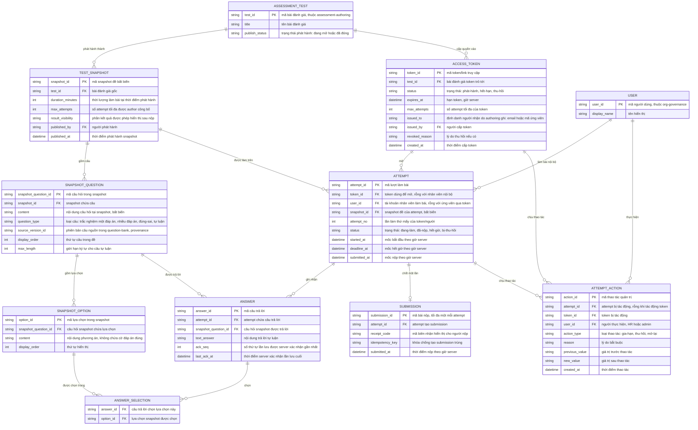

# candidate-assessment — Entity Relationship Diagram

> Scope: làm bài đánh giá qua token/tài khoản — snapshot đề bất biến, attempt
> theo giờ server, câu trả lời có server ack, submission idempotent kèm biên
> nhận và thao tác quản trị có lý do. `ASSESSMENT_TEST` và `USER` là tham
> chiếu tối thiểu sang `assessment-authoring` và `org-governance`.

## Diagram

## Entity Reference

| Entity | Purpose | Key attributes |
|--------|---------|----------------|
| ASSESSMENT_TEST | Bài đánh giá đã phát hành — tham chiếu tối thiểu từ `assessment-authoring` | test_id, publish_status |
| TEST_SNAPSHOT | Snapshot đề + cấu hình tại thời điểm phát hành — bất biến trong suốt attempt | duration_minutes, max_attempts, result_visibility, published_at |
| SNAPSHOT_QUESTION | Câu hỏi trong snapshot, giữ provenance về phiên bản câu nguồn | content, question_type, source_version_id, max_length |
| SNAPSHOT_OPTION | Phương án trả lời của câu trong snapshot — không mang cờ đáp án đúng | content, display_order |
| ACCESS_TOKEN | Quyền vào bài của ứng viên: hạn, lượt attempt, trạng thái thu hồi | status, expires_at, max_attempts, issued_to, revoked_reason |
| ATTEMPT | Một lượt làm bài theo giờ server — gắn token (ứng viên) hoặc user (nhân viên) | status, attempt_no, started_at, deadline_at, submitted_at |
| ANSWER | Câu trả lời theo câu hỏi snapshot kèm dấu server ack gần nhất | text_answer, ack_seq, last_ack_at |
| ANSWER_SELECTION | Lựa chọn được chọn của câu trắc nghiệm (hỗ trợ câu nhiều đáp án) | answer_id, option_id |
| SUBMISSION | Bài nộp đã chốt — tối đa một mỗi attempt, kèm biên nhận và khóa idempotent | receipt_code, idempotency_key, submitted_at |
| ATTEMPT_ACTION | Vết thao tác quản trị (gia hạn/thu hồi/mở lại) có lý do và giá trị trước/sau | action_type, reason, actor_id, previous_value, new_value |
| USER | Người dùng nội bộ (nhân viên làm bài, HR thao tác) — tham chiếu từ `org-governance` | user_id, display_name |

## Notes & Assumptions

- `ATTEMPT` có hai đường định danh: `token_id` cho ứng viên qua link,
  `user_id` cho nhân viên nội bộ — đúng một trong hai được điền theo loại
  attempt (URD UN-011).
- `SNAPSHOT_OPTION` cố ý không có cờ đáp án đúng: surface người làm bài là
  whitelist không đáp án (BR-candidate-assessment-005, vá GAP-AS-06). Đáp án
  đúng nằm ở `question-bank` và chỉ đi qua đường chấm của `assessment-grading`.
- `SNAPSHOT_QUESTION.source_version_id` là chốt provenance về
  `QUESTION_VERSION` của `question-bank` — quan hệ vật lý nằm ngoài scope ERD
  này, không vẽ lại entity `question-bank`.
- `ATTEMPT ||--o| SUBMISSION` thể hiện contract idempotent: một attempt có tối
  đa một submission; `idempotency_key` chống tạo trùng khi submit lặp.
- `ATTEMPT_ACTION` là vết nghiệp vụ cho gia hạn/thu hồi/mở lại theo contract
  "có lý do + audit" của PRD Mục 7.22; audit log toàn hệ thống thuộc
  `org-governance`, không trùng lặp ở đây.
- `ACCESS_TOKEN` do `assessment-authoring` phát hành; feature này thực thi
  vòng đời (hết hạn/thu hồi/gia hạn) — ghi đầy đủ vì các ràng buộc expiry là
  trách nhiệm kiểm soát của feature này.
