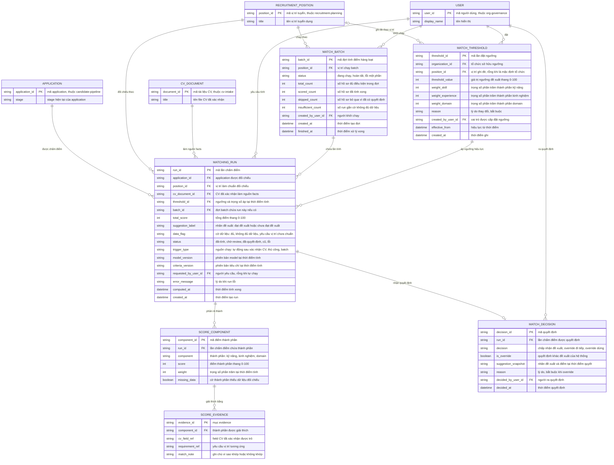

# candidate-matching — Entity Relationship Diagram

> Scope: đối chiếu application với vị trí — lần chấm điểm (run) kèm
> breakdown và evidence, ngưỡng đề xuất có lịch sử, quyết định của con
> người và đợt batch. `APPLICATION`, `RECRUITMENT_POSITION`,
> `CV_DOCUMENT`, `USER` là tham chiếu tối thiểu sang feature khác
> (`candidate-pipeline`, `recruitment-planning`, `cv-intake`,
> `org-governance`).

## Diagram

## Entity Reference

| Entity | Purpose | Key attributes |
|--------|---------|----------------|
| MATCHING_RUN | Một lần tính score trên application — điểm, nhãn đề xuất, trạng thái, cờ dữ liệu và provenance phiên bản | total_score, suggestion_label, data_flag, status, model_version, criteria_version, threshold_id |
| SCORE_COMPONENT | Breakdown của một run theo 3 thành phần kỹ năng/kinh nghiệm/domain | component, score, weight, missing_data |
| SCORE_EVIDENCE | Mục giải thích của một thành phần — trỏ field CV khớp yêu cầu vị trí | cv_field_ref, requirement_ref, match_note |
| MATCH_THRESHOLD | Một lần đặt ngưỡng + trọng số — mặc định tổ chức hoặc ghi đè vị trí; chuỗi bản ghi là lịch sử ngưỡng | threshold_value, weight_*, position_id, reason, effective_from |
| MATCH_DECISION | Quyết định của con người trên một run — bất biến, tối đa 1 trên run | decision, is_override, suggestion_snapshot, reason, decided_by_user_id |
| MATCH_BATCH | Một đợt tính điểm theo vị trí — chỉ tính, không quyết định | position_id, status, total_count, scored_count, skipped_count |
| APPLICATION | Hồ sơ ứng tuyển được đối chiếu — tham chiếu tối thiểu từ `candidate-pipeline` | application_id, stage |
| RECRUITMENT_POSITION | Vị trí làm chuẩn đối chiếu (JD + yêu cầu) — tham chiếu từ `recruitment-planning` | position_id, title |
| CV_DOCUMENT | CV đã xác nhận làm nguồn facts — tham chiếu từ `cv-intake` | document_id, title |
| USER | Người dùng nội bộ — tham chiếu từ `org-governance` | user_id, display_name |

## Notes & Assumptions

- `MATCHING_RUN.status` là vòng đời run (đã-tính → chờ-review →
  đã-quyết-định; nhánh "cũ" khi nguồn đổi, "lỗi" khi job fail).
  `suggestion_label` chỉ là gợi ý — không phải trạng thái quyết định và
  không gây hành động nào trên `APPLICATION` (BR-candidate-matching-001).
- `MATCH_THRESHOLD` lưu mỗi lần đặt thành một bản ghi mới (append-only):
  ngưỡng hiệu lực là bản ghi mới nhất khớp scope (vị trí riêng trước, rồi
  mặc định tổ chức). `MATCHING_RUN.threshold_id` chốt ngưỡng tại thời
  điểm tính nên run cũ giữ nhãn theo ngưỡng cũ — đây là cách "lịch sử
  ngưỡng" được truy vết.
- `weight_skill/experience/domain` trên `MATCH_THRESHOLD` và `weight`
  trên `SCORE_COMPONENT` cùng phục vụ trọng số cấu hình được (đề xuất
  OQ-2 của spec): run chụp trọng số tại thời điểm tính để giải thích
  chênh điểm giữa các đợt.
- `SCORE_EVIDENCE.cv_field_ref`/`requirement_ref` là tham chiếu logic
  tới field đã xác nhận của `cv-intake` và yêu cầu của
  `recruitment-planning`/`talent-framework` — entity đầy đủ của các nguồn
  đó không nằm trong ERD này.
- `MATCH_DECISION` tối đa 1 trên run (quan hệ `||--o|`); quyết định là
  bất biến — muốn đổi quyết định phải tạo run mới (BR-candidate-
  matching-005). `suggestion_snapshot` giữ nhãn + điểm tại thời điểm
  quyết để đo tỷ lệ đảo đề xuất (M-GR-02).
- `APPLICATION`, `RECRUITMENT_POSITION`, `CV_DOCUMENT`, `USER` chỉ khai
  tối thiểu phục vụ quan hệ — entity đầy đủ thuộc ERD của
  `candidate-pipeline`, `recruitment-planning`, `cv-intake`,
  `org-governance`.
- Retention: run, quyết định và lịch sử ngưỡng giữ theo retention hồ sơ
  tuyển dụng chung — chờ DPO (PRD OQ-6); ERD chưa mô hình thuộc tính
  retention.
