# candidate-pipeline — Entity Relationship Diagram

> Scope: pipeline tuyển dụng của một tổ chức — application và stage hiện
> tại, lịch sử transition trước → sau có nguồn, đợt thao tác hàng loạt,
> ghi chú/tag, cấu hình SLA theo stage và saved view cá nhân. `PERSON`,
> `RECRUITMENT_POSITION`, `USER` là tham chiếu tối thiểu sang feature khác
> (`cv-intake`, `recruitment-planning`, `org-governance`).

## Diagram

```mermaid
erDiagram
    PERSON ||--o{ APPLICATION : "ứng tuyển"
    RECRUITMENT_POSITION ||--o{ APPLICATION : "tuyển cho"
    USER ||--o{ APPLICATION : "phụ trách"
    APPLICATION ||--o{ STAGE_TRANSITION : "có lịch sử"
    USER |o--o{ STAGE_TRANSITION : "thực hiện"
    BULK_ACTION_BATCH |o--o{ STAGE_TRANSITION : "gồm"
    USER ||--o{ BULK_ACTION_BATCH : "tạo đợt"
    APPLICATION ||--o{ APPLICATION_NOTE : "có ghi chú"
    USER ||--o{ APPLICATION_NOTE : "viết"
    APPLICATION ||--o{ APPLICATION_TAG : "được gán"
    USER ||--o{ APPLICATION_TAG : "gán"
    RECRUITMENT_POSITION |o--o{ STAGE_SLA_CONFIG : "ghi đè SLA"
    USER ||--o{ STAGE_SLA_CONFIG : "cấu hình"
    USER ||--o{ SAVED_VIEW : "lưu bộ lọc"

    APPLICATION {
        string application_id PK "mã application trên pipeline"
        string person_id FK "ứng viên, tham chiếu cv-intake"
        string position_id FK "vị trí tuyển, tham chiếu recruitment-planning"
        string stage "stage hiện tại trong bộ stage cố định v1"
        string owner_user_id FK "HR phụ trách application"
        string source "nguồn vào pipeline: cv-intake, matching, thủ công"
        datetime entered_stage_at "thời điểm vào stage hiện tại"
        date stage_sla_due_at "hạn SLA của stage hiện tại"
        string hold_return_stage "stage quay về khi hết hold"
        date hold_review_at "hạn xem lại khi đang ON_HOLD"
        string stage_before_end "stage ngay trước khi kết thúc, phục vụ restore"
        datetime ended_at "thời điểm kết thúc nếu ở stage kết thúc"
        boolean duplicate_flagged "cờ cảnh báo ứng viên trùng từ cv-intake"
        datetime created_at "thời điểm tạo"
        datetime updated_at "thời điểm cập nhật cuối"
    }
    STAGE_TRANSITION {
        string transition_id PK "mã transition"
        string application_id FK "application được chuyển"
        string from_stage "stage trước"
        string to_stage "stage sau"
        string reason "lý do, bắt buộc với transition nhạy cảm"
        string source_type "nguồn: thủ công, hàng loạt, hệ thống, restore"
        string source_ref_id "id đối tượng gốc khi nguồn hệ thống: phiên, offer"
        string batch_id FK "đợt bulk chứa transition nếu có"
        string actor_user_id FK "người thực hiện, rỗng khi nguồn hệ thống"
        datetime created_at "thời điểm ghi transition"
    }
    BULK_ACTION_BATCH {
        string batch_id PK "mã đợt thao tác hàng loạt"
        string action "hành động: chuyển stage, từ chối, đổi owner"
        string target_stage "stage đích của đợt nếu là chuyển stage"
        string reason "lý do chung của đợt khi bắt buộc"
        int total_count "tổng số hồ sơ trong đợt"
        int success_count "số hồ sơ chuyển thành công"
        int skipped_count "số hồ sơ bị bỏ qua"
        string status "trạng thái đợt: đang chạy, hoàn tất, lỗi một phần"
        string created_by_user_id FK "người tạo đợt"
        datetime created_at "thời điểm tạo đợt"
        datetime completed_at "thời điểm xử lý xong"
    }
    APPLICATION_NOTE {
        string note_id PK "mã ghi chú"
        string application_id FK "application được ghi chú"
        string author_user_id FK "người viết ghi chú"
        string content "nội dung ghi chú tối đa 500 ký tự"
        datetime created_at "thời điểm viết"
    }
    APPLICATION_TAG {
        string tag_id PK "mã tag"
        string application_id FK "application được gán tag"
        string label "nhãn tag do người dùng đặt"
        string created_by_user_id FK "người gán tag"
        datetime created_at "thời điểm gán"
    }
    STAGE_SLA_CONFIG {
        string config_id PK "mã cấu hình SLA"
        string stage "stage được cấu hình"
        int sla_days "số ngày làm việc SLA của stage"
        string position_id FK "vị trí riêng nếu là override, rỗng = mặc định"
        string updated_by_user_id FK "người cập nhật cấu hình"
        datetime updated_at "thời điểm cập nhật"
    }
    SAVED_VIEW {
        string view_id PK "mã view đã lưu"
        string user_id FK "người sở hữu view"
        string name "tên view do người dùng đặt"
        string filter_definition "định nghĩa bộ lọc đã lưu dạng chuỗi"
        datetime created_at "thời điểm lưu view"
    }
    PERSON {
        string person_id PK "mã ứng viên, thuộc cv-intake"
        string full_name "tên ứng viên"
    }
    RECRUITMENT_POSITION {
        string position_id PK "mã vị trí, thuộc recruitment-planning"
        string title "tên vị trí tuyển dụng"
    }
    USER {
        string user_id PK "mã người dùng, thuộc org-governance"
        string display_name "tên hiển thị"
    }
```

## Entity Reference

| Entity | Purpose | Key attributes |
|--------|---------|----------------|
| APPLICATION | Hồ sơ ứng tuyển trên pipeline — một ứng viên × một vị trí, ở đúng một stage | stage, owner_user_id, entered_stage_at, stage_sla_due_at, hold_return_stage, stage_before_end |
| STAGE_TRANSITION | Một lần chuyển stage — activity history trước → sau kèm nguồn và lý do | from_stage, to_stage, reason, source_type, source_ref_id, batch_id, actor_user_id |
| BULK_ACTION_BATCH | Một đợt thao tác hàng loạt có preview và kết quả từng hồ sơ | action, target_stage, total_count, success_count, skipped_count, status |
| APPLICATION_NOTE | Ghi chú của người được cấp trên application | content, author_user_id |
| APPLICATION_TAG | Tag tự do gán trên application để lọc | label, created_by_user_id |
| STAGE_SLA_CONFIG | Số ngày SLA theo stage — mặc định tổ chức hoặc override theo vị trí | stage, sla_days, position_id |
| SAVED_VIEW | Bộ lọc cá nhân đã lưu của người dùng trên board | name, filter_definition |
| PERSON | Ứng viên — tham chiếu tối thiểu từ `cv-intake` | person_id, full_name |
| RECRUITMENT_POSITION | Vị trí tuyển dụng — tham chiếu tối thiểu từ `recruitment-planning` | position_id, title |
| USER | Người dùng nội bộ — tham chiếu tối thiểu từ `org-governance` | user_id, display_name |

## Notes & Assumptions

- `APPLICATION.stage` là stage hiện tại; bộ stage cố định v1 và bảng
  transition hợp lệ là quy tắc nghiệp vụ (BR-candidate-pipeline-002), không
  lưu thành entity cấu hình trong v1.
- `STAGE_TRANSITION.actor_user_id` rỗng khi `source_type` là "hệ thống"
  (transition do `interview-management`/`interview-evaluation`/
  `offer-management`/`employee-onboarding` kích); khi đó `source_ref_id`
  trỏ đối tượng gốc của feature đó — quan hệ chi tiết nằm trong ERD của
  các feature kia.
- `STAGE_TRANSITION.batch_id` chỉ có giá trị khi transition thuộc một đợt
  `BULK_ACTION_BATCH`; quan hệ vẽ optional phía batch.
- `hold_return_stage` và `stage_before_end` là chốt suy ra từ history để
  tránh phụ thuộc thứ tự dòng khi restore/unhold (đề xuất — spec OQ-4).
- `stage_sla_due_at` được tính khi vào stage từ `STAGE_SLA_CONFIG` khớp
  (vị trí riêng trước, rồi mặc định tổ chức); `ON_HOLD` không tính quá
  hạn trong thời gian hold.
- `PERSON`, `RECRUITMENT_POSITION`, `USER` chỉ khai tối thiểu phục vụ
  quan hệ — entity đầy đủ thuộc ERD của `cv-intake`,
  `recruitment-planning` và `org-governance`.
- Retention: history không xóa trong v1; chính sách xóa/anonymize hồ sơ
  kết thúc chờ quyết định retention chung (PRD OQ-6).
