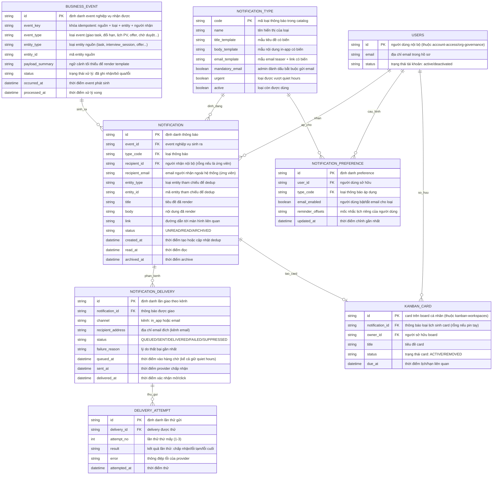

# contextual-notifications — Entity Relationship Diagram

> Scope: dữ liệu trung tâm thông báo — event nghiệp vụ đầu vào, thông báo
> in-app, delivery theo kênh và preference người dùng. Không gồm mẫu email
> nghiệp vụ (`operational-email`) hay định nghĩa board (`kanban-workspaces`).

## Diagram

## Entity Reference

| Entity | Purpose | Key attributes |
|--------|---------|----------------|
| BUSINESS_EVENT | Event nghiệp vụ các module phát vào dispatch; khóa `event_key` bảo đảm xử lý idempotent | event_key, event_type, entity_type + entity_id, status |
| NOTIFICATION_TYPE | Catalog loại thông báo và template hệ thống; định loại bắt buộc email và nhóm urgent | code, title/body/email_template, mandatory_email, urgent |
| NOTIFICATION | Một thông báo in-app cho một người nhận; dedup theo type_code + entity_type + entity_id | recipient_id/recipient_email, title, body, status, read_at |
| NOTIFICATION_DELIVERY | Một lần giao của notification theo kênh; giữ trạng thái giao nhận để truy vết và dead-letter | channel, recipient_address, status, failure_reason |
| DELIVERY_ATTEMPT | Từng lần thử gửi của một delivery email theo lịch retry | delivery_id, attempt_no, result, error |
| NOTIFICATION_PREFERENCE | Tùy chọn kênh/mốc nhắc của một người dùng cho một loại | user_id, type_code, email_enabled, reminder_offsets |
| KANBAN_CARD | Card board cá nhân tạo từ thông báo lịch hoặc pin tay — entity ngoài do `kanban-workspaces` sở hữu, chỉ tham chiếu | notification_id, owner_id, status, due_at |
| USERS | Người dùng nội bộ — entity ngoài do `account-access`/`org-governance` sở hữu, chỉ tham chiếu | id, email, status |

## Notes & Assumptions

- `NOTIFICATION.entity_type` + `entity_id` + `type_code` là khóa dedup
  nghiệp vụ: event mới cùng bộ ba này cập nhật NOTIFICATION hiện có và đặt
  lại UNREAD thay vì tạo dòng mới.
- Người nhận có hai dạng: `recipient_id` trỏ USERS cho nội bộ, hoặc
  `recipient_email` trần cho ứng viên không tài khoản — một notification
  chỉ dùng một dạng.
- `NOTIFICATION_DELIVERY.status = SUPPRESSED` ghi nhận các trường hợp cố
  ý không gửi (tài khoản deactivate, recipient không resolve được, email
  bị giữ qua quiet hours rồi entity bị hủy trước giờ gửi) — vẫn là kết quả
  truy vết được, không phải mất âm thầm.
- `DELIVERY_ATTEMPT` chỉ sinh cho kênh email; kênh in-app ghi nhận ngay ở
  NOTIFICATION.
- `KANBAN_CARD` và `USERS` là entity ngoài, khai tối thiểu để thể hiện
  quan hệ; định nghĩa đầy đủ thuộc `kanban-workspaces` và
  `account-access`/`org-governance`.
- Retention (90 ngày archive) là chính sách vận hành trên
  `NOTIFICATION.status`, không phải thuộc tính riêng; retention của
  delivery log chờ OQ-6 sản phẩm.
- Email payload tối thiểu được ràng buộc ở `NOTIFICATION_TYPE.email_template`
  (chỉ teaser + link), không phải bản ghi dữ liệu riêng.
