# cv-event-monitoring — Entity Relationship Diagram

> Scope: phần HRMS tiếp nhận sự kiện Computer Vision — zone policy + version
> + phê duyệt làm gate, catalog camera/khu vực, sự kiện và bằng chứng đến
> từ CV Backend ngoài, quyết định xử lý của manager, delivery log có retry,
> access audit cho evidence và retention. `USER`, `ORG_UNIT`, `ROLE` thuộc
> `org-governance`; `TASK` thuộc `kanban-workspaces` — chỉ khai tối thiểu.
> CV Backend là hệ thống ngoài, không có entity trong ERD này.

## Diagram

```mermaid
erDiagram
    USER ||--o{ ZONE_POLICY : "soạn"
    USER ||--o{ POLICY_APPROVAL : "phê duyệt"
    USER ||--o{ EVENT_REVIEW : "quyết định"
    USER ||--o{ ACCESS_LOG : "truy cập"
    ZONE_POLICY ||--o{ ZONE_POLICY_VERSION : "có phiên bản"
    ZONE_POLICY_VERSION ||--o{ POLICY_APPROVAL : "được duyệt qua"
    ZONE_POLICY_VERSION ||--o{ ZONE_POLICY_SCOPE : "áp dụng cho"
    ZONE ||--o{ ZONE_POLICY_SCOPE : "được phủ bởi"
    ORG_UNIT ||--o{ ZONE : "chứa"
    ZONE_POLICY_VERSION ||--o{ ZONE_EVENT_CATEGORY : "cho phép loại"
    ZONE_POLICY_VERSION ||--o{ ZONE_VIEWER_ROLE : "cho phép xem sự kiện"
    ZONE_POLICY_VERSION ||--o{ ZONE_EVIDENCE_ROLE : "cho phép xem bằng chứng"
    ROLE ||--o{ ZONE_VIEWER_ROLE : "được cấp xem sự kiện"
    ROLE ||--o{ ZONE_EVIDENCE_ROLE : "được cấp xem bằng chứng"
    ZONE ||--o{ CAMERA : "lắp tại"
    ZONE_POLICY_VERSION ||--o{ CAMERA : "kích hoạt theo"
    CAMERA ||--o{ CV_EVENT : "phát hiện bởi"
    CV_EVENT ||--o{ EVENT_EVIDENCE : "kèm bằng chứng"
    CV_EVENT ||--o{ EVENT_REVIEW : "được xử lý qua"
    EVENT_REVIEW }o--o| TASK : "tạo task xử lý"
    CV_EVENT ||--o{ EVENT_DELIVERY : "được giao qua"
    CV_EVENT ||--o{ ACCESS_LOG : "bị truy cập"
    EVENT_EVIDENCE ||--o{ ACCESS_LOG : "bị truy cập"

    ZONE_POLICY {
        string policy_id PK "mã chính sách khu vực"
        string organization_id FK "tổ chức sở hữu"
        string name "tên chính sách quan sát"
        string current_version_id FK "phiên bản đang hiệu lực"
        datetime created_at "thời điểm tạo"
        string created_by FK "admin soạn"
    }
    ZONE_POLICY_VERSION {
        string version_id PK "mã phiên bản policy"
        string policy_id FK "chính sách gốc"
        int version_no "số thứ tự phiên bản"
        string purpose "mục đích quan sát, công khai cho người trong phạm vi"
        string status "vòng đời: bản nháp, chờ duyệt, đã công bố, hết hiệu lực"
        decimal min_confidence "ngưỡng confidence tối thiểu để tiếp nhận sự kiện"
        int evidence_retention_days "hạn giữ bằng chứng theo ngày"
        int metadata_retention_months "hạn giữ metadata sự kiện theo tháng"
        string active_hours "khung giờ áp dụng giám sát đã công bố"
        int review_sla_days "SLA xử lý sự kiện theo ngày làm việc"
        int cooldown_minutes "cửa sổ gộp sự kiện cùng loại theo phút"
        datetime published_at "ngày công bố"
        datetime created_at "thời điểm tạo phiên bản"
    }
    ZONE_POLICY_SCOPE {
        string version_id FK "phiên bản policy"
        string zone_id FK "khu vực được áp dụng"
    }
    ZONE {
        string zone_id PK "mã khu vực quan sát"
        string unit_id FK "đơn vị/phòng ban chứa khu vực"
        string name "tên khu vực: phòng, tầng, khu làm việc"
        string location_ref "vị trí mô tả của khu vực"
    }
    ZONE_EVENT_CATEGORY {
        string version_id FK "phiên bản policy"
        string event_type "loại sự kiện được phép: hút thuốc, rời vị trí quá lâu"
    }
    ZONE_VIEWER_ROLE {
        string version_id FK "phiên bản policy"
        string role_id FK "vai trò được xem sự kiện"
    }
    ZONE_EVIDENCE_ROLE {
        string version_id FK "phiên bản policy"
        string role_id FK "vai trò được xem bằng chứng, hẹp hơn xem sự kiện"
    }
    POLICY_APPROVAL {
        string approval_id PK "mã quyết định duyệt"
        string version_id FK "phiên bản được duyệt"
        string approver_id FK "người duyệt: Head of HR hoặc DPO/legal"
        string approval_layer "lớp duyệt: nghiệp vụ hoặc privacy"
        string decision "quyết định: phê duyệt hoặc yêu cầu chỉnh"
        string note "ghi chú người duyệt"
        datetime decided_at "thời điểm quyết định"
    }
    CAMERA {
        string camera_id PK "mã camera duy nhất"
        string zone_id FK "khu vực lắp camera"
        string version_id FK "phiên bản policy kích hoạt camera"
        string service_ref "định danh camera phía CV Backend"
        string status "trạng thái: đăng ký, chưa kích hoạt, hoạt động, tạm dừng, mất kết nối"
        string active_hours "khung giờ giám sát riêng nếu khác policy"
        datetime registered_at "thời điểm đăng ký"
        string registered_by FK "admin đăng ký"
    }
    CV_EVENT {
        string event_id PK "mã sự kiện, khóa idempotency từ CV Backend"
        string camera_id FK "camera phát hiện"
        string zone_id FK "khu vực sự kiện"
        string version_id FK "phiên bản policy tại thời điểm tiếp nhận"
        string event_type "loại sự kiện trong danh mục đã công bố"
        datetime detected_at "thời điểm CV Backend phát hiện"
        decimal confidence "độ tin cậy model tại thời điểm phát hiện"
        int duration_seconds "thời lượng hành vi"
        string model_version "phiên bản model phía service"
        string status "vòng đời: chờ review, đã xác nhận, false positive, chờ bổ sung, đã xử lý, đã loại bỏ"
        boolean is_technical "cờ sự kiện kỹ thuật camera, định tuyến admin"
        string parent_event_id FK "sự kiện gốc khi bị gộp trong cooldown"
        datetime received_at "thời điểm HRMS ghi nhận"
        datetime sla_due_at "hạn review theo SLA"
        datetime metadata_expires_at "hạn giữ metadata sự kiện"
    }
    EVENT_EVIDENCE {
        string evidence_id PK "mã bằng chứng"
        string event_id FK "sự kiện chứa bằng chứng"
        string evidence_type "loại: ảnh snapshot hoặc clip ngắn"
        string storage_ref "tham chiếu lưu trữ phía HRMS"
        string load_status "trạng thái nạp: đang nạp, sẵn sàng, lỗi"
        datetime expires_at "hạn xóa theo retention của phiên bản"
    }
    EVENT_REVIEW {
        string review_id PK "mã quyết định xử lý"
        string event_id FK "sự kiện được quyết định"
        string reviewer_id FK "manager ra quyết định"
        string decision "quyết định: xác nhận vi phạm, false positive, cần thêm context, đã xử lý, loại bỏ"
        string reason "lý do bắt buộc"
        string task_id FK "task xử lý được tạo nếu xác nhận"
        datetime decided_at "thời điểm quyết định"
    }
    EVENT_DELIVERY {
        string delivery_id PK "mã lượt giao nhận"
        string event_id FK "sự kiện được tạo nếu tiếp nhận thành công, rỗng khi lỗi trước khi lưu"
        string request_ref "định danh request từ CV Backend"
        string result "kết quả: ghi nhận, trùng, từ chối, lỗi xử lý"
        string reject_reason "lý do từ chối hoặc lỗi để service biết"
        int attempt_no "số lần thử gửi của request này"
        string queue_status "trạng thái hàng chờ: đã ghi nhận, lỗi chờ retry, lỗi giao nhận, xử lý tay, bỏ"
        datetime received_at "thời điểm request đến"
    }
    ACCESS_LOG {
        string access_id PK "mã lượt truy cập"
        string accessor_id FK "người xem hoặc tải"
        string event_id FK "sự kiện bị xem nếu có"
        string evidence_id FK "bằng chứng bị xem/tải nếu có"
        string action "hành động: xem sự kiện, xem bằng chứng, tải bằng chứng"
        string surface "surface truy cập: dashboard, event-detail, export"
        datetime accessed_at "thời điểm truy cập"
    }
    USER {
        string user_id PK "mã người dùng, thuộc org-governance"
        string display_name "tên hiển thị"
    }
    ORG_UNIT {
        string unit_id PK "mã đơn vị/nhóm, thuộc org-governance"
        string name "tên đơn vị"
    }
    ROLE {
        string role_id PK "mã vai trò, thuộc org-governance"
        string name "tên vai trò"
    }
    TASK {
        string task_id PK "mã task, thuộc kanban-workspaces"
        string title "tên công việc"
    }
```

## Entity Reference

| Entity | Purpose | Key attributes |
|--------|---------|----------------|
| ZONE_POLICY | Chính sách quan sát của một nhóm khu vực — trỏ phiên bản hiệu lực | name, current_version_id |
| ZONE_POLICY_VERSION | Phiên bản policy — ngưỡng tiếp nhận, retention, khung giờ, SLA, cooldown, trạng thái vòng đời | status, min_confidence, evidence_retention_days, active_hours, published_at |
| ZONE_POLICY_SCOPE | Khu vực mà phiên bản policy phủ | version_id, zone_id |
| ZONE | Khu vực quan sát đã công bố (phòng/tầng/khu làm việc) thuộc đơn vị | name, unit_id, location_ref |
| ZONE_EVENT_CATEGORY | Danh mục loại sự kiện được phép tiếp nhận theo phiên bản | version_id, event_type |
| ZONE_VIEWER_ROLE | Vai trò được xem sự kiện trong phạm vi | version_id, role_id |
| ZONE_EVIDENCE_ROLE | Vai trò được xem/tải evidence — tập con của quyền xem sự kiện | version_id, role_id |
| POLICY_APPROVAL | Quyết định duyệt policy theo lớp nghiệp vụ/privacy | approval_layer, decision, approver_id |
| CAMERA | Camera đăng ký trong catalog — chỉ "hoạt động" khi khu vực có policy công bố | camera_id, status, service_ref, version_id |
| CV_EVENT | Sự kiện vi phạm đã xử lý từ CV Backend — chỉ là cảnh báo chờ người xác nhận, không gắn danh tính | event_id, event_type, confidence, model_version, status, is_technical |
| EVENT_EVIDENCE | Ảnh/clip ngắn bằng chứng — tách biệt metadata, có hạn xóa | evidence_type, storage_ref, load_status, expires_at |
| EVENT_REVIEW | Quyết định của manager — bắt buộc lý do, link task xử lý | decision, reason, reviewer_id, task_id |
| EVENT_DELIVERY | Vết giao nhận mọi request từ CV Backend — đối soát, retry, hàng chờ lỗi | result, reject_reason, attempt_no, queue_status |
| ACCESS_LOG | Vết truy cập sự kiện/evidence/export — đổ về audit `org-governance` | accessor_id, action, surface, accessed_at |
| USER | Người dùng nội bộ — tham chiếu `org-governance` | user_id, display_name |
| ORG_UNIT | Đơn vị chứa khu vực — tham chiếu `org-governance` | unit_id, name |
| ROLE | Vai trò được cấp xem — tham chiếu `org-governance` | role_id, name |
| TASK | Task xử lý sự kiện — tham chiếu `kanban-workspaces` | task_id, title |

## Notes & Assumptions

- `CV_EVENT.event_id` do CV Backend sinh và là khóa idempotency — gửi trùng
  trả "đã ghi nhận", không tạo bản ghi mới (BR-003). `EVENT_DELIVERY` giữ
  vết mọi request kể cả khi lỗi trước khi tạo được `CV_EVENT` (event_id
  rỗng).
- `CV_EVENT` cố tình không có trường danh tính cá nhân — đối tượng sự kiện
  là khu vực/camera theo BR-010 và PRD "Chưa làm" (không nhận diện danh
  tính). Việc gắn cá nhân nếu có là quyết định của manager ở `EVENT_REVIEW`,
  không phải dữ liệu hệ thống.
- `CV_EVENT.is_technical` tách sự kiện kỹ thuật (camera mất kết nối, frame
  kém, worker lỗi) định tuyến admin, khỏi luồng review của manager.
- `CV_EVENT.parent_event_id` phục vụ cooldown gộp: sự kiện cùng loại +
  camera trong cửa sổ cooldown trỏ về sự kiện đang mở thay vì tạo dòng mới
  độc lập (BR-009).
- `CV_EVENT.version_id` chốt phiên bản policy tại thời điểm tiếp nhận —
  retention của `EVENT_EVIDENCE.expires_at` và `metadata_expires_at` được
  gán lúc đó, không tra lại policy khi xóa.
- `ZONE_EVIDENCE_ROLE` là tập con nghiệp vụ của `ZONE_VIEWER_ROLE` — kiểm
  tra tại tầng ứng dụng (BR-006), ERD giữ hai quan hệ riêng để thể hiện
  rõ hai mức quyền.
- `CAMERA.version_id` là phiên bản policy kích hoạt camera; khi policy hết
  hiệu lực camera chuyển "tạm dừng" — sự kiện mới bị từ chối, sự kiện đang
  mở vẫn review được.
- `ACCESS_LOG` ghi cả lượt xem sự kiện, xem/tải evidence và export; đồng bộ
  về audit store chung của `org-governance` là Assumption (spec Mục 11).
- `ZONE` là entity của feature này (khu vực quan sát logic) — khác với đơn
  vị tổ chức `ORG_UNIT` mà nó thuộc về; không trùng khái niệm phòng ban.

## develop-hieu physical tables and files

The implemented behavior-monitoring slice maps to these concrete storage
objects.

### VIOLATION_RULE

Configures a detectable workplace policy rule.

- `rule_key`: smoking, empty_desk, phone_usage, unauthorized_access, or future
  model-specific keys.
- `label_set`: YOLO labels that should count for the rule.
- `confidence_threshold`, `iou_threshold`: inference thresholds.
- `enabled`: rule activation flag.
- `metadata`: model/controller settings.

### VIOLATION_ALERT

Stores a candidate event that requires human review.

- `track_id`: unique event identifier.
- `rule_id`: references `VIOLATION_RULE`.
- `user_id` / `profile_name`: monitored profile when configured.
- `violation_type`, `severity`: normalized alert classification.
- `camera_location` / `source`: monitor, camera index, or video source label.
- `evidence_url` / `evidence_path`: saved evidence image path.
- `detections_json`: bounding boxes, labels, confidence, and model metadata.
- `status`: pending_review, approved, or rejected.
- `reviewed_by`, `reviewed_at`, `review_note`: human review result.

### VIOLATION_ACTION_LOG

Stores the manager/admin decision trail for each alert.

- `alert_id`: reviewed alert.
- `action_by`: reviewer.
- `action_type`: approve, reject, comment, or reopen.
- `comment`: review note.
- `created_at`: action time.

### Local evidence files

Evidence images and sibling metadata JSON files are written below
`VIOLATION_DATA_DIR/Profile Name__userId/YYYY-MM-DD/`. The local file store is
the evidence payload store; Supabase/Postgres stores the alert metadata and
review state.
