# cv-intake — Entity Relationship Diagram

> Scope: dữ liệu đầu vào CV — bản ghi CV, consent, field trích xuất đề
> xuất và sự kiện kiểm toán. `PERSON` (person model chung), `POSITION`
> (`recruitment-planning`), `JOB_APPLICATION` (`candidate-pipeline`),
> `INTAKE_DOCUMENT` (`document-intake`) và `USER` (`org-governance`) là
> tham chiếu tối thiểu sang feature khác.

## Diagram

```mermaid
erDiagram
    USER ||--o{ CANDIDATE_CV : "tải lên"
    USER ||--o{ CV_AUDIT_EVENT : "thực hiện"
    USER ||--o{ CV_EXTRACTED_FIELD : "xác nhận"
    INTAKE_DOCUMENT ||--o| CANDIDATE_CV : "đại diện file"
    POSITION ||--o{ CANDIDATE_CV : "là đích gắn"
    PERSON ||--o{ CANDIDATE_CV : "sở hữu"
    CANDIDATE_CV ||--o{ CV_CONSENT : "kèm consent"
    CANDIDATE_CV ||--o{ CV_EXTRACTED_FIELD : "có field đề xuất"
    CANDIDATE_CV ||--o{ CV_AUDIT_EVENT : "ghi nhận"
    CANDIDATE_CV ||--o{ JOB_APPLICATION : "tạo thành"

    CANDIDATE_CV {
        string cv_id PK "mã bản ghi CV"
        string organization_id FK "tổ chức sở hữu"
        string person_id FK "hồ sơ người được gắn sau xác nhận, rỗng trước đó"
        string position_id FK "vị trí đích, rỗng khi chưa gán pool"
        string intake_document_id FK "bản ghi cổng document-intake khi kênh HR tải"
        string channel "kênh tiếp nhận: HR tải, form ứng viên"
        string source_note "nguồn khai báo khi HR tải hộ"
        string file_name "tên file CV"
        string storage_path "đường dẫn file khi nộp qua form ứng viên"
        string status "trạng thái: chờ xử lý, đang xử lý, chờ xác nhận, đã xác nhận, thất bại"
        int attempt_count "số lần đã thử xử lý"
        string failure_reason "lý do thất bại gần nhất"
        string uploaded_by FK "người tải, rỗng khi ứng viên tự nộp"
        datetime created_at "thời điểm tiếp nhận"
        datetime confirmed_at "thời điểm HR xác nhận"
    }
    CV_CONSENT {
        string consent_id PK "mã bản ghi consent"
        string cv_id FK "CV mà consent gắn vào"
        string purpose "mục đích xử lý dữ liệu đã đồng ý"
        string policy_version "phiên bản chính sách tại thời điểm đồng ý"
        string channel "kênh ghi consent: form ứng viên, khai báo HR"
        string granted_by "hình thức: ứng viên tự tick, HR khai báo chấp thuận"
        string status "trạng thái: có hiệu lực, đã rút"
        datetime granted_at "thời điểm đồng ý"
        datetime withdrawn_at "thời điểm rút, nếu có"
    }
    CV_EXTRACTED_FIELD {
        string field_id PK "mã field trích xuất"
        string cv_id FK "CV chứa field"
        string field_key "khóa field: họ tên, email, điện thoại, học vấn, kinh nghiệm, kỹ năng, chứng chỉ"
        string proposed_value "giá trị đề xuất từ trích xuất"
        decimal confidence "độ tin cậy 0-1 của đề xuất"
        string source_location "vị trí nguồn trong file để đối chiếu"
        string confirmed_value "giá trị cuối sau sửa/xác nhận"
        string field_source "nguồn field: AI đề xuất, HR sửa, nhập tay"
        string status "trạng thái: đề xuất, đã sửa, đã xác nhận"
        string confirmed_by FK "người xác nhận field"
        datetime confirmed_at "thời điểm xác nhận"
    }
    CV_AUDIT_EVENT {
        string event_id PK "mã sự kiện kiểm toán"
        string cv_id FK "CV liên quan"
        string actor_id FK "người thực hiện, rỗng khi tác nhân hệ thống"
        string action "hành động: tiếp nhận, từ chối, sửa field, xác nhận, gộp, thử lại, nhập tay, rút consent"
        string before_value "giá trị trước khi thay đổi"
        string after_value "giá trị sau khi thay đổi"
        string detail "lý do hoặc ghi chú"
        datetime created_at "thời điểm ghi nhận"
    }
    PERSON {
        string person_id PK "hồ sơ người, thuộc person model chung"
        string full_name "họ tên"
        string email "email định danh dò trùng"
    }
    POSITION {
        string position_id PK "vị trí tuyển dụng, thuộc recruitment-planning"
        string title "tên vị trí"
        string status "trạng thái vị trí"
    }
    JOB_APPLICATION {
        string application_id PK "hồ sơ ứng tuyển, thuộc candidate-pipeline"
        string status "trạng thái đầu pipeline"
    }
    INTAKE_DOCUMENT {
        string document_id PK "bản ghi cổng tiếp nhận, thuộc document-intake"
        string status "trạng thái xử lý file"
    }
    USER {
        string user_id PK "người dùng nội bộ, thuộc org-governance"
        string display_name "tên hiển thị"
    }
```

## Entity Reference

| Entity | Purpose | Key attributes |
|--------|---------|----------------|
| CANDIDATE_CV | Một CV được tiếp nhận — vòng đời chờ xử lý → đang xử lý → chờ xác nhận → đã xác nhận/thất bại | channel, source_note, position_id, status, attempt_count |
| CV_CONSENT | Chấp thuận xử lý dữ liệu gắn CV — mục đích, phiên bản chính sách, kênh, hiệu lực/rút | purpose, policy_version, status, granted_at, withdrawn_at |
| CV_EXTRACTED_FIELD | Một field đề xuất của trích xuất kèm confidence và vị trí nguồn; giữ giá trị cuối và provenance sau xác nhận | field_key, proposed_value, confidence, confirmed_value, field_source |
| CV_AUDIT_EVENT | Vết kiểm toán mọi hành động trên CV | actor_id, action, before_value, after_value |
| PERSON | Hồ sơ người mà CV gắn vào sau xác nhận — person model chung, chỉ tham chiếu | person_id, full_name, email |
| POSITION | Vị trí đích của CV — tham chiếu `recruitment-planning` | position_id, status |
| JOB_APPLICATION | Application tạo khi CV "Đã xác nhận" — thuộc `candidate-pipeline` | application_id, status |
| INTAKE_DOCUMENT | Bản ghi cổng file khi kênh HR tải — thuộc `document-intake` | document_id, status |
| USER | Người tải/xác nhận — tham chiếu `org-governance` | user_id, display_name |

## Notes & Assumptions

- Hai kênh tiếp nhận khác nhau về file: kênh HR tải đi qua cổng
  `document-intake` nên `intake_document_id` có giá trị và `storage_path`
  rỗng; kênh form ứng viên (document-intake v1 chỉ nội bộ) lưu file qua
  surface riêng nên `storage_path` có giá trị và `intake_document_id`
  rỗng — đề xuất ranh giới, chờ align khi document-intake mở kênh ngoài.
- `CANDIDATE_CV.person_id` rỗng cho tới khi HR xác nhận (person mới hoặc
  gộp); `position_id` rỗng khi CV vào pool "chưa gán".
- Một CV một `CV_CONSENT` hiệu lực tại một thời điểm; khi consent mới
  được ghi (tái đồng ý) thì bản ghi cũ giữ làm lịch sử — quan hệ 1-N để
  không mất vết.
- `CV_EXTRACTED_FIELD` giữ cả `proposed_value` lẫn `confirmed_value`:
  đề xuất AI không bị ghi đè, phục vụ đo M-IN-03 (field giữ nguyên/đề
  xuất) và audit trước/sau.
- `JOB_APPLICATION` chỉ khai tối thiểu — application do `cv-intake` tạo
  ở trạng thái đầu nhưng vòng đời thuộc `candidate-pipeline`; nhiều CV
  trên cùng hồ sơ thì application tham chiếu CV mới nhất đã xác nhận
  (Assumption URD).
- Retention/xóa file và consent chờ OQ-6 PRD — ERD chưa mô hình thuộc
  tính retention; `CV_CONSENT.status` "đã rút" là cơ chế v1.
