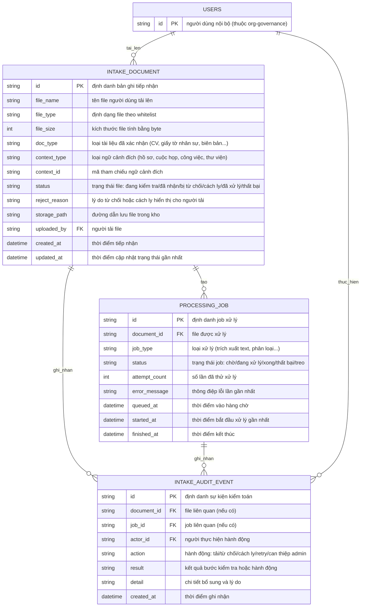

# document-intake — Entity Relationship Diagram

> Scope: dữ liệu cổng tiếp nhận — file được nhận, job xử lý và sự kiện kiểm
> toán. Không gồm nội dung trích xuất (thuộc `document-review`) hay phiên
> bản thư viện (thuộc `document-library`).

## Diagram

## Entity Reference

| Entity | Purpose | Key attributes |
|--------|---------|----------------|
| INTAKE_DOCUMENT | Bản ghi một file đi qua cổng tiếp nhận, gắn ngữ cảnh nghiệp vụ và trạng thái vòng đời | file_name, file_type, doc_type, context_type + context_id, status, storage_path |
| PROCESSING_JOB | Một lần xử lý nền của file đã nhận; nhiều job khi retry tạo lần chạy mới hoặc loại xử lý khác nhau | document_id, job_type, status, attempt_count, error_message |
| INTAKE_AUDIT_EVENT | Vết kiểm toán cho mọi lượt tải, từ chối, cách ly, retry và can thiệp admin | actor_id, action, result, detail, created_at |
| USERS | Người dùng nội bộ — entity ngoài do `org-governance` sở hữu, chỉ tham chiếu | id |

## Notes & Assumptions

- `context_type` + `context_id` là tham chiếu logic tới ngữ cảnh nghiệp vụ
  (hồ sơ ứng viên, cuộc họp, task, thư viện nguồn); kiểu liên kết cụ thể
  là quyết định thiết kế, không phải FK DB trong phạm vi spec này.
- File bị từ chối không lưu vào kho → `storage_path` rỗng với status bị từ
  chối; file bị cách ly có `storage_path` vùng riêng nhưng không tạo job.
- Trạng thái `treo` của PROCESSING_JOB là cờ giám sát (quá ngưỡng thời
  gian), không phải trạng thái kết thúc — job treo vẫn có thể được admin
  đẩy lại hàng chờ.
- Retention/xóa file thô chờ OQ-5 (liên quan OQ-6 sản phẩm); ERD chưa mô
  hình thuộc tính retention.
