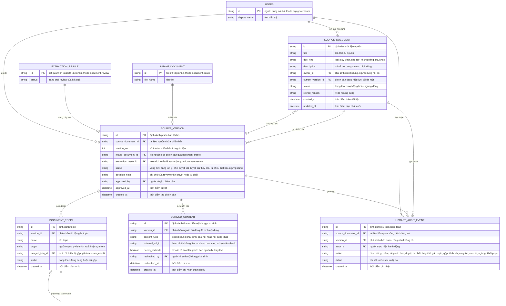

# document-library — Entity Relationship Diagram

> Scope: thư viện tài liệu nguồn của một tổ chức — tài liệu, phiên bản có
> trạng thái duyệt, topic theo phiên bản, tham chiếu nội dung phát sinh và
> sự kiện kiểm toán. `INTAKE_DOCUMENT`, `EXTRACTION_RESULT`, `USERS` là
> tham chiếu sang feature khác (`document-intake`, `document-review`,
> `org-governance`).

## Diagram

## Entity Reference

| Entity | Purpose | Key attributes |
|--------|---------|----------------|
| SOURCE_DOCUMENT | Tài liệu nguồn trong thư viện — metadata, chủ sở hữu và con trỏ phiên bản hiệu lực | title, doc_kind, owner_id, current_version_id, status |
| SOURCE_VERSION | Một phiên bản của tài liệu — gắn file intake và text đã xác nhận, có vòng đời duyệt | version_no, intake_document_id, extraction_result_id, status, approved_by |
| DOCUMENT_TOPIC | Topic gắn trên phiên bản đã duyệt — merge/split giữ trace qua `merged_into_id` | name, origin, merged_into_id, status |
| DERIVED_CONTENT | Tham chiếu nội dung phát sinh (câu hỏi...) trỏ đúng phiên bản nguồn — cờ "cần rà soát" khi bản bị thay thế | version_id, content_type, external_ref_id, needs_recheck |
| LIBRARY_AUDIT_EVENT | Vết kiểm toán mọi hành động trên tài liệu/phiên bản | actor_id, action, detail, created_at |
| INTAKE_DOCUMENT | File gốc của phiên bản — tham chiếu từ `document-intake` | id, file_name |
| EXTRACTION_RESULT | Text trích xuất đã xác nhận — tham chiếu từ `document-review` | id, status |
| USERS | Chủ sở hữu/reviewer/người rà soát — tham chiếu từ `org-governance` | id, display_name |

## Notes & Assumptions

- `SOURCE_DOCUMENT.current_version_id` trỏ tối đa một `SOURCE_VERSION`
  có `status = đã duyệt` — bảo đảm "một bản hiệu lực duy nhất"
  (BR-document-library-002); khi duyệt bản mới, con trỏ chuyển và bản cũ
  sang "đã thay thế".
- `SOURCE_VERSION.extraction_result_id` chỉ được điền khi kết quả trích
  xuất đã xác nhận ở `document-review` — điều kiện lên "chờ duyệt"
  (BR-document-library-003).
- `DERIVED_CONTENT.external_ref_id` là tham chiếu logic sang entity của
  `question-bank`/`ai-question-generation` (nội dung phát sinh không
  thuộc feature này); khóa tham chiếu phiên bản tại thời điểm sinh là
  bất biến (BR-document-library-009).
- `DOCUMENT_TOPIC.merged_into_id` giữ vết merge/split: topic bị gộp vẫn
  tồn tại với status "đã gộp" và trỏ topic đích — truy nguyên về phiên
  bản nguồn không đứt (business rule reverse spec `knowledge-and-
  question-bank`).
- `INTAKE_DOCUMENT`, `EXTRACTION_RESULT`, `USERS` là entity ngoài — chỉ
  khai tối thiểu; định nghĩa đầy đủ ở ERD của `document-intake`,
  `document-review` và `org-governance`.
- Retention file gốc và phiên bản cũ chờ OQ-3 (OQ-6 sản phẩm, OQ-KB-02);
  phiên bản đã được `DERIVED_CONTENT` tham chiếu không xóa hẳn.
