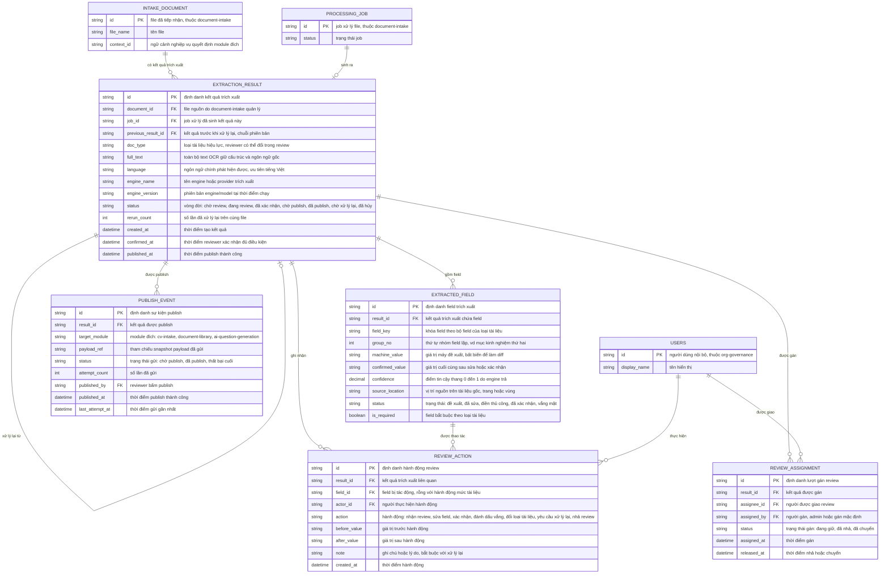

# document-review — Entity Relationship Diagram

> Scope: lớp kiểm chứng của pipeline Document AI — kết quả trích xuất,
> field đề xuất kèm confidence/vùng nguồn, hành động review của con người,
> phân công reviewer và sự kiện publish sang module đích. `INTAKE_DOCUMENT`,
> `PROCESSING_JOB`, `USERS` là tham chiếu sang feature khác
> (`document-intake`, `org-governance`).

## Diagram

## Entity Reference

| Entity | Purpose | Key attributes |
|--------|---------|----------------|
| EXTRACTION_RESULT | Một lần trích xuất trên file đã xử lý — text đầy đủ, engine provenance và vòng đời review | document_id, job_id, full_text, engine_name/engine_version, status, rerun_count |
| EXTRACTED_FIELD | Một field đề xuất trong kết quả — giữ cả giá trị máy lẫn giá trị con người để làm diff | field_key, machine_value, confirmed_value, confidence, source_location, status |
| REVIEW_ACTION | Vết audit mức field/tài liệu của reviewer — sửa, xác nhận, đổi loại, yêu cầu xử lý lại | action, actor_id, before_value, after_value, note |
| REVIEW_ASSIGNMENT | Lượt gán review và lịch sử reassign — chống sửa đè đồng thời | assignee_id, assigned_by, status, released_at |
| PUBLISH_EVENT | Một lần gửi payload sang module đích — trạng thái và số lần gửi lại | target_module, payload_ref, status, attempt_count |
| INTAKE_DOCUMENT | File nguồn đã qua cổng intake — tham chiếu từ `document-intake` | id, file_name, context_id |
| PROCESSING_JOB | Job đã xử lý file sinh ra kết quả — tham chiếu từ `document-intake` | id, status |
| USERS | Reviewer/admin/người gán — tham chiếu từ `org-governance` | id, display_name |

## Notes & Assumptions

- `EXTRACTION_RESULT.previous_result_id` tạo chuỗi phiên bản khi "xử lý
  lại": kết quả mới trỏ về kết quả trước; kết quả cũ giữ trạng thái "chờ
  xử lý lại" rồi đóng khi bản mới được publish — phục vụ diff giữa hai
  lần trích xuất và truy vết (BR-document-review-005).
- `EXTRACTED_FIELD.machine_value` là bất biến sau khi tạo — diff và chỉ số
  M-IN-03 (field giữ nguyên/đề xuất) tính từ cặp `machine_value` ↔
  `confirmed_value`.
- `source_location` lưu dạng tham chiếu logic (trang + vùng); định dạng
  cụ thể do engine quyết định — spec chỉ yêu cầu định vị được trên tài
  liệu gốc.
- `PUBLISH_EVENT` idempotent theo cặp (`result_id`, `target_module`):
  gửi lại tăng `attempt_count`, không tạo sự kiện trùng ở module đích.
- `INTAKE_DOCUMENT`, `PROCESSING_JOB`, `USERS` là entity ngoài — chỉ khai
  tối thiểu để vẽ quan hệ; định nghĩa đầy đủ ở ERD của `document-intake`
  và `org-governance`.
- Retention của `full_text`, `source_location` và diff gắn vòng đời file
  nguồn ở intake — chờ OQ-7 (liên quan OQ-6 sản phẩm); ERD chưa mô hình
  thuộc tính retention.
