# employee-evaluation — Entity Relationship Diagram

> Scope: chu trình đánh giá năng lực nhân viên — đợt đánh giá, assignment,
> quy tắc chuyển điểm thành level đề xuất, kết quả từng kỹ năng có
> reviewer xác nhận, kết quả đã ghi nhận có chuỗi bản chỉnh, evidence đính
> kèm và self-assessment. `EMPLOYEE_PROFILE`, `EMPLOYEE_SKILL`, `USER`,
> `ASSESSMENT_TEST`, `SUBMISSION`, `GRADING_RESULT`, `POSITION_FRAMEWORK`,
> `SKILL`, `SKILL_LEVEL_SCALE` là tham chiếu tối thiểu sang
> `employee-profiles`, `org-governance`, `assessment-authoring`,
> `candidate-assessment`, `assessment-grading` và `talent-framework`.

## Diagram

```mermaid
erDiagram
    USER ||--o{ EVALUATION_CAMPAIGN : "tạo"
    LEVEL_SUGGESTION_RULE ||--o{ EVALUATION_CAMPAIGN : "áp cho"
    USER ||--o{ LEVEL_SUGGESTION_RULE : "soạn và duyệt"
    LEVEL_SUGGESTION_RULE ||--o{ LEVEL_SUGGESTION_BAND : "gồm dải điểm"
    SKILL_LEVEL_SCALE ||--o{ LEVEL_SUGGESTION_BAND : "là mức đích"
    EVALUATION_CAMPAIGN ||--o{ EVALUATION_ASSIGNMENT : "gồm"
    EMPLOYEE_PROFILE ||--o{ EVALUATION_ASSIGNMENT : "được đánh giá trong"
    USER ||--o{ EVALUATION_ASSIGNMENT : "làm reviewer cho"
    ASSESSMENT_TEST ||--o{ EVALUATION_ASSIGNMENT : "được giao qua"
    POSITION_FRAMEWORK |o--o{ EVALUATION_ASSIGNMENT : "làm chuẩn khung"
    EVALUATION_ASSIGNMENT ||--o| SUBMISSION : "chốt bằng"
    EVALUATION_ASSIGNMENT ||--o{ SKILL_EVALUATION : "gồm kết quả kỹ năng"
    GRADING_RESULT |o--o{ SKILL_EVALUATION : "làm nguồn đề xuất"
    SKILL ||--o{ SKILL_EVALUATION : "được đánh giá trong"
    SKILL_LEVEL_SCALE ||--o{ SKILL_EVALUATION : "làm level đề xuất hoặc xác nhận"
    SKILL_EVALUATION ||--o{ EVALUATION_EVIDENCE : "kèm evidence"
    SKILL_EVALUATION }o--o| EMPLOYEE_SKILL : "cập nhật thành"
    EMPLOYEE_PROFILE ||--o{ EMPLOYEE_SKILL : "hồ sơ năng lực"
    SKILL ||--o{ EMPLOYEE_SKILL : "được ghi trong"
    EVALUATION_ASSIGNMENT ||--o{ EVALUATION_RESULT : "có các phiên bản"
    EVALUATION_RESULT ||--o| EVALUATION_RESULT : "là bản chỉnh của"
    USER ||--o{ EVALUATION_RESULT : "ghi nhận"
    EVALUATION_ASSIGNMENT ||--o{ SELF_ASSESSMENT : "tự đánh trước"
    SKILL ||--o{ SELF_ASSESSMENT : "tự đánh về"
    SKILL_LEVEL_SCALE ||--o{ SELF_ASSESSMENT : "là mức tự đánh"

    EVALUATION_CAMPAIGN {
        string campaign_id PK "mã đợt đánh giá"
        string organization_id FK "tổ chức sở hữu"
        string name "tên đợt"
        string campaign_type "loại đợt: theo-kỳ hoặc theo-nhu-cầu"
        string status "vòng đời: bản-nháp, đang-mở, hết-hạn, hoàn-tất, đã-hủy"
        string scope_description "phạm vi nhân viên theo nhóm/vị trí đã chốt"
        string rule_id FK "phiên bản quy tắc chuyển đổi áp dụng"
        date submission_due "hạn làm bài của đợt"
        date review_due "hạn reviewer xác nhận, sau hạn làm bài"
        string cancel_reason "lý do hủy đợt nếu có"
        string created_by_user_id FK "người tạo đợt"
        datetime created_at "thời điểm tạo"
    }
    EVALUATION_ASSIGNMENT {
        string assignment_id PK "mã assignment"
        string campaign_id FK "đợt chứa assignment"
        string profile_id FK "nhân viên được đánh giá"
        string reviewer_user_id FK "người xác nhận, phải khác người được đánh giá"
        string test_id FK "bài đánh giá được giao"
        string framework_id FK "khung vị trí làm chuẩn lúc giao, rỗng khi chọn thủ công"
        string attempt_id "attempt trên engine candidate-assessment"
        string submission_id FK "submission đã nộp nếu có"
        string status "trạng thái: đã-giao, đang-làm, đã-nộp, đang-chấm, chờ-xác-nhận, đã-ghi-nhận, quá-hạn, đã-hủy"
        date due_date "hạn làm bài của assignment"
        string cancel_reason "lý do hủy assignment nếu có"
        datetime assigned_at "thời điểm giao"
    }
    LEVEL_SUGGESTION_RULE {
        string rule_id PK "mã quy tắc chuyển đổi"
        string organization_id FK "tổ chức sở hữu"
        int version_no "phiên bản quy tắc"
        string name "tên quy tắc"
        string description "mô tả cách chuyển điểm theo kỹ năng thành level đề xuất"
        string status "vòng đời: bản-nháp, chờ-duyệt, đã-công-bố, ngừng-dùng"
        string created_by_user_id FK "người soạn quy tắc"
        string approved_by_user_id FK "business owner duyệt"
        datetime published_at "thời điểm công bố"
    }
    LEVEL_SUGGESTION_BAND {
        string band_id PK "mã dải điểm"
        string rule_id FK "quy tắc chứa dải"
        decimal min_score_percent "điểm tối thiểu của dải theo phần trăm"
        decimal max_score_percent "điểm tối đa của dải theo phần trăm"
        string level_id FK "level đề xuất tương ứng trên thang chung"
    }
    SKILL_EVALUATION {
        string skill_eval_id PK "mã kết quả đánh giá một kỹ năng"
        string assignment_id FK "assignment chứa kết quả"
        string skill_id FK "kỹ năng được đánh giá"
        string result_id FK "kết quả chấm làm nguồn đề xuất, rỗng với ghi nhận thủ công"
        string suggested_level_id FK "level đề xuất từ quy tắc"
        string confirmed_level_id FK "level cuối do reviewer quyết"
        string status "trạng thái: đề-xuất, đã-xác-nhận, điều-chỉnh, ghi-nhận-thủ-công, chưa-đánh-giá"
        string reason "lý do điều chỉnh hoặc ghi nhận thủ công, bắt buộc khi khác đề xuất"
        string employee_skill_id FK "kỹ năng hồ sơ được cập nhật sau ghi nhận"
        string confirmed_by_user_id FK "reviewer xác nhận"
        datetime confirmed_at "thời điểm xác nhận"
    }
    EVALUATION_RESULT {
        string eval_result_id PK "mã kết quả đã ghi nhận"
        string assignment_id FK "assignment nguồn"
        string profile_id FK "nhân viên sở hữu kết quả"
        int version_no "số phiên bản, bản chỉnh tăng dần"
        string previous_evaluation_result_id FK "bản ghi nhận trước mà bản này chỉnh"
        boolean is_current "bản đang hiệu lực"
        string strengths "điểm mạnh do reviewer ghi"
        string development_needs "nhu cầu phát triển do reviewer ghi"
        string amend_reason "lý do bản chỉnh, bắt buộc từ phiên bản 2"
        string recorded_by_user_id FK "reviewer hoặc HR ghi nhận"
        datetime recorded_at "thời điểm ghi nhận"
    }
    EVALUATION_EVIDENCE {
        string evidence_id PK "mã evidence đính kèm"
        string skill_eval_id FK "kết quả kỹ năng được bổ sung"
        string evidence_type "loại: ghi chú quan sát hoặc tài liệu tham chiếu"
        string content "nội dung ghi chú hoặc mô tả tài liệu"
        string document_ref "tham chiếu tài liệu hoặc chứng chỉ nếu có"
        string attached_by_user_id FK "người đính kèm"
        datetime created_at "thời điểm đính kèm"
    }
    SELF_ASSESSMENT {
        string self_assessment_id PK "mã tự đánh giá"
        string assignment_id FK "assignment tương ứng"
        string skill_id FK "kỹ năng tự đánh"
        string level_id FK "mức nhân viên tự đánh"
        string note "ghi chú của nhân viên"
        datetime created_at "thời điểm gửi"
    }
    EMPLOYEE_PROFILE {
        string profile_id PK "mã hồ sơ nhân viên, thuộc employee-profiles"
        string full_name "họ tên"
        string manager_id FK "hồ sơ quản lý trực tiếp, làm reviewer mặc định"
    }
    EMPLOYEE_SKILL {
        string profile_id FK "hồ sơ được gắn kỹ năng, thuộc employee-profiles"
        string skill_id FK "kỹ năng trong taxonomy"
        string level "trình độ đã xác nhận theo thang chung"
        string status "nguồn ghi nhận: tự khai hoặc đã xác nhận"
    }
    USER {
        string user_id PK "mã người dùng, thuộc account-access/org-governance"
        string display_name "tên hiển thị"
    }
    ASSESSMENT_TEST {
        string test_id PK "mã bài đánh giá, thuộc assessment-authoring"
        string title "tên bài đánh giá"
    }
    SUBMISSION {
        string submission_id PK "mã bài nộp, thuộc candidate-assessment"
        string attempt_id "attempt tạo submission"
        datetime submitted_at "thời điểm nộp theo giờ server"
    }
    GRADING_RESULT {
        string result_id PK "mã kết quả chấm, thuộc assessment-grading"
        string submission_id "submission được chấm"
        string status "trạng thái chấm và review của kết quả"
    }
    POSITION_FRAMEWORK {
        string framework_id PK "mã khung kỳ vọng vị trí, thuộc talent-framework"
        string position_id "vị trí áp khung"
        string status "chỉ bản đã-công-bố được làm chuẩn"
    }
    SKILL {
        string skill_id PK "mã kỹ năng, thuộc talent-framework"
        string name "tên kỹ năng"
    }
    SKILL_LEVEL_SCALE {
        string level_id PK "mã mức trên thang chung, thuộc talent-framework"
        int level_no "thứ tự mức"
        string name "tên mức"
    }
```

## Entity Reference

| Entity | Purpose | Key attributes |
|--------|---------|----------------|
| EVALUATION_CAMPAIGN | Đợt đánh giá — loại, phạm vi, hạn, vòng đời và phiên bản quy tắc chuyển đổi áp dụng | campaign_type, status, scope_description, rule_id, submission_due, review_due |
| EVALUATION_ASSIGNMENT | Bài được giao cho một nhân viên trong đợt — bài, reviewer, hạn, trạng thái và liên kết attempt/submission | profile_id, reviewer_user_id, test_id, framework_id, status, due_date |
| LEVEL_SUGGESTION_RULE | Quy tắc chuyển điểm theo kỹ năng thành level đề xuất — qua duyệt của business owner, có phiên bản | version_no, status, approved_by_user_id, published_at |
| LEVEL_SUGGESTION_BAND | Dải điểm phần trăm ánh xạ sang một level trên thang chung | min_score_percent, max_score_percent, level_id |
| SKILL_EVALUATION | Kết quả của một kỹ năng trong assignment — đề xuất/xác nhận/điều chỉnh/ghi nhận thủ công có lý do | suggested_level_id, confirmed_level_id, status, reason, result_id |
| EVALUATION_RESULT | Kết quả đã ghi nhận của một assignment — điểm mạnh, nhu cầu phát triển, provenance; chuỗi bản chỉnh không ghi đè | version_no, previous_evaluation_result_id, is_current, strengths, development_needs |
| EVALUATION_EVIDENCE | Evidence đính kèm cho ghi nhận thủ công hoặc bổ sung — ghi chú quan sát/tài liệu | evidence_type, content, document_ref |
| SELF_ASSESSMENT | Mức tự đánh của nhân viên theo kỹ năng trước đợt, cho reviewer đối chiếu | skill_id, level_id, note |
| EMPLOYEE_PROFILE | Hồ sơ nhân viên — tham chiếu từ `employee-profiles`; `manager_id` làm reviewer mặc định | profile_id, manager_id |
| EMPLOYEE_SKILL | Kỹ năng trên hồ sơ năng lực — đích ghi của kết quả đã xác nhận, thuộc `employee-profiles` | profile_id, skill_id, level, status |
| USER | Người dùng nội bộ (HR, reviewer, owner) — tham chiếu từ `account-access`/`org-governance` | user_id, display_name |
| ASSESSMENT_TEST | Bài đánh giá được giao — tham chiếu từ `assessment-authoring` | test_id, title |
| SUBMISSION | Bài nộp của assignment — tham chiếu từ `candidate-assessment` | submission_id, attempt_id, submitted_at |
| GRADING_RESULT | Kết quả chấm làm nguồn level đề xuất — tham chiếu từ `assessment-grading` | result_id, status |
| POSITION_FRAMEWORK | Khung vị trí làm chuẩn giao bài và suy phạm vi kỹ năng — tham chiếu từ `talent-framework` | framework_id, status |
| SKILL | Kỹ năng được đánh giá — tham chiếu từ `talent-framework` | skill_id, name |
| SKILL_LEVEL_SCALE | Mức trên thang chung làm level đề xuất/xác nhận/tự đánh — tham chiếu từ `talent-framework` | level_id, level_no |

## Notes & Assumptions

- `EVALUATION_CAMPAIGN.status` và `EVALUATION_ASSIGNMENT.status` theo vòng
  đời trong brainstorm Mục 6.3: đợt bản-nháp → đang-mở → hết-hạn →
  hoàn-tất; assignment đã-giao → đang-làm → đã-nộp → đang-chấm →
  chờ-xác-nhận → đã-ghi-nhận (quá-hạn/đã-hủy là nhánh phụ).
- `SKILL_EVALUATION` là trung tâm governance: `suggested_level_id` sinh từ
  `LEVEL_SUGGESTION_BAND` của quy tắc đã công bố, `confirmed_level_id` do
  reviewer quyết — điều chỉnh bắt buộc `reason` (BR-employee-evaluation-003);
  `result_id` rỗng khi `status = ghi-nhận-thủ-công` (kỹ năng không có bài đo).
- `EVALUATION_RESULT` mô hình snapshot + bản chỉnh: bản mới tạo hàng mới
  trỏ `previous_evaluation_result_id`, hàng cũ chuyển `is_current = false` — cùng cơ
  chế không-ghi-đè như `GRADE_ITEM` của `assessment-grading`.
- `EVALUATION_CAMPAIGN.rule_id` chốt provenance phiên bản quy tắc tại thời
  điểm mở đợt (BR-employee-evaluation-007); quy tắc có vòng đời duyệt giống
  khung của `talent-framework` (bản-nháp → chờ-duyệt → đã-công-bố →
  ngừng-dùng), `approved_by_user_id` là business owner (R-13, OQ-11 — đề xuất chờ
  Head of HR).
- `EVALUATION_ASSIGNMENT.framework_id` rỗng khi nhân viên chưa có khung đã
  công bố và HR chọn bài thủ công; khi có, đây là snapshot tham chiếu khung
  tại thời điểm giao (BR-employee-evaluation-010).
- `employee_skill_id` trỏ `EMPLOYEE_SKILL` của `employee-profiles` — hồ sơ
  năng lực gốc không thuộc feature này; chỉ level đã xác nhận mới được ghi
  sang (NFR-employee-evaluation-003). Khóa của `EMPLOYEE_SKILL` là cặp
  profile+skill theo ERD upstream; chi tiết ánh xạ là quyết định thiết kế.
- `SELF_ASSESSMENT` phục vụ đối chiếu (P1), không phải evidence bắt buộc —
  reviewer thấy "chưa có" khi nhân viên không tự đánh.
- `SUBMISSION`, `GRADING_RESULT`, `ASSESSMENT_TEST`, `POSITION_FRAMEWORK`,
  `SKILL`, `SKILL_LEVEL_SCALE`, `EMPLOYEE_PROFILE`, `EMPLOYEE_SKILL`,
  `USER` khai tối thiểu vì thuộc các feature khác; quan hệ vật lý đầy đủ
  nằm trong ERD của feature sở hữu. Audit log toàn hệ thống thuộc
  `org-governance`, không vẽ lại ở đây.
