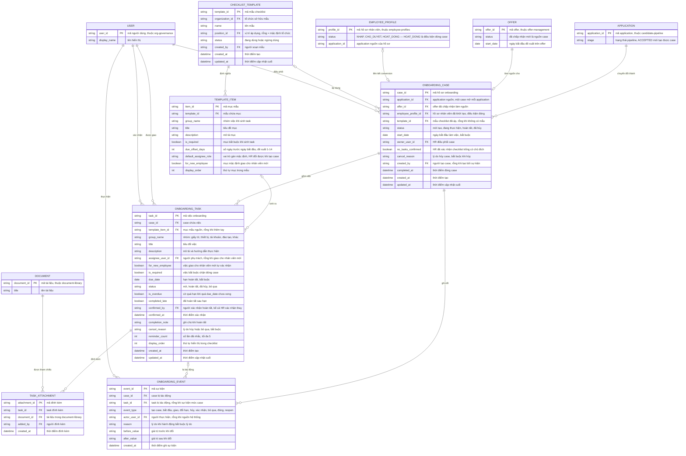

# employee-onboarding — Entity Relationship Diagram

> Scope: hồ sơ onboarding (case) sau khi offer được chấp nhận —
> checklist có nhóm gồm task có assignee/hạn, mẫu checklist snapshot,
> đính kèm tài liệu, audit sự kiện và liên kết conversion sang hồ sơ
> nhân viên. `APPLICATION`, `OFFER`, `EMPLOYEE_PROFILE`, `USER`,
> `DOCUMENT` là tham chiếu tối thiểu sang feature khác
> (`candidate-pipeline`, `offer-management`, `employee-profiles`,
> `org-governance`, `document-library`).

## Diagram

## Entity Reference

| Entity | Purpose | Key attributes |
|--------|---------|----------------|
| ONBOARDING_CASE | Hồ sơ onboarding của một application đã chấp nhận offer — vòng đời mới tạo → đang thực hiện → hoàn tất/đã hủy | application_id, offer_id, employee_profile_id, status, start_date, owner_user_id |
| ONBOARDING_TASK | Một việc trong checklist — nhóm, assignee hoặc cờ nhân viên mới, hạn, cờ bắt buộc, xác nhận hoàn tất | case_id, group_name, assignee_user_id, for_new_employee, is_required, due_date, status |
| CHECKLIST_TEMPLATE | Mẫu checklist theo tổ chức/vị trí — snapshot khi áp vào case | name, position_id, status |
| TEMPLATE_ITEM | Một mục trong mẫu — offset hạn trước ngày bắt đầu, vai trò assignee mặc định | due_offset_days, default_assignee_role, is_required |
| TASK_ATTACHMENT | Tài liệu từ `document-library` đính kèm task (P1) | task_id, document_id |
| ONBOARDING_EVENT | Audit mọi tác động trên case và task — kèm lý do và trước/sau | event_type, actor_user_id, reason, before_value, after_value |
| APPLICATION | Application nguồn — tham chiếu tối thiểu từ `candidate-pipeline` | application_id, stage |
| OFFER | Offer đã chấp nhận — tham chiếu tối thiểu từ `offer-management` | offer_id, status, start_date |
| EMPLOYEE_PROFILE | Hồ sơ nhân viên khởi tạo từ conversion — tham chiếu tối thiểu từ `employee-profiles` | profile_id, status, application_id |
| USER | Người dùng nội bộ — tham chiếu tối thiểu từ `org-governance` | user_id, display_name |
| DOCUMENT | Tài liệu đính kèm — tham chiếu tối thiểu từ `document-library` | document_id, title |

## Notes & Assumptions

- `ONBOARDING_CASE` là điểm nối conversion: một application `ACCEPTED`
  tối đa một case đang mở (BR-employee-onboarding-001); `offer_id` giữ
  nguồn dữ liệu prefill và `employee_profile_id` giữ kết quả khởi tạo
  để kiểm tra điều kiện đóng (`HOAT_DONG`).
- `ONBOARDING_TASK.template_item_id` chốt mục mẫu nguồn theo nguyên tắc
  snapshot (BR-employee-onboarding-006): sửa mẫu không đổi task đã sinh;
  task thêm tay có trường này rỗng.
- "Quá hạn" và "hoàn tất trễ" là cờ (`is_overdue`, `completed_late`)
  chứ không phải trạng thái — trạng thái task chỉ gồm mở, hoàn tất, đã
  hủy, bỏ qua; `reminder_count` kiểm soát nhịp nhắc (tối đa 5 lần).
- `for_new_employee` trên task đánh dấu việc của nhân viên mới; khi cờ
  này bật, `assignee_user_id` rỗng và quyền xác nhận phụ thuộc nhân
  viên đã có tài khoản chưa (BR-employee-onboarding-008) — việc kiểm
  tra tài khoản đi qua `account-access`, không mô hình ở đây.
- `ONBOARDING_EVENT.task_id` rỗng với sự kiện mức case (tạo, bắt đầu,
  đóng, hủy, reopen) và có giá trị với sự kiện mức task (giao, đổi
  hạn, xác nhận, hủy, bỏ qua); reopen là sự kiện trên cùng case chứ
  không tạo case mới.
- `no_tasks_confirmed` trên case ghi việc HR xác nhận checklist trống
  có chủ đích (OQ-4) — audit lựa chọn ngoại lệ.
- `APPLICATION`, `OFFER`, `EMPLOYEE_PROFILE`, `USER`, `DOCUMENT` chỉ
  khai tối thiểu phục vụ quan hệ — entity đầy đủ thuộc ERD của feature
  tương ứng. Transition `ONBOARDED` nằm trong state machine của
  `candidate-pipeline`, case chỉ phát sự kiện (BR-employee-onboarding-007).
- Retention: case, task, sự kiện và đính kèm giữ theo retention hồ sơ
  nhân viên — chờ DPO (PRD OQ-6); ERD chưa mô hình thuộc tính retention.
