# employee-profiles — Entity Relationship Diagram

> Scope: hồ sơ nhân viên thống nhất — hồ sơ, yêu cầu cập nhật tự phục vụ,
> vết audit, phiên gộp trùng và kỹ năng gắn lên hồ sơ. `USER`, `POSITION`,
> `ORGANIZATION_UNIT`, `SKILL`, `APPLICATION` là tham chiếu tối thiểu sang
> feature khác (`org-governance`/`account-access`, `talent-framework`,
> `candidate-pipeline`).

## Diagram

```mermaid
erDiagram
    USER ||--o{ EMPLOYEE_PROFILE : "tạo và cập nhật"
    USER |o--o| EMPLOYEE_PROFILE : "liên kết tài khoản"
    APPLICATION ||--o| EMPLOYEE_PROFILE : "chuyển đổi thành"
    POSITION ||--o{ EMPLOYEE_PROFILE : "được gán cho"
    ORGANIZATION_UNIT ||--o{ EMPLOYEE_PROFILE : "chứa hồ sơ"
    EMPLOYEE_PROFILE ||--o{ EMPLOYEE_PROFILE : "quản lý trực tiếp"
    EMPLOYEE_PROFILE ||--o{ PROFILE_CHANGE_REQUEST : "có yêu cầu"
    USER ||--o{ PROFILE_CHANGE_REQUEST : "gửi hoặc duyệt"
    EMPLOYEE_PROFILE ||--o{ PROFILE_AUDIT_EVENT : "ghi vết"
    USER ||--o{ PROFILE_AUDIT_EVENT : "thực hiện"
    EMPLOYEE_PROFILE ||--o{ PROFILE_MERGE : "là hồ sơ chính"
    EMPLOYEE_PROFILE ||--o{ PROFILE_MERGE : "là hồ sơ phụ"
    EMPLOYEE_PROFILE ||--o{ EMPLOYEE_SKILL : "có kỹ năng"
    SKILL ||--o{ EMPLOYEE_SKILL : "được gán cho"

    EMPLOYEE_PROFILE {
        string profile_id PK "mã hồ sơ nhân viên"
        string organization_id FK "tổ chức sở hữu hồ sơ"
        string user_id FK "tài khoản đăng nhập liên kết khi được mời"
        string application_id FK "application nguồn nếu tạo từ chuyển đổi"
        string employee_code "mã nhân viên nội bộ"
        string full_name "họ tên"
        date date_of_birth "ngày sinh"
        string national_id "số định danh CCCD hoặc CMND 9-12 số"
        string personal_email "email cá nhân"
        string phone "số điện thoại"
        string address "địa chỉ liên hệ"
        string emergency_contact "liên hệ khẩn cấp"
        string avatar_url "ảnh đại diện"
        string position_id FK "vị trí hiện tại"
        string unit_id FK "phòng ban hiện tại"
        string manager_id FK "hồ sơ của người quản lý trực tiếp"
        date start_date "ngày bắt đầu làm việc"
        string status "trạng thái bản ghi: NHAP, CHO_DUYET, HOAT_DONG, LUU_TRU"
        string created_by FK "người tạo hồ sơ"
        datetime created_at "thời điểm tạo"
        datetime updated_at "thời điểm cập nhật cuối"
    }
    PROFILE_CHANGE_REQUEST {
        string request_id PK "mã yêu cầu cập nhật"
        string profile_id FK "hồ sơ được yêu cầu sửa"
        string field_name "trường hạn chế được yêu cầu"
        string old_value "giá trị hiện tại tại thời điểm gửi"
        string new_value "giá trị đề xuất"
        string reason "lý do của người yêu cầu"
        string status "trạng thái: CHO_DUYET, DA_DUYET, TU_CHOI"
        string requested_by FK "nhân viên gửi yêu cầu"
        string reviewed_by FK "HR ra quyết định"
        string reject_reason "lý do từ chối nếu có"
        datetime created_at "thời điểm gửi yêu cầu"
        datetime decided_at "thời điểm quyết định"
    }
    PROFILE_AUDIT_EVENT {
        string event_id PK "mã sự kiện audit"
        string profile_id FK "hồ sơ bị tác động"
        string actor_id FK "người thực hiện hành động"
        string action "hành động: tạo, sửa, kích hoạt, lưu trữ, gộp, tự cập nhật, export, truy cập bị từ chối"
        string field_name "trường bị thay đổi nếu là sửa"
        string old_value "giá trị trước"
        string new_value "giá trị sau"
        string reason "lý do ghi nhận"
        datetime created_at "thời điểm ghi nhận"
    }
    PROFILE_MERGE {
        string merge_id PK "mã phiên gộp hồ sơ"
        string primary_profile_id FK "hồ sơ chính được giữ lại"
        string secondary_profile_id FK "hồ sơ phụ chuyển LUU_TRU"
        string field_selections "bản ghi giá trị được chọn giữ lại cho từng trường"
        string status "trạng thái: CHO_DUYET, DA_DUYET, TU_CHOI"
        string requested_by FK "HR đề xuất gộp"
        string approved_by FK "reviewer duyệt gộp"
        datetime created_at "thời điểm đề xuất"
        datetime decided_at "thời điểm duyệt"
    }
    EMPLOYEE_SKILL {
        string profile_id FK "hồ sơ được gắn kỹ năng"
        string skill_id FK "kỹ năng trong taxonomy"
        string level "trình độ theo khung chung"
        string status "nguồn ghi nhận: tự khai hoặc đã xác nhận"
        string confirmed_by FK "người xác nhận kỹ năng nếu có"
        datetime created_at "thời điểm gắn"
    }
    USER {
        string user_id PK "mã người dùng, thuộc account-access/org-governance"
        string display_name "tên hiển thị"
    }
    POSITION {
        string position_id PK "mã vị trí, thuộc org-governance"
        string title "tên vị trí"
    }
    ORGANIZATION_UNIT {
        string unit_id PK "mã đơn vị, thuộc org-governance"
        string name "tên đơn vị"
    }
    SKILL {
        string skill_id PK "mã kỹ năng, thuộc talent-framework"
        string name "tên kỹ năng"
    }
    APPLICATION {
        string application_id PK "mã application, thuộc candidate-pipeline"
        string status "trạng thái application nguồn"
    }
```

## Entity Reference

| Entity | Purpose | Key attributes |
|--------|---------|----------------|
| EMPLOYEE_PROFILE | Hồ sơ nhân viên — source of truth cho thông tin cá nhân, liên hệ, định danh, vị trí/phòng ban/manager và trạng thái bản ghi | status, employee_code, national_id, position_id, unit_id, manager_id, application_id |
| PROFILE_CHANGE_REQUEST | Yêu cầu sửa trường hạn chế do nhân viên gửi — chỉ áp dụng khi HR duyệt | field_name, old_value, new_value, status, requested_by, reviewed_by |
| PROFILE_AUDIT_EVENT | Vết audit mọi tác động lên hồ sơ: tạo, sửa, kích hoạt, lưu trữ, gộp, export, truy cập bị từ chối | actor_id, action, field_name, old_value, new_value, reason |
| PROFILE_MERGE | Phiên gộp 2 hồ sơ trùng có phê duyệt; giữ lựa chọn giá trị từng trường | primary_profile_id, secondary_profile_id, field_selections, status |
| EMPLOYEE_SKILL | Kỹ năng gắn lên hồ sơ từ taxonomy chung, phân biệt tự khai và đã xác nhận | skill_id, level, status, confirmed_by |
| USER | Người dùng nội bộ — entity ngoài thuộc `account-access`/`org-governance`, chỉ tham chiếu | user_id, display_name |
| POSITION | Vị trí/chức danh — entity ngoài thuộc `org-governance` | position_id, title |
| ORGANIZATION_UNIT | Đơn vị/phòng ban — entity ngoài thuộc `org-governance` | unit_id, name |
| SKILL | Kỹ năng trong taxonomy — entity ngoài thuộc `talent-framework` | skill_id, name |
| APPLICATION | Application ứng viên làm nguồn chuyển đổi — entity ngoài thuộc `candidate-pipeline` | application_id, status |

## Notes & Assumptions

- `EMPLOYEE_PROFILE.status` là trạng thái BẢN GHI (NHAP → CHO_DUYET →
  HOAT_DONG → LUU_TRU), không phải trạng thái vòng đời việc làm — thử
  việc/chính thức/tạm nghỉ/nghỉ việc thuộc `employment-lifecycle`, feature
  đó báo tín hiệu nghỉ việc để hồ sơ chuyển LUU_TRU (BR ranh giới ở spec
  Mục 11).
- `manager_id` tự tham chiếu `EMPLOYEE_PROFILE` (quan hệ quản lý trực tiếp
  giữa 2 hồ sơ); khi manager nghỉ việc, hồ sơ cấp dưới vào danh sách thiếu
  manager — không tự gán lại.
- `user_id` rỗng khi nhân viên chưa được mời tài khoản — hồ sơ HOAT_DONG
  tồn tại độc lập tài khoản; self-service chỉ bật khi có liên kết.
- `application_id` giữ provenance chuyển đổi: hồ sơ từ offer chấp nhận trỏ
  về application nguồn để truy vết dữ liệu prefill (CV đã xác nhận + offer).
- `national_id` duy nhất trong tổ chức (BR-employee-profiles-007) — là một
  trong 3 khóa kiểm tra trùng bắt buộc cùng email và điện thoại.
- `PROFILE_MERGE.field_selections` lưu bản ghi "trường nào giữ giá trị của
  hồ sơ nào" để truy vết quyết định gộp; chi tiết cấu trúc là quyết định
  thiết kế, spec chỉ yêu cầu truy vết được.
- Dữ liệu nhạy cảm (national_id, date_of_birth, emergency_contact) chỉ lộ
  cho vai trò được cấp — ràng buộc quyền thực thi ở tầng truy cập, không
  thể hiện trong ERD (NFR-employee-profiles-001).
- Retention của PROFILE_AUDIT_EVENT và hồ sơ LUU_TRU theo chính sách DPO —
  chờ OQ-6 PRD; ERD chưa mô hình thuộc tính retention.
