# employment-lifecycle — Entity Relationship Diagram

> Scope: việc làm và vòng đời của một nhân viên — employment, chuỗi hợp
> đồng, thay đổi vòng đời có phê duyệt, checklist bàn giao, tài liệu đính
> kèm và vết audit (PRD Mục 7.4). `EMPLOYEE_PROFILE` thuộc
> `employee-profiles`; `USER`, `POSITION`, `ORGANIZATION_UNIT` thuộc
> `account-access`/`org-governance`; `INTAKE_DOCUMENT` thuộc
> `document-intake` — chỉ khai tối thiểu để tham chiếu.

## Diagram

```mermaid
erDiagram
    EMPLOYEE_PROFILE ||--o| EMPLOYMENT : "có một việc làm"
    USER ||--o{ EMPLOYMENT : "tạo"
    EMPLOYMENT ||--o{ EMPLOYMENT_CONTRACT : "có chuỗi hợp đồng"
    EMPLOYMENT ||--o| EMPLOYMENT_CONTRACT : "hợp đồng hiện hành"
    EMPLOYMENT_CONTRACT |o--o| EMPLOYMENT_CONTRACT : "thay thế hợp đồng trước"
    EMPLOYMENT ||--o{ LIFECYCLE_CHANGE : "có thay đổi vòng đời"
    USER ||--o{ LIFECYCLE_CHANGE : "đề xuất"
    USER ||--o{ LIFECYCLE_CHANGE : "phê duyệt"
    LIFECYCLE_CHANGE ||--o{ CHANGE_CHECKLIST_ITEM : "sinh checklist"
    USER ||--o{ CHANGE_CHECKLIST_ITEM : "phụ trách đầu việc"
    ORGANIZATION_UNIT ||--o{ LIFECYCLE_CHANGE : "là đơn vị đích"
    POSITION ||--o{ LIFECYCLE_CHANGE : "là vị trí đích"
    EMPLOYEE_PROFILE ||--o{ LIFECYCLE_CHANGE : "là quản lý đích"
    EMPLOYMENT ||--o{ LIFECYCLE_DOCUMENT : "đính kèm tài liệu"
    LIFECYCLE_CHANGE ||--o{ LIFECYCLE_DOCUMENT : "đính kèm tài liệu"
    INTAKE_DOCUMENT ||--o{ LIFECYCLE_DOCUMENT : "được gán vào"
    EMPLOYMENT ||--o{ EMPLOYMENT_AUDIT_EVENT : "ghi vết"
    LIFECYCLE_CHANGE ||--o{ EMPLOYMENT_AUDIT_EVENT : "ghi vết"
    USER ||--o{ EMPLOYMENT_AUDIT_EVENT : "thực hiện"

    EMPLOYMENT {
        string employment_id PK "mã việc làm"
        string profile_id FK "hồ sơ nhân viên, duy nhất một việc làm mỗi hồ sơ"
        string organization_id FK "tổ chức sở hữu"
        string status "trạng thái vòng đời: HOP_DONG, THU_VIEC, CHINH_THUC, TAM_NGHI, DIEU_CHUYEN, NGHI_VIEC"
        string current_contract_id FK "hợp đồng đang hiện hành"
        date probation_end_date "ngày dự kiến hết thử việc, trống nếu không áp dụng"
        date state_effective_from "ngày hiệu lực của trạng thái hiện tại"
        string created_by FK "người tạo việc làm"
        datetime created_at "thời điểm tạo"
        datetime updated_at "thời điểm cập nhật cuối"
    }
    EMPLOYMENT_CONTRACT {
        string contract_id PK "mã hợp đồng"
        string employment_id FK "việc làm sở hữu"
        string contract_number "số hợp đồng, duy nhất trong tổ chức"
        string contract_type "loại: thử việc, xác định thời hạn, không xác định thời hạn"
        date signed_date "ngày ký hợp đồng"
        date effective_from "ngày hiệu lực bắt đầu"
        date effective_to "ngày hiệu lực kết thúc, trống với loại không xác định"
        string status "trạng thái: CHO_HIEU_LUC, HIEU_LUC, HET_HAN, THAY_THE"
        string replaces_contract_id FK "hợp đồng bị hợp đồng này thay thế"
        string created_by FK "người nhập hợp đồng"
        datetime created_at "thời điểm tạo"
    }
    LIFECYCLE_CHANGE {
        string change_id PK "mã thay đổi vòng đời"
        string employment_id FK "việc làm bị thay đổi"
        string change_type "loại: bắt đầu làm việc, kết thúc thử việc, tạm nghỉ, quay lại, điều chuyển, nghỉ việc, gia hạn hoặc ký hợp đồng mới"
        string status "trạng thái: NHAP, CHO_DUYET, DA_DUYET, TU_CHOI, HUY, HIEU_LUC"
        date effective_date "ngày hiệu lực thay đổi"
        string reason "lý do thay đổi, bắt buộc với nghỉ việc, tạm nghỉ, điều chuyển và backdate"
        string new_unit_id FK "đơn vị đích khi điều chuyển"
        string new_position_id FK "vị trí đích khi điều chuyển"
        string new_manager_id FK "hồ sơ người quản lý mới khi điều chuyển"
        date expected_return_date "ngày dự kiến quay lại khi tạm nghỉ"
        string new_contract_id FK "hợp đồng mới khi gia hạn hoặc ký lại"
        boolean is_backdated "cờ ngày hiệu lực trong quá khứ"
        boolean self_approved "cờ ngoại lệ tự duyệt khi tổ chức một approver"
        boolean checklist_incomplete "cờ checklist chưa hoàn tất khi có hiệu lực"
        string requested_by FK "người đề xuất thay đổi"
        string reviewed_by FK "approver ra quyết định"
        string review_note "ghi chú của người duyệt"
        datetime reviewed_at "thời điểm quyết định duyệt"
        datetime applied_at "thời điểm áp dụng hiệu lực thực tế"
        datetime created_at "thời điểm tạo"
        datetime updated_at "thời điểm cập nhật cuối"
    }
    CHANGE_CHECKLIST_ITEM {
        string item_id PK "mã đầu việc checklist"
        string change_id FK "thay đổi sinh checklist này"
        string title "tiêu đề đầu việc bàn giao"
        string owner_id FK "người phụ trách đầu việc"
        date due_date "hạn hoàn tất"
        string status "trạng thái: chưa xong, hoàn tất, quá hạn"
        string completed_by FK "người xác nhận hoàn tất"
        datetime completed_at "thời điểm hoàn tất"
    }
    LIFECYCLE_DOCUMENT {
        string link_id PK "mã gán tài liệu"
        string employment_id FK "việc làm chứa tài liệu"
        string change_id FK "thay đổi chứa tài liệu, trống nếu gắn trực tiếp việc làm"
        string document_id FK "file qua cổng document-intake"
        string doc_role "vai trò tài liệu: quyết định, đơn, biên bản bàn giao, hợp đồng, tham chiếu"
        boolean is_required "tài liệu bắt buộc theo loại thay đổi"
        string uploaded_by FK "người đính kèm"
        datetime created_at "thời điểm gán"
    }
    EMPLOYMENT_AUDIT_EVENT {
        string event_id PK "mã sự kiện audit"
        string employment_id FK "việc làm bị tác động"
        string change_id FK "thay đổi liên quan nếu có"
        string actor_id FK "người thực hiện hành động"
        string action "hành động: tạo việc làm, thêm hợp đồng, gửi duyệt, duyệt, từ chối, trả về, hủy, áp dụng hiệu lực, hoàn tất checklist, truy cập bị từ chối"
        string from_status "trạng thái trước tác động"
        string to_status "trạng thái sau tác động"
        string detail "chi tiết và lý do ghi nhận"
        datetime created_at "thời điểm ghi nhận"
    }
    EMPLOYEE_PROFILE {
        string profile_id PK "mã hồ sơ nhân viên, thuộc employee-profiles"
        string status "trạng thái bản ghi: NHAP, CHO_DUYET, HOAT_DONG, LUU_TRU"
    }
    USER {
        string user_id PK "mã người dùng, thuộc account-access"
        string display_name "tên hiển thị"
    }
    POSITION {
        string position_id PK "mã chức danh, thuộc org-governance"
        string name "tên chức danh"
    }
    ORGANIZATION_UNIT {
        string unit_id PK "mã đơn vị, thuộc org-governance"
        string name "tên đơn vị"
    }
    INTAKE_DOCUMENT {
        string id PK "mã file tiếp nhận, thuộc document-intake"
        string file_name "tên file đã tải lên"
        string doc_type "loại tài liệu đã xác nhận"
    }
```

## Entity Reference

| Entity | Purpose | Key attributes |
|--------|---------|----------------|
| EMPLOYMENT | Việc làm 1-1 với hồ sơ HOAT_DONG — trạng thái vòng đời hiện tại chỉ đổi qua thay đổi có hiệu lực | profile_id, status, current_contract_id, state_effective_from, probation_end_date |
| EMPLOYMENT_CONTRACT | Một hợp đồng lao động trong chuỗi — chỉ một hợp đồng HIEU_LUC tại một thời điểm, giữ liên kết thay thế | contract_number, contract_type, effective_from/to, status, replaces_contract_id |
| LIFECYCLE_CHANGE | Thay đổi vòng đời có phê duyệt — loại, ngày hiệu lực, trường đích, trạng thái duyệt và cờ backdate/tự duyệt/checklist | change_type, status, effective_date, reason, new_unit_id/new_position_id/new_manager_id, requested_by, reviewed_by, applied_at |
| CHANGE_CHECKLIST_ITEM | Đầu việc bàn giao sinh theo loại thay đổi — owner + hạn, không chặn hiệu lực | title, owner_id, due_date, status, completed_by |
| LIFECYCLE_DOCUMENT | Gán tài liệu vào việc làm hoặc thay đổi qua `document-intake` — phân biệt tài liệu bắt buộc | document_id, doc_role, is_required, change_id |
| EMPLOYMENT_AUDIT_EVENT | Vết audit mọi sự kiện vòng đời — trước → sau, lý do, actor | action, from_status, to_status, actor_id, detail |
| EMPLOYEE_PROFILE | Hồ sơ nhân viên — entity ngoài thuộc `employee-profiles`, chỉ tham chiếu | profile_id, status |
| USER | Người dùng nội bộ — entity ngoài thuộc `account-access` | user_id, display_name |
| POSITION | Chức danh đích khi điều chuyển — entity ngoài thuộc `org-governance` | position_id, name |
| ORGANIZATION_UNIT | Đơn vị đích khi điều chuyển — entity ngoài thuộc `org-governance` | unit_id, name |
| INTAKE_DOCUMENT | File tài liệu qua cổng tiếp nhận — entity ngoài thuộc `document-intake` | id, file_name, doc_type |

## Notes & Assumptions

- `EMPLOYMENT.status` là trạng thái VÒNG ĐỜI (HOP_DONG → THU_VIEC →
  CHINH_THUC → TAM_NGHI/DIEU_CHUYEN → NGHI_VIEC), khác với
  `EMPLOYEE_PROFILE.status` là trạng thái BẢN GHI; nghỉ việc có hiệu lực
  chỉ báo tín hiệu để `employee-profiles` chuyển LUU_TRU (BR-013).
- Một việc làm có tối đa một LIFECYCLE_CHANGE ở NHAP đã gửi/CHO_DUYET/
  DA_DUYET chờ hiệu lực và `EMPLOYMENT_CONTRACT` chỉ một bản ghi HIEU_LUC
  tại một thời điểm — ràng buộc nghiệp vụ kiểm khi ghi, không thể hiện
  trên ERD (BR-003, BR-007).
- `LIFECYCLE_CHANGE.new_*` chỉ dùng khi `change_type` là điều chuyển;
  `expected_return_date` chỉ khi tạm nghỉ; `new_contract_id` chỉ khi gia
  hạn/ký mới — các trường đích trống ở loại khác.
- `is_backdated`, `self_approved`, `checklist_incomplete` là cờ audit/
  ngoại lệ: backdate ≤90 ngày kèm lý do (BR-009), tự duyệt chỉ khi tổ
  chức một approver (BR-005), checklist chưa xong không chặn hiệu lực
  (BR-008).
- `LIFECYCLE_DOCUMENT` tách gán tài liệu khỏi file: `document_id` trỏ
  `INTAKE_DOCUMENT` của `document-intake`; `is_required` đánh dấu tài
  liệu bắt buộc theo catalog loại thay đổi do Head of HR duyệt.
- `new_manager_id` trên LIFECYCLE_CHANGE trỏ `EMPLOYEE_PROFILE` (hồ sơ của
  người quản lý mới) — cùng convention `EMPLOYEE_PROFILE.manager_id` tự
  tham chiếu của `employee-profiles`.
- Audit truy cập bị từ chối và action về quyền cũng ghi vào `AUDIT_EVENT`
  của `org-governance`; `EMPLOYMENT_AUDIT_EVENT` là vết nghiệp vụ gắn
  việc làm/thay đổi.
- Retention của EMPLOYMENT, hợp đồng, thay đổi và tài liệu sau nghỉ việc
  theo chính sách DPO — chờ OQ-6 PRD; ERD chưa mô hình thuộc tính
  retention.
