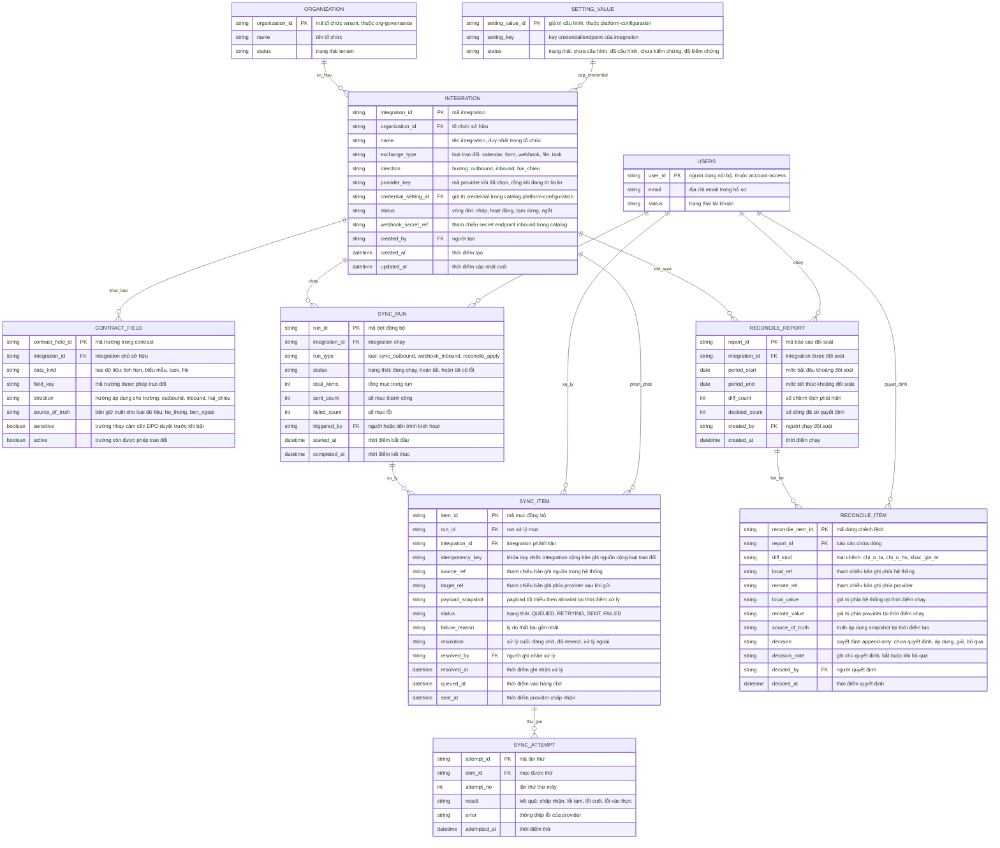

# external-integrations — Entity Relationship Diagram

> Scope: dữ liệu khung tích hợp provider-agnostic — integration và contract
> field allowlist, sync run/item/attempt, reconcile report/item.
> `SETTING_VALUE` (credential/endpoint) thuộc `platform-configuration`,
> `USERS` thuộc `account-access`, `ORGANIZATION` thuộc `org-governance`.

## Diagram

## Entity Reference

| Entity | Purpose | Key attributes |
|--------|---------|----------------|
| INTEGRATION | Một kết nối theo contract của tổ chức — vòng đời nháp → hoạt động → tạm dừng → ngắt; `provider_key` rỗng khi chưa chọn provider | exchange_type, direction, provider_key, credential_setting_id, status |
| CONTRACT_FIELD | Allowlist trường được phép trao đổi + source-of-truth per loại dữ liệu — nền của minimal payload và reconcile | data_kind, field_key, direction, source_of_truth, sensitive |
| SYNC_RUN | Một đợt chạy sync hoặc nhóm apply của reconcile | run_type, status, counters |
| SYNC_ITEM | Một bản ghi trao đổi — khóa idempotent, payload snapshot tối thiểu, trạng thái và vết xử lý | idempotency_key, source_ref, target_ref, status, resolution |
| SYNC_ATTEMPT | Từng lần gọi provider theo lịch retry 5p/30p/2h | item_id, attempt_no, result, error |
| RECONCILE_REPORT | Một lần chạy đối soát theo khoảng thời gian | period_start/period_end, diff_count, decided_count |
| RECONCILE_ITEM | Một dòng chênh lệch — quyết định append-only có người/thời điểm | diff_kind, local/remote value, source_of_truth snapshot, decision |
| SETTING_VALUE | Credential/endpoint của integration — entity ngoài do `platform-configuration` sở hữu | setting_value_id, setting_key, status |
| USERS | Người cấu hình/kích hoạt/quyết định — entity ngoài do `account-access` sở hữu | user_id, email, status |
| ORGANIZATION | Tenant sở hữu integration — entity ngoài do `org-governance` sở hữu | organization_id, name, status |

## Notes & Assumptions

- `INTEGRATION.provider_key` rỗng khi feature đang trì hoãn chưa chọn
  provider (project profile 2026-09-13); khi chọn, provider chỉ điền vào
  `provider_key` + adapter — khung contract không đổi.
- `INTEGRATION.credential_setting_id` trỏ `SETTING_VALUE` của
  `platform-configuration`: credential/endpoint là nguồn duy nhất nằm trong
  catalog đó (write-only, masked, versioned) — đề xuất, URD OQ-8 chờ
  Operations owner. `webhook_secret_ref` cũng là tham chiếu catalog.
- `SYNC_ITEM.idempotency_key` = integration + bản ghi nguồn + loại trao
  đổi — replay webhook hay chạy lại run bị chặn kèm log duplicate-skipped
  (FR-external-integrations-005, R-12).
- `SYNC_ITEM.status` theo state machine: QUEUED → SENT; QUEUED → RETRYING
  → FAILED; FAILED → QUEUED khi resend tạo `SYNC_ATTEMPT` mới cùng khóa.
- `SYNC_ITEM.payload_snapshot` giữ payload tối thiểu theo allowlist tại
  thời điểm xử lý — truy vết đúng dữ liệu đã trao đổi; retention chờ DPO
  (OQ-6 PRD).
- `CONTRACT_FIELD.sensitive` đánh dấu trường nhạy cảm: chỉ được `active`
  sau khi DPO duyệt — cơ chế chặn ở tầng nghiệp vụ (FR-external-
  integrations-011).
- `RECONCILE_ITEM.source_of_truth` là snapshot rule tại thời điểm tạo
  report — đổi contract sau đó không sửa quyết định đã ghi (BR-external-
  integrations-010); `decision` là append-only, ghi một lần.
- `RECONCILE_ITEM` với decision "áp dụng" sinh `SYNC_RUN` loại
  `reconcile_apply` chứa các `SYNC_ITEM` sửa phía không phải truth —
  quan hệ logic qua `SYNC_RUN.integration_id` + `run_type`.
- `source_ref`/`target_ref`/`local_ref`/`remote_ref` là tham chiếu logic
  (chuỗi khóa bản ghi), không phải FK vật lý vì đa hình theo module nguồn.
- `USERS`, `ORGANIZATION`, `SETTING_VALUE` là entity ngoài khai tối thiểu;
  định nghĩa đầy đủ thuộc `account-access`, `org-governance` và
  `platform-configuration`.
- Webhook inbound không tạo entity riêng: request hợp lệ thành
  `SYNC_ITEM` trong `SYNC_RUN` loại `webhook_inbound`; request sai chữ ký
  bị từ chối và chỉ xuất hiện trong audit của `org-governance`.
