# interview-evaluation — Entity Relationship Diagram

> Scope: đánh giá của một phiên phỏng vấn — phiếu theo rubric của từng
> interviewer, điểm tiêu chí, evidence, lịch sử nộp/trả về, tóm tắt AI
> có nguồn và quyết định vòng của con người. `INTERVIEW_SESSION`,
> `SESSION_PARTICIPANT`, `USER` là tham chiếu tối thiểu sang feature
> khác (`interview-management`, `org-governance`).

## Diagram

```mermaid
erDiagram
    INTERVIEW_SESSION ||--o{ EVALUATION_FORM : "có phiếu"
    SESSION_PARTICIPANT ||--o| EVALUATION_FORM : "nộp một phiếu"
    RUBRIC ||--o{ EVALUATION_FORM : "áp khung"
    RUBRIC ||--o{ RUBRIC_CRITERION : "gồm tiêu chí"
    EVALUATION_FORM ||--o{ CRITERION_SCORE : "chấm theo"
    RUBRIC_CRITERION ||--o{ CRITERION_SCORE : "được chấm trong"
    EVALUATION_FORM ||--o{ EVALUATION_EVIDENCE : "đính kèm"
    EVALUATION_FORM ||--o{ FORM_EVENT : "ghi lịch sử"
    USER ||--o{ FORM_EVENT : "thực hiện"
    INTERVIEW_SESSION ||--o{ AI_SUMMARY : "được tóm tắt"
    AI_SUMMARY ||--o{ SUMMARY_SOURCE : "trích từ"
    EVALUATION_FORM ||--o{ SUMMARY_SOURCE : "là nguồn của"
    USER ||--o{ AI_SUMMARY : "yêu cầu và review"
    INTERVIEW_SESSION ||--o{ ROUND_DECISION : "có quyết định vòng"
    AI_SUMMARY |o--o{ ROUND_DECISION : "được dùng làm căn cứ"
    USER ||--o{ ROUND_DECISION : "ghi"
    ROUND_DECISION |o--o| ROUND_DECISION : "đảo bản trước"

    EVALUATION_FORM {
        string form_id PK "mã phiếu đánh giá"
        string session_id FK "phiên được đánh giá"
        string participant_id FK "participant nộp phiếu, thuộc interview-management"
        string rubric_id FK "rubric khóa tại thời điểm mở phiếu"
        string status "nháp, đã nộp, bị trả về"
        string overall_comment "nhận xét tổng, bắt buộc khi nộp"
        string recommendation "khuyến nghị tổng: đạt, không đạt, cần trao đổi thêm"
        datetime due_at "hạn nộp phiếu, mặc định 48 giờ sau giờ kết thúc phiên"
        boolean is_late "cờ nộp sau hạn"
        int return_count "số lần bị trả về, tối đa 2"
        datetime submitted_at "thời điểm nộp lần gần nhất"
        datetime created_at "thời điểm mở phiếu"
        datetime updated_at "thời điểm cập nhật cuối"
    }
    CRITERION_SCORE {
        string score_id PK "mã điểm tiêu chí"
        string form_id FK "phiếu chứa điểm"
        string criterion_id FK "tiêu chí được chấm"
        int score "điểm thang 1-5"
        string note "nhận xét theo tiêu chí, tùy chọn"
    }
    EVALUATION_EVIDENCE {
        string evidence_id PK "mục evidence trên phiếu"
        string form_id FK "phiếu đính kèm"
        string evidence_type "loại: link, file, tham chiếu transcript"
        string ref_value "đường dẫn hoặc tham chiếu tới evidence"
        string note "ghi chú của interviewer về evidence"
        datetime created_at "thời điểm đính kèm"
    }
    FORM_EVENT {
        string event_id PK "mã sự kiện phiếu"
        string form_id FK "phiếu bị tác động"
        string event_type "loại: nộp, trả về, nộp lại, khóa"
        string actor_user_id FK "người thực hiện, rỗng khi nguồn hệ thống"
        string reason "lý do, bắt buộc khi trả về"
        datetime created_at "thời điểm ghi sự kiện"
    }
    RUBRIC {
        string rubric_id PK "mã bộ tiêu chí đánh giá"
        string organization_id FK "tổ chức sở hữu rubric"
        string name "tên rubric"
        string position_id FK "vị trí gán riêng, rỗng = mặc định tổ chức"
        int round_no "vòng áp dụng, rỗng = mọi vòng"
        string status "đang dùng hoặc ngừng dùng"
        string created_by FK "người soạn rubric"
        datetime created_at "thời điểm tạo"
        datetime updated_at "thời điểm cập nhật cuối"
    }
    RUBRIC_CRITERION {
        string criterion_id PK "mã tiêu chí"
        string rubric_id FK "rubric chứa tiêu chí"
        string name "tên tiêu chí"
        string description "mô tả cách chấm tiêu chí"
        int display_order "thứ tự hiển thị trong form"
        int max_score "thang điểm tối đa, mặc định 5"
    }
    AI_SUMMARY {
        string summary_id PK "mã bản tóm tắt"
        string session_id FK "phiên được tóm tắt"
        int version_no "số thứ tự phiên bản tóm tắt"
        string status "chờ review, đã chấp nhận, bị thay thế"
        string content "nội dung: điểm trung bình tiêu chí, đồng thuận, bất đồng trích nguồn, evidence nổi bật"
        string missing_forms "danh sách participant chưa nộp tại thời điểm chạy"
        string model_version "phiên bản model sinh tóm tắt"
        string requested_by FK "HR yêu cầu tổng hợp"
        string reviewed_by FK "HR chấp nhận hoặc xử lý"
        datetime created_at "thời điểm sinh tóm tắt"
        datetime reviewed_at "thời điểm HR xử lý"
    }
    SUMMARY_SOURCE {
        string summary_id FK "tóm tắt chứa nguồn"
        string form_id FK "phiếu đã nộp làm nguồn tại thời điểm chạy"
    }
    ROUND_DECISION {
        string decision_id PK "mã quyết định vòng"
        string session_id FK "phiên được quyết định"
        string result "kết quả vòng: đạt, không đạt, cần thêm vòng"
        string rationale "nhận xét căn cứ, bắt buộc"
        string summary_id FK "tóm tắt đã dùng làm căn cứ nếu có"
        string missing_forms_note "ghi nhận phiếu thiếu khi quyết trong lúc còn thiếu"
        string supersedes_id FK "quyết định bị đảo nếu đây là bản đảo"
        boolean is_current "quyết định hiệu lực của phiên"
        string decided_by FK "vai trò được cấp ghi quyết định"
        datetime decided_at "thời điểm quyết định"
    }
    INTERVIEW_SESSION {
        string session_id PK "mã phiên phỏng vấn, thuộc interview-management"
        int round_no "số vòng phỏng vấn"
        string status "trạng thái phiên, phiếu chỉ ghi khi đã diễn ra"
    }
    SESSION_PARTICIPANT {
        string participant_id PK "mã participant, thuộc interview-management"
        string user_id "người được gán vào phiên"
        string response_status "phiếu chỉ cho participant đã chấp nhận"
    }
    USER {
        string user_id PK "mã người dùng, thuộc org-governance"
        string display_name "tên hiển thị"
    }
```

## Entity Reference

| Entity | Purpose | Key attributes |
|--------|---------|----------------|
| EVALUATION_FORM | Phiếu đánh giá của một participant trên một phiên — vòng đời nháp → đã nộp → bị trả về, khóa sau quyết định | session_id, participant_id, rubric_id, status, overall_comment, recommendation, due_at, is_late |
| CRITERION_SCORE | Điểm và nhận xét của phiếu trên từng tiêu chí rubric | criterion_id, score, note |
| EVALUATION_EVIDENCE | Evidence đính kèm phiếu — link, file hoặc tham chiếu transcript | evidence_type, ref_value, note |
| FORM_EVENT | Lịch sử nộp/trả về/nộp lại/khóa của phiếu — giữ cả hai lần nộp | event_type, actor_user_id, reason |
| RUBRIC | Bộ tiêu chí đánh giá của tổ chức, gán theo vị trí/vòng | name, position_id, round_no, status |
| RUBRIC_CRITERION | Một tiêu chí trong rubric — thang 1–5, có thứ tự | name, description, display_order, max_score |
| AI_SUMMARY | Bản tóm tắt AI của phiên — phiên bản, trạng thái review, model version | version_no, status, content, missing_forms, model_version |
| SUMMARY_SOURCE | Junction tóm tắt ↔ các phiếu nguồn tại thời điểm chạy | summary_id, form_id |
| ROUND_DECISION | Quyết định vòng của con người — chuỗi đảo qua supersedes_id | result, rationale, summary_id, supersedes_id, is_current |
| INTERVIEW_SESSION | Phiên phỏng vấn — tham chiếu tối thiểu từ `interview-management` | session_id, round_no, status |
| SESSION_PARTICIPANT | Interviewer được gán phiên — tham chiếu tối thiểu từ `interview-management` | participant_id, user_id, response_status |
| USER | Người dùng nội bộ — tham chiếu tối thiểu từ `org-governance` | user_id, display_name |

## Notes & Assumptions

- `EVALUATION_FORM.status` là vòng đời phiếu (nháp → đã nộp → bị trả về
  → đã nộp lần 2); "đã nộp trễ" là cờ `is_late` chứ không phải trạng
  thái riêng, và khóa vĩnh viễn sau quyết định được suy từ phiên có
  `ROUND_DECISION` hiệu lực — không cần trạng thái riêng.
- `rubric_id` trên phiếu chốt rubric tại thời điểm mở (BR-interview-
  evaluation-010): rubric đổi chỉ ảnh hưởng phiếu mở sau, phiếu nháp
  không bị đổi khung giữa chừng.
- `SUMMARY_SOURCE` chốt danh sách phiếu nguồn tại thời điểm job chạy —
  phiếu nộp sau đó không tự vào tóm tắt mà gây cảnh báo "tạo lại"
  (FR-interview-evaluation-010). Bất đồng và trích nguồn nằm trong
  `AI_SUMMARY.content`; việc trích tới phiếu cụ thể đi qua junction này.
- `ROUND_DECISION.supersedes_id` tự tham chiếu để xây chuỗi đảo quyết
  định (đề xuất OQ-5): quyết định gốc giữ `is_current = false`, bản
  mới nhất là hiệu lực; quyết định đã ghi không bị sửa.
- `summary_id` trên `ROUND_DECISION` rỗng khi HR quyết trực tiếp trên
  phiếu gốc — tóm tắt là hỗ trợ, không phải điều kiện (BR-interview-
  evaluation-002).
- `INTERVIEW_SESSION`, `SESSION_PARTICIPANT`, `USER` chỉ khai tối thiểu
  phục vụ quan hệ — entity đầy đủ thuộc ERD của `interview-management`
  và `org-governance`. Tham chiếu recording/transcript trong
  `EVALUATION_EVIDENCE.ref_value` trỏ sang `interview-recording`, không
  mô hình ở đây.
- Retention: phiếu, sự kiện, tóm tắt và quyết định giữ theo retention
  hồ sơ tuyển dụng chung — chờ DPO (PRD OQ-6); ERD chưa mô hình thuộc
  tính retention.
