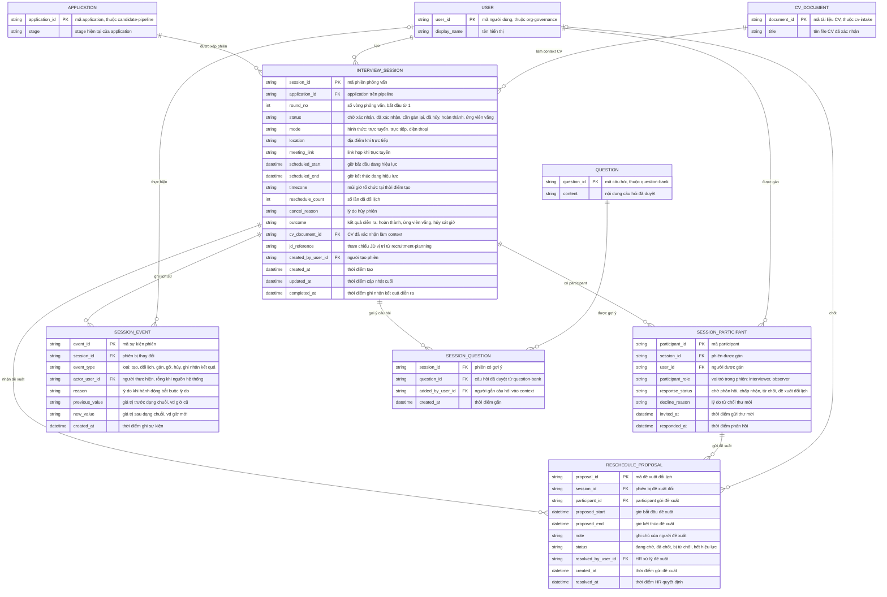

# interview-management — Entity Relationship Diagram

> Scope: phiên phỏng vấn của một application — lịch, participant và phản
> hồi, đề xuất đổi lịch, lịch sử thay đổi phiên và context tham chiếu (CV
> đã xác nhận, câu hỏi gợi ý). `APPLICATION`, `USER`, `QUESTION`,
> `CV_DOCUMENT` là tham chiếu tối thiểu sang feature khác
> (`candidate-pipeline`, `org-governance`, `question-bank`, `cv-intake`).

## Diagram

## Entity Reference

| Entity | Purpose | Key attributes |
|--------|---------|----------------|
| INTERVIEW_SESSION | Phiên phỏng vấn của một application — vòng đời chờ xác nhận → đã xác nhận → hoàn thành/vắng, hoặc cần gán lại/đã hủy | application_id, round_no, status, mode, scheduled_start, scheduled_end, outcome, reschedule_count |
| SESSION_PARTICIPANT | Interviewer/observer được gán vào phiên với trạng thái phản hồi riêng | participant_role, response_status, decline_reason, invited_at, responded_at |
| RESCHEDULE_PROPOSAL | Đề xuất đổi lịch của participant chờ HR chốt hoặc từ chối | proposed_start, proposed_end, status, resolved_by_user_id |
| SESSION_EVENT | Lịch sử mọi thay đổi phiên — audit trước → sau kèm actor và lý do | event_type, actor_user_id, reason, previous_value, new_value |
| SESSION_QUESTION | Junction phiên ↔ câu hỏi đã duyệt làm gợi ý context | session_id, question_id, added_by_user_id |
| APPLICATION | Application trên pipeline — tham chiếu tối thiểu từ `candidate-pipeline`, quyết định cho phép tạo phiên theo stage | application_id, stage |
| USER | Người dùng nội bộ — tham chiếu tối thiểu từ `org-governance` | user_id, display_name |
| QUESTION | Câu hỏi đã duyệt — tham chiếu tối thiểu từ `question-bank` | question_id, content |
| CV_DOCUMENT | CV đã xác nhận của ứng viên — tham chiếu tối thiểu từ `cv-intake` | document_id, title |

## Notes & Assumptions

- `INTERVIEW_SESSION.status` là state machine của phiên (xem spec Mục 5
  và brainstorm 6.3); `SESSION_PARTICIPANT.response_status` là state
  machine riêng của participant — đổi lịch phiên đưa toàn bộ participant
  về "chờ phản hồi" cho giờ mới.
- `SESSION_EVENT.actor_user_id` rỗng cho sự kiện nguồn hệ thống (vd hết
  hạn phản hồi, vô hiệu participant); `previous_value`/`new_value` giữ
  dạng chuỗi để chứa cặp giờ cũ → mới và các thay đổi khác.
- `jd_reference` là tham chiếu JD vị trí lấy qua application — giữ trên
  phiên để context không lệch khi JD đổi sau; entity JD đầy đủ thuộc
  `recruitment-planning`.
- `RESCHEDULE_PROPOSAL.status` "hết hiệu lực" áp khi phiên bị hủy hoặc
  đổi giờ trước khi đề xuất được xử lý (brainstorm Mục 6.4).
- `APPLICATION`, `USER`, `QUESTION`, `CV_DOCUMENT` chỉ khai tối thiểu
  phục vụ quan hệ — entity đầy đủ thuộc ERD của `candidate-pipeline`,
  `org-governance`, `question-bank`, `cv-intake`.
- Consent ghi âm và file recording không nằm trong ERD này — thuộc
  `interview-recording` (PRD Mục 7.24).
- Retention: phiên, participant và event giữ theo retention hồ sơ tuyển
  dụng chung; xóa/anonymize cùng application (PRD OQ-6 — chờ DPO).
