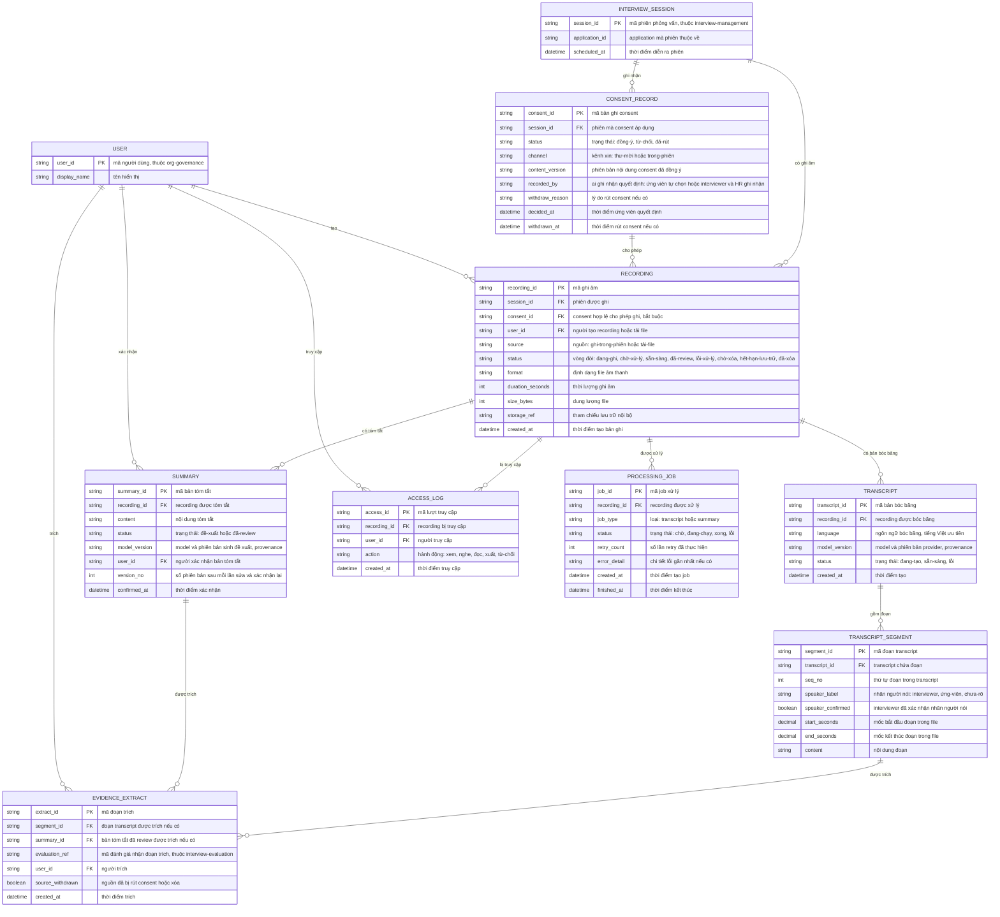

# interview-recording — Entity Relationship Diagram

> Scope: consent ghi âm theo session, recording và vòng đời xử lý,
> transcript có đoạn timestamp, summary đề xuất → đã review, đoạn trích
> evidence kèm nguồn, audit truy cập và job xử lý/retry.
> `INTERVIEW_SESSION` và `USER` là tham chiếu tối thiểu sang
> `interview-management` và `org-governance`.

## Diagram

## Entity Reference

| Entity | Purpose | Key attributes |
|--------|---------|----------------|
| INTERVIEW_SESSION | Phiên phỏng vấn — tham chiếu tối thiểu từ `interview-management` | session_id, application_id, scheduled_at |
| CONSENT_RECORD | Quyết định consent của ứng viên theo session — điều kiện cứng trước khi ghi | status, channel, content_version, decided_at, withdrawn_at |
| RECORDING | File âm thanh gắn session — luôn trỏ về consent hợp lệ; vòng đời tới chờ-xóa/đã-xóa | consent_id, source, status, duration_seconds, storage_ref |
| TRANSCRIPT | Bản bóc băng của recording — có provenance model | language, model_version, status |
| TRANSCRIPT_SEGMENT | Đoạn transcript có timestamp và nhãn người nói được xác nhận | seq_no, speaker_label, start_seconds, end_seconds, content |
| SUMMARY | Bản tóm tắt — đề xuất của AI chỉ thành evidence sau khi interviewer xác nhận | status, model_version, user_id, confirmed_at |
| EVIDENCE_EXTRACT | Đoạn đã trích vào đánh giá kèm liên kết nguồn — đánh dấu khi nguồn bị rút/xóa | segment_id, summary_id, evaluation_ref, source_withdrawn |
| ACCESS_LOG | Audit mọi lượt xem/nghe/đọc/xuất, kể cả lượt bị từ chối | action, user_id, created_at |
| PROCESSING_JOB | Job xử lý transcript/summary — retry có giới hạn, lỗi không mất file gốc | job_type, status, retry_count, error_detail |
| USER | Người dùng nội bộ (interviewer, HR, admin) — tham chiếu từ `org-governance` | user_id, display_name |

## Notes & Assumptions

- `RECORDING.consent_id` là NOT NULL về mặt contract: mọi recording phải trỏ
  về `CONSENT_RECORD` có `status = đồng-ý` tại thời điểm tạo — hiện thực
  BR-interview-recording-001 "không consent không ghi".
- `CONSENT_RECORD` là append-only theo thời gian: một session có thể có
  nhiều bản ghi (từ chối rồi đồng ý lại, đồng ý rồi rút); bản ghi mới nhất
  quyết định trạng thái hiện tại. `content_version` giữ phiên bản nội dung
  đã đồng ý — đổi nội dung consent không sửa bản ghi cũ.
- Khi consent bị rút, `RECORDING.status` chuyển `chờ-xóa` và mọi truy cập bị
  chặn; `EVIDENCE_EXTRACT.source_withdrawn = true` đánh dấu các đoạn đã
  trích — nội dung trích giữ nguyên trong evaluation kèm cờ (BR-interview-
  recording-005).
- `RECORDING.status` gộp cả vòng đời xử lý và retention (`hết-hạn-lưu-trữ`,
  `đã-xóa`): khi hết hạn theo policy, bản ghi chuyển lưu trữ nguội; `đã-xóa`
  chỉ còn metadata tối thiểu để audit, không còn nội dung truy cập được.
- `EVIDENCE_EXTRACT` trích từ `TRANSCRIPT_SEGMENT` (đoạn câu có timestamp)
  hoặc `SUMMARY` đã review — ít nhất một trong hai FK phải có; `evaluation_ref`
  là tham chiếu chuỗi sang `interview-evaluation`, không phải FK vật lý.
- `SUMMARY.version_no` tăng mỗi lần sửa và xác nhận lại; chỉ bản `đã-review`
  được trích làm evidence (human-in-the-loop).
- `PROCESSING_JOB` tách khỏi `RECORDING.status`: một recording có thể có
  nhiều job (transcript rồi summary, retry); lỗi job không làm mất file gốc.
- `ACCESS_LOG.action = từ-chối` ghi cả lượt truy cập bị chặn vì ngoài
  data-scope hoặc dữ liệu chờ xóa.
