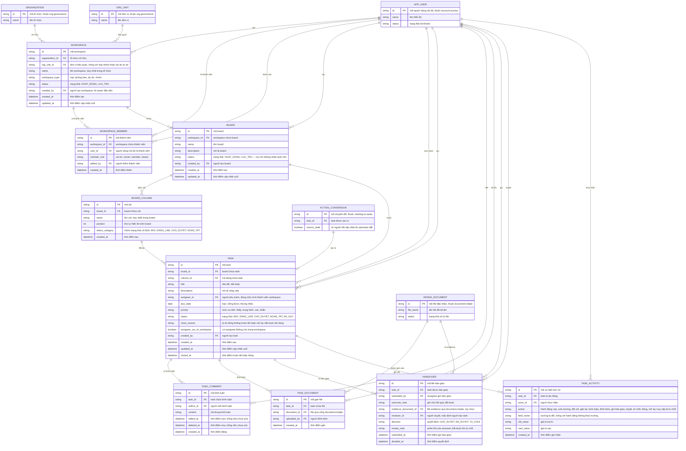

# kanban-workspaces — Entity Relationship Diagram

> Scope: workspace theo nhóm/phòng ban/dự án, board và cột Kanban, task có
> một assignee/hạn/ưu tiên/trạng thái, bình luận, file đính kèm, bàn giao
> có duyệt và lịch sử hoạt động (PRD Mục 7.16). `APP_USER` thuộc
> `account-access`; `ORGANIZATION`, `ORG_UNIT` thuộc `org-governance`;
> `INTAKE_DOCUMENT` thuộc `document-intake`; `ACTION_CONVERSION` thuộc
> `meeting-to-tasks` — chỉ khai tối thiểu để tham chiếu.

## Diagram

## Entity Reference

| Entity | Purpose | Key attributes |
|--------|---------|----------------|
| WORKSPACE | Không gian công việc theo nhóm/phòng ban/dự án — ranh giới quyền và gán đơn vị liên quan | organization_id, org_unit_id, name, workspace_type, status |
| WORKSPACE_MEMBER | Thành viên workspace với vai trò owner/member/viewer — quyền trên board và task đi qua đây | workspace_id, user_id, member_role |
| BOARD | Bảng Kanban trong workspace — lưu trữ không nhận task mới | workspace_id, name, status |
| BOARD_COLUMN | Cột trên board — mỗi cột gán đúng một trong 4 nhóm trạng thái cố định | board_id, name, position, status_category |
| TASK | Công việc trên board — một assignee, hạn, ưu tiên, trạng thái; cờ thiếu owner khi assignee rời workspace | board_id, column_id, title, assignee_id, due_date, priority, status, assignee_out_of_workspace |
| TASK_COMMENT | Bình luận trên task — giữ vết sửa/xóa | task_id, author_id, content, edited_at, deleted_at |
| TASK_DOCUMENT | Gán file đính kèm vào task qua `document-intake` | task_id, document_id, uploaded_by |
| HANDOVER | Một lần bàn giao — ghi chú kết quả bắt buộc, evidence tùy chọn, quyết định của reviewer | task_id, outcome_note, evidence_document_id, reviewer_id, decision, review_note |
| TASK_ACTIVITY | Lịch sử hoạt động trên task — ai, hành động, trường, trước → sau | task_id, actor_id, action, field_name, old_value, new_value |
| ORGANIZATION | Tổ chức sở hữu workspace — entity ngoài thuộc `org-governance` | id, name |
| ORG_UNIT | Đơn vị liên quan của workspace — entity ngoài thuộc `org-governance` | id, name |
| APP_USER | Người dùng nội bộ: thành viên, assignee, reviewer, actor — entity ngoài thuộc `account-access` | id, name, status |
| INTAKE_DOCUMENT | File đính kèm/evidence qua cổng tiếp nhận — entity ngoài thuộc `document-intake` | id, file_name, status |
| ACTION_CONVERSION | Bản ghi chuyển đổi đầu việc thành task — entity ngoài thuộc `meeting-to-tasks`, giữ link nguồn và cờ source_stale | id, task_id, source_stale |

## Notes & Assumptions

- `WORKSPACE`, `BOARD`, `TASK` giữ đúng tên entity như `meeting-to-tasks`
  đã tham chiếu (WORKSPACE{id,name}, BOARD{id,workspace_id,name},
  TASK{id,board_id,title,status}) — contract này không đổi, các thuộc tính
  ở đây là phần đầy đủ mà upstream khai tối thiểu.
- `ACTION_CONVERSION ||--o| TASK : "tạo ra"` lặp lại quan hệ upstream để
  thể hiện link nguồn hai chiều: `ACTION_CONVERSION.task_id` trỏ task ở
  đây; cờ `source_stale` do upstream đặt và feature này chỉ đọc để hiển
  thị "nguồn đã cập nhật" — không tự đồng bộ nội dung (BR-012).
- `TASK.status` là trạng thái sự thật; `BOARD_COLUMN.status_category` chỉ
  là cách nhìn: kéo task giữa cột mở đổi status theo nhóm cột, còn
  CHO_DUYET chỉ qua gửi bàn giao và HOAN_TAT chỉ qua duyệt — ràng buộc
  nghiệp vụ kiểm khi ghi, không thể hiện trên ERD (BR-001, BR-006).
- `TASK.assignee_id` trỏ `APP_USER` và phải là thành viên workspace còn
  hiệu lực; khi assignee bị gỡ, cờ `assignee_out_of_workspace` bật để task
  vào danh sách thiếu owner (BR-004, BR-005, FR-021).
- `HANDOVER.reviewer_id` mặc định là người tạo task; quản lý trong scope
  và workspace owner duyệt được — đề xuất chờ Product owner (OQ-1). Một
  task có nhiều HANDOVER theo thời gian (bàn giao lại sau từ chối), tối đa
  một HANDOVER CHO_DUYET tại một thời điểm.
- `HANDOVER.evidence_document_id` trỏ `INTAKE_DOCUMENT` — một file intake
  có thể là evidence của nhiều lần bàn giao và đính kèm của nhiều task.
- `TASK_COMMENT.edited_at/deleted_at` giữ vết mềm: sửa trong 15 phút hiển
  thị "đã sửa", xóa hiển thị "bình luận đã xóa" — bản ghi không mất hẳn
  (BR-010).
- `TASK_ACTIVITY` là vết nghiệp vụ gắn task; audit truy cập bị từ chối và
  sự kiện về quyền cũng ghi `AUDIT_EVENT` của `org-governance`.
- `WORKSPACE_MEMBER` là junction workspace–người dùng mang `member_role`;
  một người chỉ một vai trò trong một workspace.
- Retention task/comment/đính kèm/lịch sử theo vòng đời workspace và chính
  sách DPO — chờ OQ-6 PRD (spec OQ-7); ERD chưa mô hình thuộc tính
  retention.
