# Báo cáo quản trị theo phạm vi quyền — Entity Relationship Diagram

> Scope: các bản ghi tổng hợp, cảnh báo, export và AI summary của
> management-reporting. `ORG_UNIT` và `USER_ACCOUNT` là entity neo thuộc
> `org-governance`/`account-access` — chỉ tham chiếu, không sở hữu.

## Diagram

```mermaid
erDiagram
    ORG_UNIT ||--o{ KPI_MEASUREMENT : "tổng hợp theo đơn vị"
    ORG_UNIT ||--o{ REPORT_ALERT : "phát sinh cảnh báo"
    ORG_UNIT ||--o{ ALERT_THRESHOLD : "cấu hình ngưỡng"
    ORG_UNIT ||--o{ REPORT_EXPORT : "phạm vi xuất"
    ORG_UNIT ||--o{ AI_SUMMARY : "phạm vi tóm tắt"
    ORG_UNIT ||--o{ SCHEDULED_REPORT : "đặt lịch gửi"
    USER_ACCOUNT ||--o{ ALERT_ACTION : "thực hiện action"
    USER_ACCOUNT ||--o{ REPORT_EXPORT : "yêu cầu xuất"
    USER_ACCOUNT ||--o{ AI_SUMMARY : "yêu cầu tóm tắt"
    USER_ACCOUNT ||--o{ AI_SUMMARY_ITEM : "xác nhận đề xuất"
    USER_ACCOUNT ||--o{ ALERT_THRESHOLD : "điều chỉnh ngưỡng"
    USER_ACCOUNT ||--o{ SAVED_REPORT_VIEW : "lưu khung báo cáo"
    USER_ACCOUNT ||--o{ SCHEDULED_REPORT : "tạo lịch gửi"
    REPORT_ALERT ||--o{ ALERT_ACTION : "ghi nhận xử lý"
    AI_SUMMARY ||--o{ AI_SUMMARY_ITEM : "gồm các nhận định"

    ORG_UNIT {
        string id PK "định danh đơn vị tổ chức"
        string name "tên đơn vị"
    }
    USER_ACCOUNT {
        string id PK "định danh người dùng nội bộ"
        string display_name "tên hiển thị"
    }
    KPI_MEASUREMENT {
        string id PK "định danh số liệu tổng hợp"
        string org_unit_id FK "đơn vị được tổng hợp"
        string metric_code "mã chỉ số KPI nghiệp vụ"
        string period_type "loại kỳ báo cáo"
        date period_start "ngày bắt đầu kỳ"
        date period_end "ngày kết thúc kỳ"
        decimal value "giá trị tổng hợp"
        int group_size "kích thước nhóm phục vụ ngưỡng ẩn"
        boolean is_hidden "số liệu bị ẩn vì nhóm dưới ngưỡng"
        datetime computed_at "mốc dữ liệu được tính đến"
    }
    REPORT_ALERT {
        string id PK "định danh cảnh báo"
        string org_unit_id FK "đơn vị phát sinh cảnh báo"
        string source_type "loại entity nguồn"
        string source_id "tham chiếu entity nguồn vượt ngưỡng"
        string alert_type "loại cảnh báo"
        decimal threshold_value "ngưỡng đã bị vi phạm"
        string status "trạng thái vòng đời cảnh báo"
        string close_reason "lý do đóng hoặc tự hết"
        datetime snooze_until "mốc hết tạm hoãn"
        datetime created_at "thời điểm tạo cảnh báo"
        datetime resolved_at "thời điểm đóng hoặc tự hết"
    }
    ALERT_ACTION {
        string id PK "định danh action trên cảnh báo"
        string alert_id FK "cảnh báo được xử lý"
        string actor_id FK "người thực hiện action"
        string action_type "loại action xử lý"
        string reason "lý do kèm action"
        datetime created_at "thời điểm ghi nhận"
    }
    ALERT_THRESHOLD {
        string id PK "định danh cấu hình ngưỡng"
        string org_unit_id FK "đơn vị áp dụng; trống nghĩa là mặc định"
        string alert_type "loại cảnh báo được đặt ngưỡng"
        decimal threshold_value "giá trị ngưỡng"
        string threshold_unit "đơn vị ngưỡng theo ngày hoặc giờ"
        boolean is_default "ngưỡng mặc định toàn hệ thống"
        string updated_by FK "người điều chỉnh ngưỡng gần nhất"
        datetime updated_at "thời điểm điều chỉnh"
    }
    REPORT_EXPORT {
        string id PK "định danh lượt xuất báo cáo"
        string exported_by FK "người yêu cầu xuất"
        string org_unit_id FK "phạm vi dữ liệu đã xuất"
        string period_label "kỳ báo cáo đã chọn"
        string format "định dạng file xuất"
        int row_count "số dòng dữ liệu trong file"
        string status "trạng thái file export"
        datetime created_at "thời điểm tạo file"
        datetime expires_at "hạn tải trước khi tự xóa"
    }
    AI_SUMMARY {
        string id PK "định danh lượt tóm tắt AI"
        string requested_by FK "người yêu cầu tóm tắt"
        string org_unit_id FK "phạm vi dữ liệu đã tóm tắt"
        string period_label "kỳ báo cáo được tóm tắt"
        datetime generated_at "thời điểm sinh tóm tắt"
    }
    AI_SUMMARY_ITEM {
        string id PK "định danh nhận định trong tóm tắt"
        string summary_id FK "lượt tóm tắt chứa nhận định"
        string finding "nội dung nhận định AI đề xuất"
        string evidence_ref "liên kết evidence nguồn của nhận định"
        string suggested_action "hành động AI đề xuất xử lý"
        string decision "quyết định của người xem trên đề xuất"
        string decided_by FK "người xác nhận hoặc bỏ qua đề xuất"
        datetime decided_at "thời điểm quyết định"
    }
    SAVED_REPORT_VIEW {
        string id PK "định danh khung báo cáo cá nhân"
        string owner_id FK "người xem sở hữu khung"
        string name "tên khung báo cáo"
        string filter_definition "bộ lọc đã lưu dạng mô tả"
        datetime created_at "thời điểm lưu khung"
    }
    SCHEDULED_REPORT {
        string id PK "định danh lịch gửi báo cáo định kỳ"
        string org_unit_id FK "phạm vi dữ liệu của báo cáo"
        string created_by FK "người tạo lịch gửi"
        string frequency "tần suất gửi báo cáo"
        string recipient_scope "quy tắc chọn người nhận theo scope"
        datetime last_sent_at "lần gửi gần nhất"
    }
```

## Entity Reference

| Entity | Purpose | Key attributes |
|--------|---------|----------------|
| KPI_MEASUREMENT | Số liệu tổng hợp một chỉ số trên một đơn vị theo kỳ | metric_code, period_start/end, value, group_size, is_hidden, computed_at |
| REPORT_ALERT | Cảnh báo quá hạn/rủi ro với vòng đời đầy đủ | source_type/source_id, alert_type, threshold_value, status, close_reason, snooze_until |
| ALERT_ACTION | Audit trail action trên cảnh báo | alert_id, actor_id, action_type, reason |
| ALERT_THRESHOLD | Ngưỡng cảnh báo theo loại và đơn vị | alert_type, threshold_value/unit, is_default, updated_by |
| REPORT_EXPORT | Lượt export có audit và hạn file | exported_by, org_unit_id, format, row_count, expires_at |
| AI_SUMMARY | Lượt tóm tắt AI trên một scope/kỳ | requested_by, org_unit_id, period_label, generated_at |
| AI_SUMMARY_ITEM | Nhận định đề xuất kèm evidence và quyết định người xem | finding, evidence_ref, suggested_action, decision, decided_by |
| SAVED_REPORT_VIEW | Khung báo cáo/bộ lọc cá nhân đã lưu | owner_id, name, filter_definition |
| SCHEDULED_REPORT | Lịch gửi báo cáo định kỳ qua email (P1) | org_unit_id, frequency, recipient_scope, last_sent_at |
| ORG_UNIT | Đơn vị tổ chức — entity neo ngoài feature (org-governance) | id, name |
| USER_ACCOUNT | Người dùng nội bộ — entity neo ngoài feature (account-access) | id, display_name |

## Notes & Assumptions

- `REPORT_ALERT.source_id` là tham chiếu logic tới entity nguồn
  (application/task/bài đánh giá) — không phải FK vật lý vì entity nguồn
  thuộc nhiều module khác nhau; quyền xem entity kiểm tra ở tầng entity.
- `ALERT_THRESHOLD.org_unit_id` trống nghĩa là ngưỡng mặc định toàn hệ
  thống; ngưỡng theo đơn vị ghi đè mặc định.
- `AI_SUMMARY_ITEM.decision` ghi nhận confirm/bỏ qua của con người trên
  từng đề xuất — bảo đảm invariant AI không tự thực thi action.
- `REPORT_EXPORT.expires_at` phục vụ tự xóa file sau retention (đề xuất
  30 ngày — OQ-7); audit lượt export giữ độc lập với vòng đời file.
- Ngưỡng nhóm tối thiểu ẩn số liệu không là thuộc tính entity — là rule
  vận hành (đề xuất 5 — OQ-3); `group_size`/`is_hidden` lưu kết quả áp
  dụng để truy vết.
- Nhận ký của `SCHEDULED_REPORT` ở dạng quy tắc scope thay vì danh sách
  cứng — mỗi lần gửi resolve người nhận theo scope hiện tại (OQ-8).
