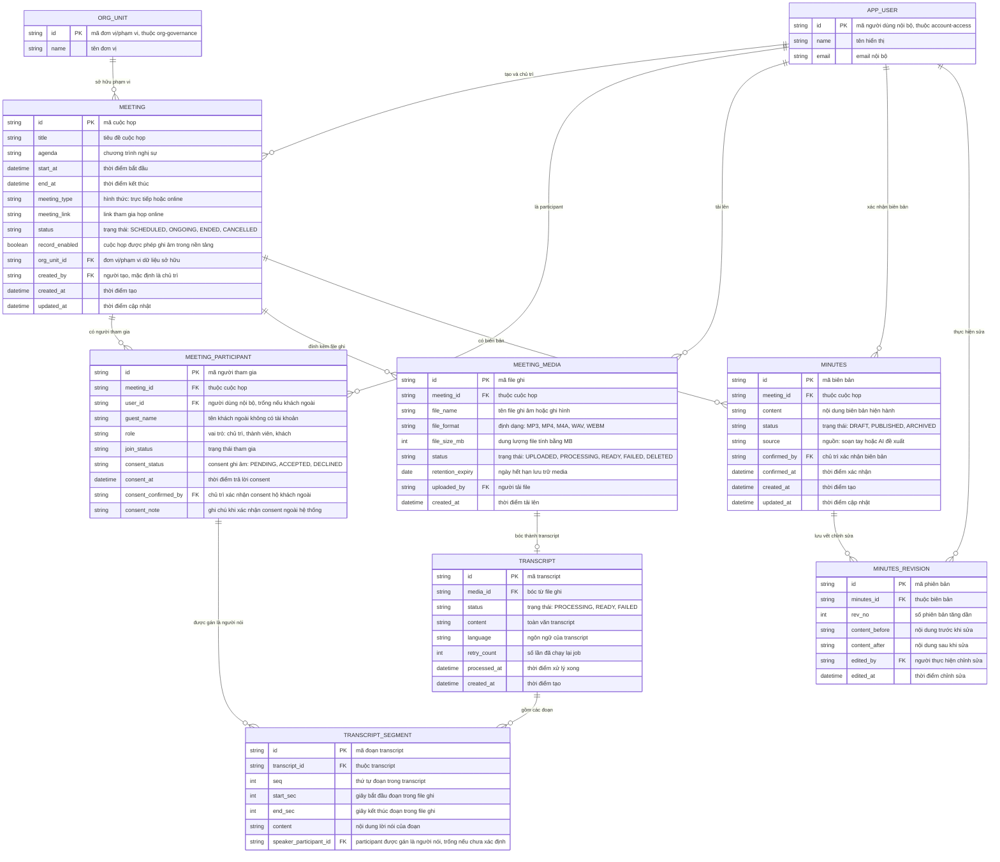

# meeting-records — Entity Relationship Diagram

> Scope: meeting record, participants + consent, file ghi, transcript,
> biên bản và revision trong đúng phạm vi quyền (PRD Mục 7.13).

## Diagram

## Entity Reference

| Entity | Purpose | Key attributes |
|--------|---------|----------------|
| MEETING | Cuộc họp nội bộ — nguồn dữ liệu duy nhất để chốt kết quả | title, start_at/end_at, status, org_unit_id |
| MEETING_PARTICIPANT | Người tham gia cuộc họp và consent ghi âm từng người | meeting_id, user_id/guest_name, role, consent_status |
| MEETING_MEDIA | File ghi âm/ghi hình đính kèm cuộc họp | meeting_id, file_name, status, retention_expiry |
| TRANSCRIPT | Transcript được bóc từ một file ghi | media_id, status, retry_count |
| TRANSCRIPT_SEGMENT | Đoạn transcript có nhãn người nói sửa được | transcript_id, seq, speaker_participant_id |
| MINUTES | Biên bản cuộc họp — phải được chủ trì xác nhận | meeting_id, status, source, confirmed_by |
| MINUTES_REVISION | Lịch sử chỉnh sửa biên bản, không ghi đè | minutes_id, rev_no, content_before/after |
| APP_USER | Người dùng nội bộ — entity ngoài feature (account-access) | id, name, email |
| ORG_UNIT | Đơn vị/phạm vi dữ liệu — entity ngoài feature (org-governance) | id, name |

## Notes & Assumptions

- APP_USER và ORG_UNIT chỉ khai tối thiểu để tham chiếu khóa ngoại; model đầy
  đủ thuộc `account-access` và `org-governance`.
- Consent ghi âm nằm trên MEETING_PARTICIPANT (mỗi người một trạng thái);
  khách ngoài không có user_id thì chủ trì xác nhận hộ qua
  consent_confirmed_by + consent_note (BR-004).
- Một cuộc họp có thể có nhiều MINUTES theo thời gian (bản mới thay thế, giữ
  revision); chỉ một MINUTES ở trạng thái PUBLISHED tại một thời điểm —
  ràng buộc nghiệp vụ, không thể hiện trên ERD.
- speaker_participant_id trống = đoạn "chưa xác định người nói" (BR-008).
- retention_expiry trên MEETING_MEDIA điều khiển xóa media; TRANSCRIPT và
  MINUTES giữ theo chính sách hồ sơ riêng (OQ-1 spec).
- Audit truy cập/xóa media và tranh chấp consent nằm ở audit log của
  `org-governance`, không tạo entity riêng trong feature này.
