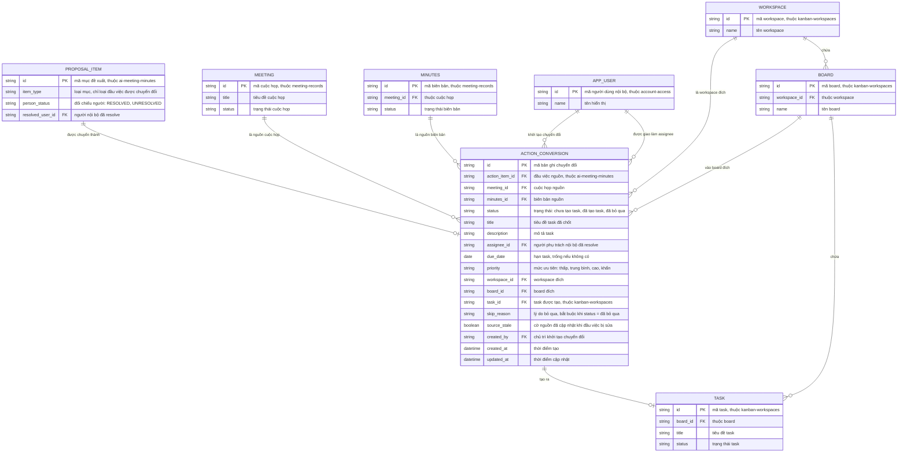

# meeting-to-tasks — Entity Relationship Diagram

> Scope: bản ghi chuyển đổi đầu việc đã xác nhận thành task có owner, hạn,
> ưu tiên và link nguồn (PRD Mục 7.15). `PROPOSAL_ITEM` thuộc
> `ai-meeting-minutes`; `MINUTES`, `MEETING` thuộc `meeting-records`;
> `WORKSPACE`, `BOARD`, `TASK` thuộc `kanban-workspaces`; `APP_USER` thuộc
> `account-access` — chỉ khai tối thiểu để tham chiếu.

## Diagram

## Entity Reference

| Entity | Purpose | Key attributes |
|--------|---------|----------------|
| ACTION_CONVERSION | Bản ghi chuyển đổi một đầu việc thành task — trạng thái, nội dung đã chốt, đích, link nguồn và task được tạo | action_item_id, status, assignee_id, due_date, priority, workspace_id, board_id, task_id, source_stale |
| PROPOSAL_ITEM | Đầu việc nguồn đã xác nhận — entity của `ai-meeting-minutes`, chỉ loại "đầu việc" được chuyển đổi | item_type, person_status, resolved_user_id |
| MEETING | Cuộc họp nguồn của link truy nguyên — entity của `meeting-records` | id, title, status |
| MINUTES | Biên bản nguồn PUBLISHED — entity của `meeting-records` | id, meeting_id, status |
| WORKSPACE | Workspace đích do chủ trì chọn — entity của `kanban-workspaces` | id, name |
| BOARD | Board đích chứa task — entity của `kanban-workspaces` | id, workspace_id, name |
| TASK | Task được tạo trên board — entity của `kanban-workspaces`, vòng đời do feature đó quản lý | id, board_id, title, status |
| APP_USER | Người dùng nội bộ: chủ trì khởi tạo và assignee — entity của `account-access` | id, name |

## Notes & Assumptions

- Một đầu việc có tối đa 1 ACTION_CONVERSION (quan hệ `||--o|`): trạng thái
  chuyển đổi (chưa tạo/đã tạo/bỏ qua) nằm trên một bản ghi duy nhất; khi task
  nguồn bị xóa, bản ghi quay về "chưa tạo task" và `task_id` trống để cho
  tạo lại — lịch sử các lần tạo nằm ở audit log, không tách entity.
- `meeting_id` + `minutes_id` được giữ trực tiếp trên ACTION_CONVERSION để
  link nguồn hai chiều không phụ thuộc truy vấn dây chuyền — đây là chốt
  chống rủi ro "task mất liên kết biên bản" của PRD Mục 7.15 (BR-009).
- `assignee_id` chỉ trỏ APP_USER — khách ngoài (participant không tài khoản)
  không thể làm assignee task; đầu việc đó chuyển "đã bỏ qua" kèm lý do
  (BR-002, FR-012).
- `source_stale` bật khi đầu việc nguồn bị sửa trong revision biên bản sau
  khi task tạo; cờ chỉ tắt khi có người xác nhận đã đối chiếu — không
  auto-sync nội dung (BR-005, bám PRD OQ-9).
- `skip_reason` bắt buộc khi `status = đã bỏ qua` (BR-008).
- Quan hệ `WORKSPACE ||--o{ BOARD ||--o{ TASK` khai tối thiểu để đủ ngữ cảnh
  đích; model đầy đủ (column, comment, handover) thuộc ERD của
  `kanban-workspaces`.
- Điều kiện "chỉ đầu việc của biên bản PUBLISHED" và "tối đa 1 task còn hiệu
  lực mỗi đầu việc" là ràng buộc nghiệp vụ kiểm khi tạo, không thể hiện trên
  ERD.
