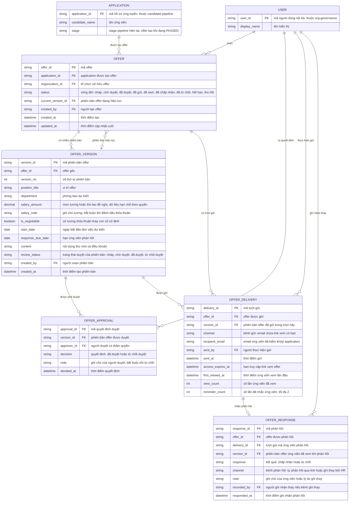

# offer-management — Entity Relationship Diagram

> Scope: vòng đời offer của một tổ chức — offer, phiên bản nội dung, quyết
> định phê duyệt, lượt gửi (delivery) và phản hồi ứng viên. `APPLICATION`
> là tham chiếu tối thiểu sang `candidate-pipeline`; `USER` là tham chiếu
> sang `org-governance`.

## Diagram

## Entity Reference

| Entity | Purpose | Key attributes |
|--------|---------|----------------|
| OFFER | Một đề nghị tuyển dụng cho một application — định danh, vòng đời, phiên bản hiệu lực, provenance | application_id, status, current_version_id, organization_id |
| OFFER_VERSION | Snapshot nội dung offer của một phiên bản — điều khoản bất biến sau khi gửi | version_no, position_title, salary_amount, start_date, response_due_date, content, review_status |
| OFFER_APPROVAL | Quyết định duyệt/từ chối duyệt của người có thẩm quyền trên một phiên bản | approver_id, decision, note, decided_at |
| OFFER_DELIVERY | Một lần gửi phiên bản cho ứng viên — kênh, người nhận, hạn link và dấu vết xem | channel, recipient_email, sent_at, access_expires_at, first_viewed_at, view_count, reminder_count |
| OFFER_RESPONSE | Phản hồi chấp nhận/từ chối của ứng viên — một lần duy nhất trên mỗi lượt gửi | response, channel, version_id, recorded_by, responded_at |
| APPLICATION | Hồ sơ ứng tuyển nguồn của offer — tham chiếu tối thiểu từ `candidate-pipeline` | application_id, candidate_name, stage |
| USER | Người dùng nội bộ (HR, người duyệt) — tham chiếu tối thiểu từ `org-governance` | user_id, display_name |

## Notes & Assumptions

- `OFFER.status` là vòng đời nghiệp vụ của cả offer; `OFFER_VERSION.
  review_status` theo dõi duyệt của từng phiên bản vì sửa sau gửi tạo phiên
  bản mới chờ duyệt trong khi bản đã gửi vẫn hiệu lực — cùng mô hình hai
  trục trạng thái của `question-bank`.
- `OFFER.current_version_id` trỏ phiên bản mới nhất; khi phiên bản mới được
  gửi (một `OFFER_DELIVERY` mới), link của lượt gửi cũ vô hiệu — ứng viên chỉ
  thấy phiên bản của lượt gửi còn hạn.
- `OFFER_VERSION.salary_amount` + `content` là vùng dữ liệu hạn chế
  (NFR-offer-management-002): chỉ HR trong scope, người duyệt và đúng ứng
  viên của offer đó truy cập.
- `OFFER_RESPONSE` tối đa 1 trên mỗi `OFFER_DELIVERY` và chỉ ghi một lần —
  phản hồi đầu tiên là hiệu lực (BR-offer-management-005); `recorded_by` rỗng
  khi ứng viên tự phản hồi.
- `APPLICATION`/`USER` là entity của feature khác (`candidate-pipeline`,
  `org-governance`) — chỉ khai tối thiểu để tham chiếu, không sao chép đầy
  đủ. Transition `OFFERED`/`ACCEPTED`/`OFFER_REJECTED` trên `APPLICATION.
  stage` do `candidate-pipeline` thực hiện qua state machine của nó, không
  nằm trong schema này.
- Ứng viên không có `USER` — định danh của họ nằm ở `APPLICATION` và
  `OFFER_DELIVERY.recipient_email`; truy cập qua link có `access_expires_at`.
