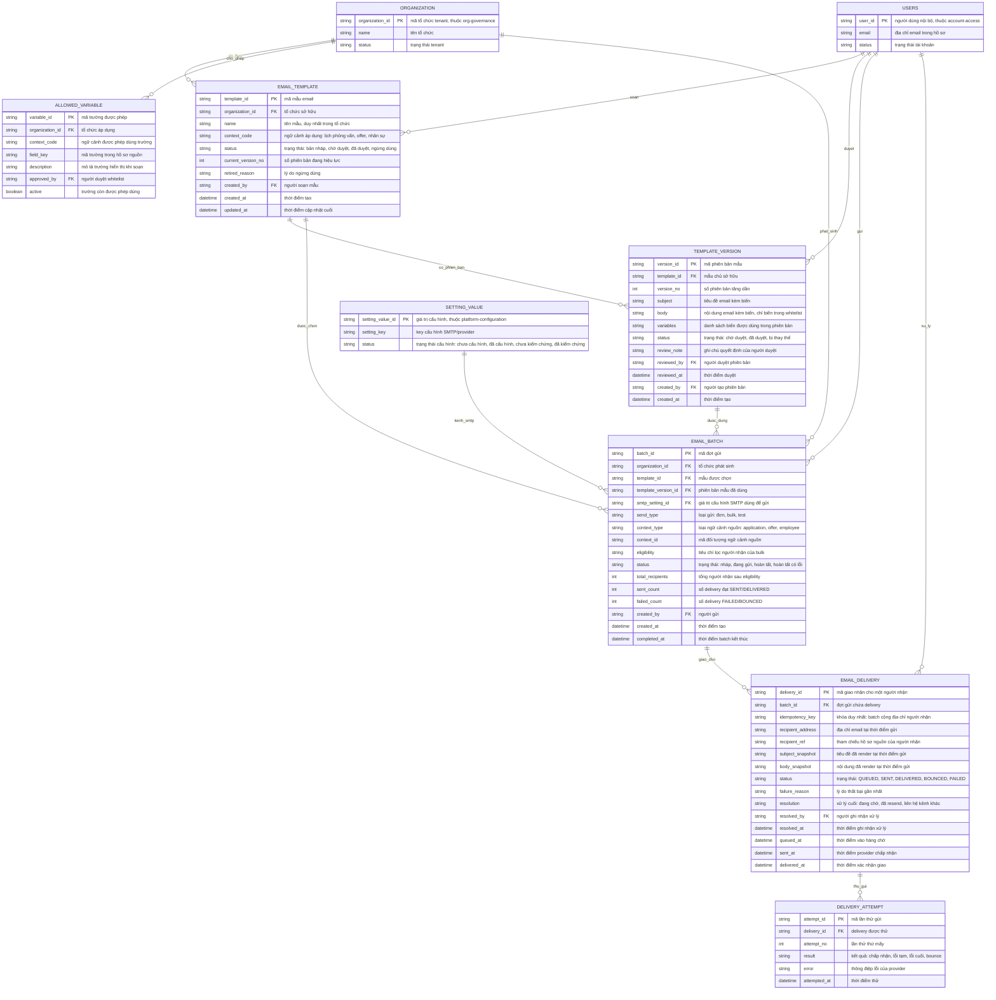

# operational-email — Entity Relationship Diagram

> Scope: dữ liệu email nghiệp vụ — mẫu và phiên bản mẫu có duyệt, whitelist
> biến, đợt gửi, giao nhận từng người nhận và lần thử gửi. `SETTING_VALUE`
> (giá trị SMTP) thuộc `platform-configuration`, `USERS` thuộc
> `account-access`, `ORGANIZATION` thuộc `org-governance`.

## Diagram

## Entity Reference

| Entity | Purpose | Key attributes |
|--------|---------|----------------|
| EMAIL_TEMPLATE | Mẫu email của tổ chức theo ngữ cảnh — state machine bản nháp → chờ duyệt → đã duyệt → ngừng dùng | name, context_code, status, current_version_no |
| TEMPLATE_VERSION | Snapshot tiêu đề/nội dung/biến của một phiên bản mẫu — sửa lớn tạo phiên bản mới qua duyệt | template_id, version_no, subject, body, variables, reviewed_by |
| ALLOWED_VARIABLE | Whitelist trường được phép làm biến theo ngữ cảnh — nền của minimal payload (R-08) | context_code, field_key, approved_by, active |
| EMAIL_BATCH | Một đợt gửi (đơn/bulk/test): mẫu + phiên bản, ngữ cảnh nguồn, eligibility, tổng kết | send_type, context_type + context_id, eligibility, status, counters |
| EMAIL_DELIVERY | Một người nhận trong batch — khóa idempotent, snapshot nội dung, trạng thái giao nhận và vết xử lý | idempotency_key, recipient_address, status, failure_reason, resolution |
| DELIVERY_ATTEMPT | Từng lần thử gửi theo lịch retry 5p/30p/2h | delivery_id, attempt_no, result, error |
| SETTING_VALUE | Giá trị cấu hình SMTP/provider hiệu lực — entity ngoài do `platform-configuration` sở hữu, chỉ tham chiếu | setting_value_id, setting_key, status |
| USERS | Người soạn/duyệt/gửi/xử lý — entity ngoài do `account-access` sở hữu | user_id, email, status |
| ORGANIZATION | Tenant sở hữu mẫu/whitelist/batch — entity ngoài do `org-governance` sở hữu | organization_id, name, status |

## Notes & Assumptions

- `EMAIL_BATCH` giữ cả `template_id` và `template_version_id`: delivery log
  truy vết được đúng phiên bản đã gửi (BR-operational-email-012), còn lọc
  theo mẫu không cần dựng lại qua phiên bản.
- `EMAIL_DELIVERY.idempotency_key` = batch + địa chỉ người nhận — bảo đảm
  bấm gửi hai lần, retry hoặc resend không tạo email trùng; địa chỉ trùng
  trong một batch gộp một delivery (FR-operational-email-013).
- `EMAIL_DELIVERY.status` theo state machine: QUEUED → SENT → DELIVERED;
  QUEUED/SENT → BOUNCED khi provider báo bounce; QUEUED → FAILED khi hết
  retry; FAILED → QUEUED khi resend (brainstorm Mục 6.3).
- `EMAIL_DELIVERY.recipient_address` và snapshot giữ giá trị tại thời điểm
  gửi — hồ sơ người nhận đổi sau đó không ảnh hưởng vết đã gửi; resend sau
  khi sửa hồ sơ tạo attempt mới với địa chỉ mới.
- `EMAIL_DELIVERY.resolution` ghi nhận đóng vết xử lý thủ công: resend hoặc
  "đã liên hệ kênh khác" kèm `resolved_by`/`resolved_at` (FR-operational-
  email-015).
- `smtp_setting_id` trỏ `SETTING_VALUE` của `platform-configuration`: giá
  trị SMTP là nguồn duy nhất nằm trong catalog đó; entity khai tối thiểu để
  thể hiện quan hệ (đề xuất — OQ-9 URD/spec chờ Operations owner).
- `recipient_ref` là tham chiếu logic tới hồ sơ nguồn (user, application
  hoặc employee theo `context_type`) — không phải FK vật lý vì đa hình.
- `ALLOWED_VARIABLE` là whitelist do owner nghiệp vụ + DPO duyệt; trường
  nhạy cảm (lương, điểm đánh giá, giấy tờ tùy thân) không bao giờ có bản
  ghi active — ràng buộc chặn ở tầng nghiệp vụ.
- `USERS`, `ORGANIZATION`, `SETTING_VALUE` là entity ngoài khai tối thiểu;
  định nghĩa đầy đủ thuộc `account-access`, `org-governance` và
  `platform-configuration`.
- Retention `EMAIL_DELIVERY`/snapshot và `DELIVERY_ATTEMPT` chờ DPO (OQ-6
  PRD): đề xuất log theo audit policy, snapshot nội dung tối thiểu.
