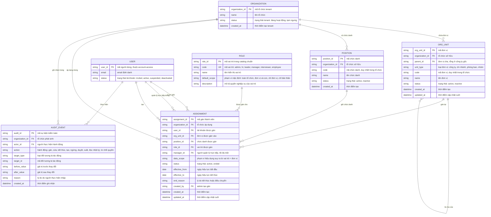

# org-governance — Entity Relationship Diagram

> Scope: cơ cấu tổ chức và quyền của một tenant — cây đơn vị, chức danh,
> catalog vai trò, gán thành viên kèm phạm vi và nhật ký kiểm toán.
> `ORGANIZATION`, `ORG_UNIT`, `ROLE`, `ASSIGNMENT`, `AUDIT_EVENT` là entity
> nền được các feature khác tham chiếu; `USER` là tham chiếu sang
> `account-access`.

## Diagram

## Entity Reference

| Entity | Purpose | Key attributes |
|--------|---------|----------------|
| ORGANIZATION | Tenant khách hàng B2B — gốc của cơ cấu, gán và nhật ký | name, status |
| ORG_UNIT | Cây đơn vị (công ty gốc → chi nhánh → phòng ban → nhóm, ≤5 cấp) — mọi module lọc phạm vi theo cây này | parent_id (self-ref), unit_type, code, status |
| POSITION | Chức danh của tổ chức, dùng khi gán thành viên | code, name, status |
| ROLE | Catalog 6 vai trò chuẩn của sản phẩm (mức hệ thống, không theo tenant) — các feature khác tham chiếu `role_id`/`code` | code, name, default_scope |
| ASSIGNMENT | Liên kết người dùng ↔ đơn vị + chức danh + vai trò + quản lý; mang phạm vi hiệu dụng — các feature khác tham chiếu khi cần biết người thuộc đơn vị/vai trò nào | user_id, org_unit_id, role_id, manager_id, data_scope, status, effective_from/to |
| AUDIT_EVENT | Nhật ký kiểm toán append-only cho hành động quan trọng và lượt từ chối quyền | actor_id, action, target_type/target_id, before/after_value, reason |
| USER | Tài khoản nội bộ — entity ngoài do `account-access` sở hữu, chỉ tham chiếu | user_id, email, status |

## Notes & Assumptions

- `ORG_UNIT.parent_id` là tham chiếu tự (self-ref "là cha của"): rỗng ở
  công ty gốc; chu trình và độ sâu >5 bị chặn ở tầng nghiệp vụ
  (BR-org-governance-003).
- `ROLE` là catalog chuẩn mức sản phẩm — không có `organization_id` vì vai
  trò không thuộc tenant riêng; admin không tạo vai trò trong v1
  (FR-org-governance-004).
- `ASSIGNMENT.manager_id` tham chiếu `USER` (quan hệ "quản lý trực tiếp
  trong"); `ASSIGNMENT.created_by` tham chiếu `USER` (quan hệ "tạo") —
  hai quan hệ cùng trỏ `USER` với vai trò khác nhau.
- `ASSIGNMENT.data_scope` là giá trị suy ra từ `ROLE.default_scope` + đơn
  vị được gán, lưu lại để truy vết phạm vi tại thời điểm gán; khi người
  dùng có nhiều gán ACTIVE (≤5), phạm vi hiệu dụng = hợp nhất rộng nhất.
- `AUDIT_EVENT` là nhật ký quản trị tập trung: actor/action/target/trước-
  sau/lý do/thời điểm; append-only, giữ tối thiểu 12 tháng (OQ-3). Các
  module nghiệp vụ có thể ghi sự kiện quan trọng của họ vào đây hoặc giữ
  audit riêng gắn entity (vd `INTAKE_AUDIT_EVENT` của document-intake) —
  nhật ký này chuẩn cho action về quyền, cơ cấu và lượt từ chối quyền.
- `AUDIT_EVENT.target_id` là tham chiếu logic tới đối tượng bị tác động
  (đa hình theo `target_type`), không phải FK DB.
- `ORGANIZATION` được tạo ở bước tenant provisioning ngoài giao diện admin
  thường; ERD mô hình nó làm gốc để các feature khác có điểm neo tham
  chiếu `organization_id`.
- Retention `AUDIT_EVENT` (≥12 tháng, không redact) là đề xuất chờ DPO —
  liên quan OQ-6 PRD.
