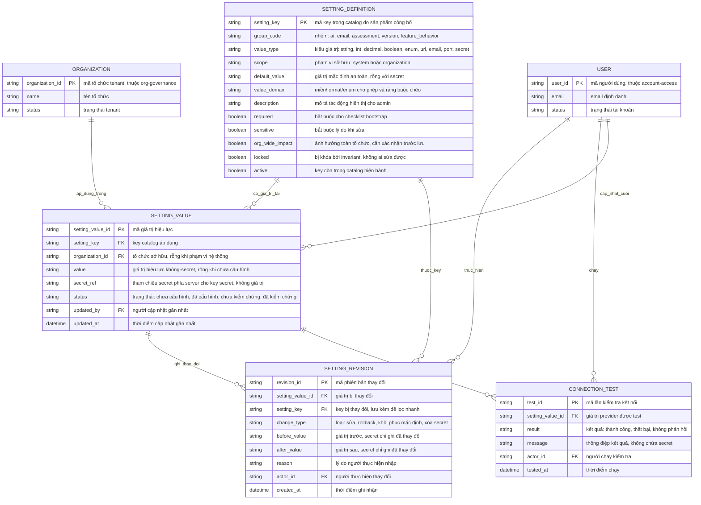

# platform-configuration — Entity Relationship Diagram

> Scope: dữ liệu cấu hình nền tảng — catalog key do sản phẩm công bố, giá trị
> hiệu lực theo phạm vi (hệ thống/tổ chức), lịch sử thay đổi và kết quả test
> connection append-only. Secret chỉ là tham chiếu trạng thái, không giữ giá
> trị. `ORGANIZATION` thuộc `org-governance`, `USER` thuộc `account-access`.

## Diagram

## Entity Reference

| Entity | Purpose | Key attributes |
|--------|---------|----------------|
| SETTING_DEFINITION | Một key trong catalog do sản phẩm công bố — định nghĩa kiểu, miền, phạm vi, mặc định an toàn và các cờ điều khiển | setting_key, group_code, value_type, scope, default_value, required/sensitive/locked |
| SETTING_VALUE | Giá trị hiệu lực của một key tại một phạm vi — một dòng duy nhất cho mỗi (setting_key, phạm vi) | setting_key + organization_id, value, secret_ref, status |
| SETTING_REVISION | Vết thay đổi append-only của một giá trị — trước/sau, ai, lý do, loại thay đổi | setting_value_id, change_type, before/after_value, actor_id, reason |
| CONNECTION_TEST | Vết kiểm tra kết nối append-only của provider setting — thành công/thất bại không chứa secret | setting_value_id, result, message, actor_id |
| ORGANIZATION | Tenant sở hữu giá trị phạm vi tổ chức — entity ngoài do `org-governance` sở hữu, chỉ tham chiếu | organization_id, name, status |
| USER | Admin/vận hành nền tảng thực hiện thay đổi và test — entity ngoài do `account-access` sở hữu, chỉ tham chiếu | user_id, email, status |

## Notes & Assumptions

- `SETTING_VALUE` là khóa nghiệp vụ (setting_key + phạm vi): phạm vi hệ thống
  có `organization_id` rỗng, phạm vi tổ chức trỏ `ORGANIZATION`. Mỗi cặp chỉ
  có đúng một dòng giá trị hiệu lực.
- Với key `value_type = secret`, `SETTING_VALUE.value` luôn rỗng; giá trị
  thật chỉ tồn tại phía server qua `secret_ref` — entity này không bao giờ
  chứa credential (PRD Mục 9; reverse spec FR-PL-04). `SETTING_REVISION`
  trên key secret chỉ ghi "đã thay đổi secret" thay vì trước/sau.
- `SETTING_VALUE.status` là state machine: chưa-cấu-hình → đã-cấu-hình →
  đã-kiểm-chứng, và đã-cấu-hình/đã-kiểm-chứng → chưa-kiểm-chứng khi đổi giá
  trị provider hoặc test lỗi (brainstorm Mục 6.3).
- `SETTING_REVISION` và `CONNECTION_TEST` là append-only: không sửa/xóa
  (BR-platform-configuration-007); rollback và khôi phục mặc định là
  `change_type` riêng nhưng vẫn tạo revision mới.
- `SETTING_REVISION.setting_key` lặp lại từ `SETTING_VALUE` để lọc lịch sử
  theo key mà không cần dựng lại ngữ cảnh phạm vi.
- `ORGANIZATION` và `USER` là entity ngoài khai tối thiểu để thể hiện quan
  hệ; định nghĩa đầy đủ thuộc `org-governance` và `account-access`.
- Giá trị SMTP/provider mà `operational-email` dùng được mô hình là các key
  nhóm `email` trong catalog này — một nguồn giá trị duy nhất; màn cấu hình
  của `operational-email` đọc-ghi cùng `SETTING_VALUE` (đề xuất — OQ-8 spec).
- Retention `SETTING_REVISION` (≥12 tháng) và `CONNECTION_TEST` (20 lần gần
  nhất) là chính sách vận hành chờ DPO — liên quan OQ-6 PRD.
