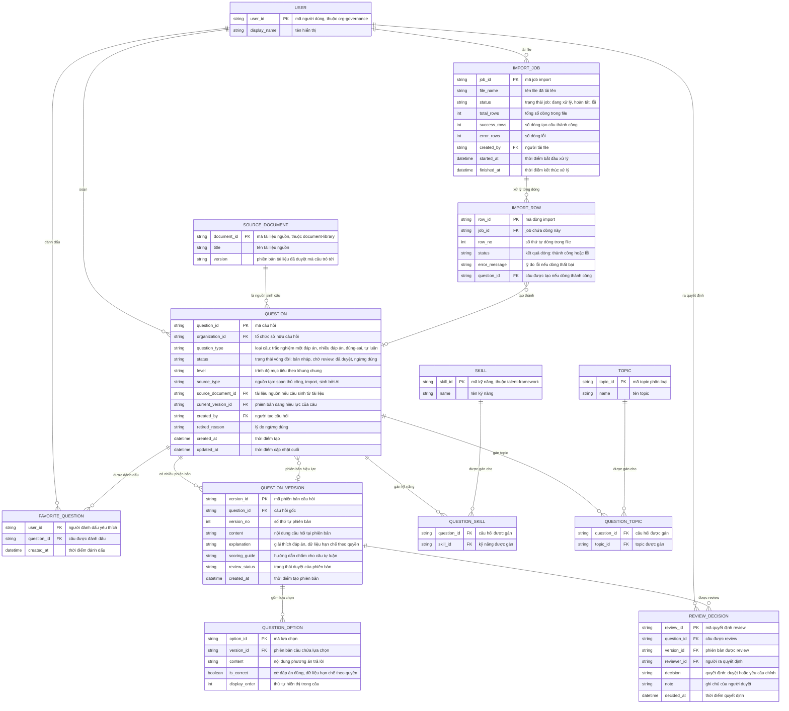

# question-bank — Entity Relationship Diagram

> Scope: ngân hàng câu hỏi của một tổ chức — câu hỏi, phiên bản, lựa chọn,
> phân loại kỹ năng/topic, quyết định review, job import và đánh dấu yêu thích.
> `SKILL`, `TOPIC`, `USER`, `SOURCE_DOCUMENT` là tham chiếu sang feature khác
> (`talent-framework`, `org-governance`, `document-library`).

## Diagram

## Entity Reference

| Entity | Purpose | Key attributes |
|--------|---------|----------------|
| QUESTION | Câu hỏi trong kho của tổ chức — định danh, phân loại, trạng thái vòng đời và provenance | question_type, status, level, source_type, source_document_id, current_version_id |
| QUESTION_VERSION | Snapshot nội dung/đáp án của một phiên bản — bất biến sau khi bài phát hành tham chiếu | version_no, content, explanation, scoring_guide, review_status |
| QUESTION_OPTION | Phương án trả lời của câu trắc nghiệm, thuộc một phiên bản; cờ đáp án đúng là dữ liệu hạn chế | content, is_correct, display_order |
| REVIEW_DECISION | Bản ghi quyết định duyệt/yêu cầu chỉnh của reviewer trên một phiên bản | decision, note, reviewer_id, decided_at |
| SKILL | Kỹ năng trong taxonomy chung — tham chiếu từ `talent-framework`, không sở hữu ở đây | skill_id, name |
| TOPIC | Topic phân loại câu hỏi của tổ chức | topic_id, name |
| QUESTION_SKILL | Gán nhiều-nhiều câu hỏi ↔ kỹ năng | question_id, skill_id |
| QUESTION_TOPIC | Gán nhiều-nhiều câu hỏi ↔ topic (tối đa 10 topic mỗi câu) | question_id, topic_id |
| IMPORT_JOB | Một lần import file mẫu — trạng thái job và đếm kết quả | file_name, status, total_rows, success_rows, error_rows |
| IMPORT_ROW | Kết quả xử lý từng dòng của job — lỗi không chặn dòng hợp lệ | row_no, status, error_message, question_id |
| FAVORITE_QUESTION | Đánh dấu câu yêu thích/thường dùng của từng người | user_id, question_id |
| USER | Người dùng nội bộ — tham chiếu từ `org-governance` | user_id, display_name |
| SOURCE_DOCUMENT | Tài liệu nguồn mà câu AI sinh trỏ tới — tham chiếu từ `document-library`, giữ đúng phiên bản đã duyệt | document_id, title, version |

## Notes & Assumptions

- `QUESTION.status` là vòng đời nghiệp vụ (bản nháp → chờ review → đã duyệt →
  ngừng dùng); `QUESTION_VERSION.review_status` theo dõi duyệt của từng phiên
  bản vì sửa lớn tạo phiên bản mới chờ review trong khi bản cũ vẫn hiệu lực.
- Đáp án đúng nằm ở `QUESTION_OPTION.is_correct` và `QUESTION_VERSION.
  explanation`/`scoring_guide` — đây là vùng dữ liệu hạn chế, chỉ lộ cho vai
  trò được cấp (BR-question-bank-005).
- `SOURCE_DOCUMENT.version` là chốt provenance theo R-11: câu sinh từ AI trỏ
  đúng phiên bản tài liệu đã duyệt tại thời điểm duyệt câu; khi tài liệu có
  bản mới, hành vi "cần rà soát" chờ OQ-4 của spec.
- `IMPORT_ROW.question_id` rỗng khi dòng lỗi; dòng lỗi không tạo câu.
- Bài đánh giá (`assessment-authoring`) tham chiếu `QUESTION_VERSION` qua
  snapshot riêng của nó — quan hệ đó nằm trong ERD của `assessment-authoring`,
  không vẽ lại ở đây.
