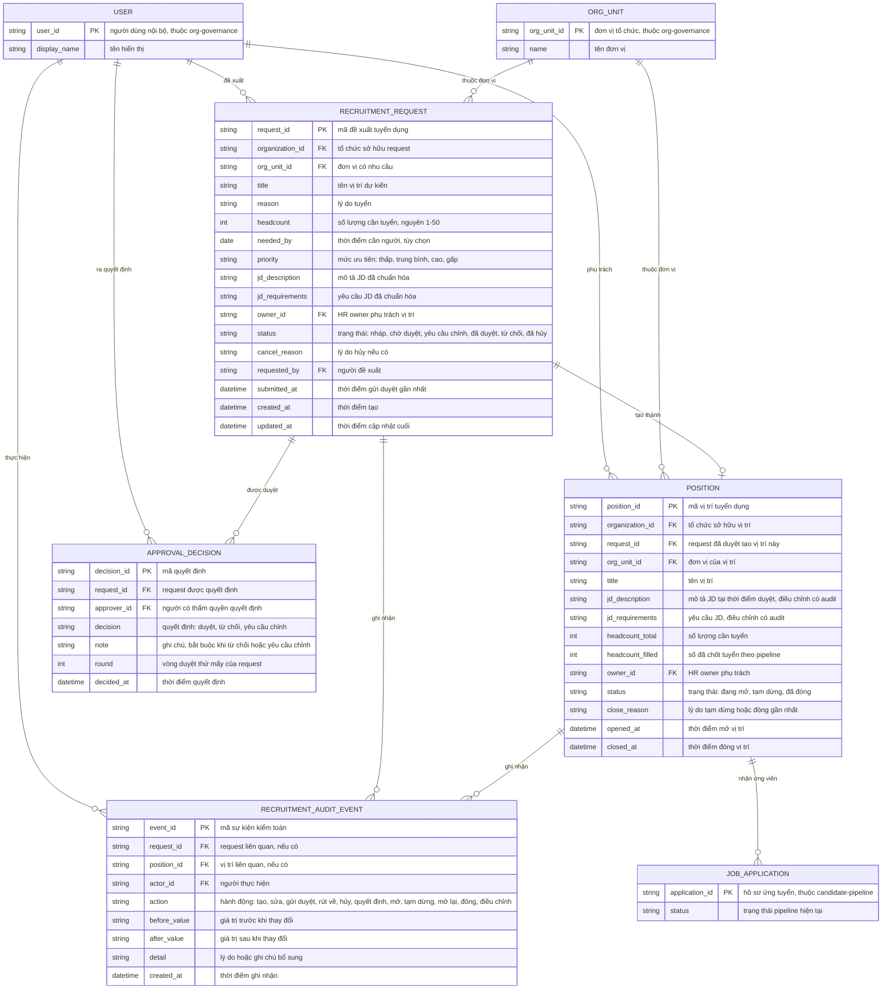

# recruitment-planning — Entity Relationship Diagram

> Scope: dữ liệu nhu cầu tuyển dụng — recruitment request, vị trí đã duyệt,
> quyết định phê duyệt và sự kiện kiểm toán. `USER` và `ORG_UNIT` là tham
> chiếu sang `org-governance`; `JOB_APPLICATION` là tham chiếu tối thiểu
> sang `candidate-pipeline` để đếm headcount.

## Diagram

## Entity Reference

| Entity | Purpose | Key attributes |
|--------|---------|----------------|
| RECRUITMENT_REQUEST | Đề xuất nhu cầu tuyển của quản lý/HR — vòng đời nháp → chờ duyệt → đã duyệt/từ chối/hủy | title, org_unit_id, headcount, priority, jd_*, owner_id, status |
| POSITION | Vị trí tuyển dụng tạo từ request "Đã duyệt" — đích gắn CV và theo dõi headcount | request_id, jd_*, headcount_total, headcount_filled, status |
| APPROVAL_DECISION | Một quyết định của cấp thẩm quyền trên request; nhiều dòng khi request qua nhiều vòng chỉnh | request_id, approver_id, decision, note, round |
| RECRUITMENT_AUDIT_EVENT | Vết kiểm toán mọi hành động trên request và vị trí kèm trước/sau | actor_id, action, before_value, after_value, detail |
| USER | Người đề xuất, HR owner, approver — tham chiếu từ `org-governance` | user_id, display_name |
| ORG_UNIT | Đơn vị của request và vị trí — tham chiếu từ `org-governance` | org_unit_id, name |
| JOB_APPLICATION | Hồ sơ ứng tuyển gắn vị trí để đếm "đã chốt" — thuộc `candidate-pipeline` | application_id, status |

## Notes & Assumptions

- Một request tạo tối đa một POSITION (quan hệ `||--o|`); khi request bị
  từ chối hoặc hủy thì `POSITION.request_id` không tồn tại — POSITION chỉ
  được sinh từ request "Đã duyệt" (BR-recruitment-planning-001/003).
- `POSITION.headcount_filled` là giá trị vật lý hóa từ đếm JOB_APPLICATION
  đạt trạng thái chốt tuyển do `candidate-pipeline` công bố; cập nhật khi
  application đổi trạng thái, không do HR nhập tay (OQ-3 đề xuất).
- `JOB_APPLICATION` chỉ khai tối thiểu để thể hiện quan hệ đếm headcount —
  entity thật thuộc `candidate-pipeline`, không sao chép cấu trúc.
- `APPROVAL_DECISION.round` đánh số vòng duyệt để lịch sử yêu cầu chỉnh →
  gửi lại truy vết được theo thứ tự.
- `RECRUITMENT_AUDIT_EVENT` ghi cả sự kiện trên request lẫn vị trí; một
  trong hai FK có thể rỗng tùy đối tượng.
- Snapshot đơn vị: `ORG_UNIT` đổi tên/giải thể sau duyệt không viết lại
  request — giá trị hiển thị theo tham chiếu hiện tại kèm cảnh báo (edge
  case brainstorm 6.5).
- Không mô hình chuỗi duyệt đa cấp (out of scope v1 — OQ-7).
