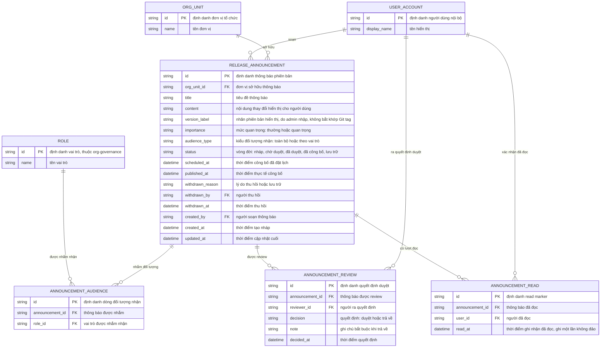

# Thông báo phiên bản có phê duyệt — Entity Relationship Diagram

> Scope: thông báo phiên bản nghiệp vụ — soạn, duyệt, lên lịch/công bố,
> đối tượng nhận, read marker và thu hồi. `USER_ACCOUNT`, `ORG_UNIT`,
> `ROLE` là entity neo thuộc `account-access`/`org-governance` — chỉ tham
> chiếu, không sở hữu.

## Diagram

## Entity Reference

| Entity | Purpose | Key attributes |
|--------|---------|----------------|
| RELEASE_ANNOUNCEMENT | Thông báo phiên bản nghiệp vụ — vòng đời nháp → chờ duyệt → đã duyệt → đã công bố → lưu trữ | title, content, version_label, importance, audience_type, status, scheduled_at, published_at, withdrawn_reason |
| ANNOUNCEMENT_AUDIENCE | Vai trò được nhắm khi `audience_type` là "theo vai trò"; rỗng nghĩa là toàn bộ người dùng | announcement_id, role_id |
| ANNOUNCEMENT_REVIEW | Bản ghi quyết định duyệt/trả về của reviewer — provenance cho mọi thông báo đã duyệt | reviewer_id, decision, note, decided_at |
| ANNOUNCEMENT_READ | Read marker theo từng người × thông báo — ghi một lần, giữ cả khi thông báo lưu trữ | announcement_id, user_id, read_at |
| ORG_UNIT | Đơn vị tổ chức — entity neo ngoài feature (org-governance) | id, name |
| USER_ACCOUNT | Người dùng nội bộ (người soạn, reviewer, người đọc, người thu hồi) — entity neo ngoài feature (account-access) | id, display_name |
| ROLE | Vai trò dùng nhắm đối tượng nhận — entity neo ngoài feature (org-governance) | id, name |

## Notes & Assumptions

- `RELEASE_ANNOUNCEMENT.version_label` là chuỗi hiển thị do admin nhập —
  không phải FK sang entity release kỹ thuật; nghiệp vụ đồng bộ với phiên
  bản thật là trách nhiệm của admin (PRD "Chưa làm"; OQ-5 PRD).
- `audience_type = "toàn bộ"` thì không có dòng `ANNOUNCEMENT_AUDIENCE`;
  `"theo vai trò"` thì có ≥1 dòng. Resolve người nhận theo vai trò hiện
  tại của user tại thời điểm truy vấn (đề xuất — OQ-2 của spec).
- `ANNOUNCEMENT_READ` không có cột trạng thái: tồn tại bản ghi = đã đọc;
  không đảo, không xóa khi thông báo lưu trữ để giữ số liệu đọc lịch sử
  (BR-010).
- `withdrawn_*` chỉ có giá trị khi `status = "lưu trữ"`; lý do bắt buộc
  ≥10 ký tự (BR-005).
- Audit chi tiết từng action (gửi duyệt, công bố, xóa nháp) nằm ở audit
  log của `org-governance` — `ANNOUNCEMENT_REVIEW` chỉ giữ quyết định
  duyệt/trả về là provenance nghiệp vụ tối thiểu.
- `USER_ACCOUNT`, `ORG_UNIT`, `ROLE` khai tối thiểu theo quy ước cross-
  feature: bản đầy đủ thuộc `account-access`/`org-governance`.
