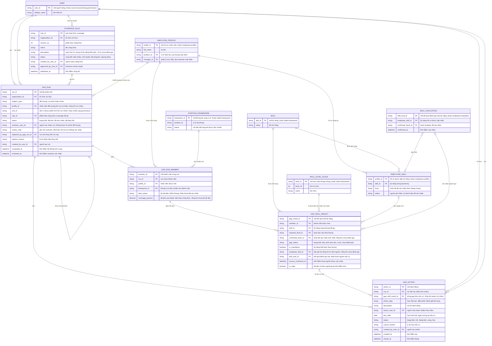

# skill-gap-analysis — Entity Relationship Diagram

> Scope: phân tích độ phủ kỹ năng — lần phân tích (run) cho cá nhân/nhóm
> kèm snapshot provenance, thành viên được tính, kết quả từng kỹ năng có
> trạng thái và nguồn level, công thức coverage qua duyệt của business
> owner, và action sinh từ run đã xác nhận. `EMPLOYEE_PROFILE`,
> `EMPLOYEE_SKILL`, `USER`, `POSITION_FRAMEWORK`, `SKILL`,
> `SKILL_LEVEL_SCALE`, `SKILL_EVALUATION` là tham chiếu tối thiểu sang
> `employee-profiles`, `org-governance`, `talent-framework` và
> `employee-evaluation`.

## Diagram

## Entity Reference

| Entity | Purpose | Key attributes |
|--------|---------|----------------|
| GAP_RUN | Lần phân tích — đối tượng cá nhân/nhóm, chuẩn và công thức đã áp, trạng thái review, provenance thay thế | subject_type, rule_id, status, reviewer_user_id, computed_at, replaced_by_gap_run_id |
| GAP_RUN_MEMBER | Thành viên được tính trong run — khung áp riêng, trạng thái đủ/thiếu dữ liệu, % coverage cá nhân | profile_id, framework_id, data_status, coverage_percent |
| GAP_SKILL_RESULT | Kết quả một kỹ năng của một thành viên — yêu cầu vs đã xác nhận, trạng thái gap, nguồn và nhãn dữ liệu cũ | required_level_id, confirmed_level_id, gap_status, is_mandatory, is_stale |
| COVERAGE_RULE | Công thức tính độ phủ có phiên bản — qua duyệt của business owner, chỉ bản đã công bố được áp | version_no, status, approved_by_user_id, published_at |
| GAP_ACTION | Hành động từ run đã xác nhận — đào tạo/điều phối/đánh giá bổ sung có owner, hạn, trạng thái | action_type, owner_user_id, due_date, status |
| EMPLOYEE_PROFILE | Hồ sơ nhân viên — tham chiếu từ `employee-profiles`; suy khung mặc định qua `position_id` | profile_id, position_id, manager_id |
| EMPLOYEE_SKILL | Kỹ năng trên hồ sơ năng lực — nguồn level "đã xác nhận" duy nhất vào tính coverage, thuộc `employee-profiles` | profile_id, skill_id, level, status |
| SKILL_EVALUATION | Kết quả đánh giá đã xác nhận level — evidence drill sâu hơn, thuộc `employee-evaluation` | skill_eval_id, confirmed_level_id, confirmed_at |
| POSITION_FRAMEWORK | Khung vị trí làm chuẩn so sánh — tham chiếu từ `talent-framework` | framework_id, status |
| SKILL | Kỹ năng được đo trong khung — tham chiếu từ `talent-framework` | skill_id, name |
| SKILL_LEVEL_SCALE | Mức trên thang chung làm yêu cầu/đã xác nhận — tham chiếu từ `talent-framework` | level_id, level_no |
| USER | Người dùng nội bộ (HR, quản lý, owner, reviewer) — tham chiếu từ `account-access`/`org-governance` | user_id, display_name |

## Notes & Assumptions

- `GAP_RUN.status` theo vòng đời trong brainstorm Mục 6.3: đã-tính →
  đã-xác-nhận → đã-thay-thế (self-ref `replaced_by_gap_run_id`, immutable sau
  xác nhận — bản mới là run mới, không ghi đè).
- `GAP_RUN_MEMBER` gom cả run cá nhân (một member) lẫn run nhóm (tối đa
  300 — đề xuất OQ-5): `data_status` tách "đủ-dữ-liệu" khỏi "thiếu-khung"
  và "thiếu-level-đã-xác-nhận" để thành viên thiếu dữ liệu không vào mẫu
  tính (BR-skill-gap-analysis-003, D7).
- `GAP_RUN_MEMBER.framework_id` ghi khung đã áp cho từng thành viên —
  với run nhóm nhiều vị trí, mỗi người so với khung của mình; với run cá
  nhân có thể là khung vị trí khác (chuẩn tham chiếu, OQ-7).
- `GAP_SKILL_RESULT.employee_skill_id` và `skill_eval_id` rỗng khi
  `gap_status = chưa-đánh-giá` — không suy level 0 (BR-skill-gap-analysis-003);
  khi có, chúng là evidence truy nguyên sang `employee-profiles` và
  `employee-evaluation` (FR-skill-gap-analysis-004).
- `GAP_RUN.rule_id` chốt phiên bản `COVERAGE_RULE` "đã-công-bố" tại thời
  điểm tính (BR-skill-gap-analysis-001); công thức có vòng đời duyệt giống khung
  của `talent-framework`, `approved_by_user_id` là business owner (R-13, OQ-11 —
  đề xuất chờ Head of HR).
- `GAP_ACTION.run_id` trỏ run "đã-xác-nhận" bắt buộc (BR-skill-gap-analysis-004);
  `gap_skill_result_id` rỗng khi action áp cho cả nhóm thay vì một dòng gap.
- `GAP_RUN.unit_id` là tham chiếu đơn vị tổ chức sang `org-governance`
  (thuộc tính, không phải entity của feature này); scope enforcement và
  audit truy cập nằm ở `org-governance`.
- `EMPLOYEE_PROFILE`, `EMPLOYEE_SKILL`, `SKILL_EVALUATION`,
  `POSITION_FRAMEWORK`, `SKILL`, `SKILL_LEVEL_SCALE`, `USER` khai tối
  thiểu vì thuộc các feature khác; feature này chỉ ĐỌC nguồn ngoài
  (NFR-skill-gap-analysis-003), quan hệ vật lý đầy đủ nằm trong ERD feature sở
  hữu.
