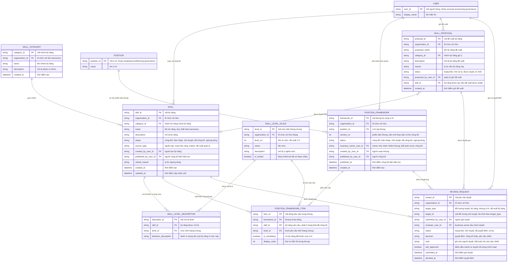

# talent-framework — Entity Relationship Diagram

> Scope: taxonomy kỹ năng của một tổ chức — nhóm kỹ năng, kỹ năng, thang
> level chung, mô tả hành vi từng mức, khung kỳ vọng vị trí, đề xuất kỹ
> năng và yêu cầu/quyết định duyệt. `POSITION`, `USER` là tham chiếu sang
> feature khác (`employee-profiles`/`org-governance`, `account-access`).

## Diagram

## Entity Reference

| Entity | Purpose | Key attributes |
|--------|---------|----------------|
| SKILL_CATEGORY | Nhóm kỹ năng tầng một của taxonomy thuộc tổ chức | name, description |
| SKILL | Kỹ năng trong taxonomy — định danh, phân loại, vòng đời duyệt và provenance | name, category_id, status, source_type, retired_reason |
| SKILL_LEVEL_SCALE | Thang cấp độ chung của tổ chức (đề xuất 5 mức); khóa khi đã có tham chiếu | level_no, name, is_locked |
| SKILL_LEVEL_DESCRIPTOR | Mô tả hành vi mong đợi của một kỹ năng ở một mức cụ thể | skill_id, level_id, behavior_description |
| POSITION | Vị trí mà khung kỳ vọng gắn vào — tham chiếu từ `employee-profiles`/`org-governance` | position_id, name |
| POSITION_FRAMEWORK | Khung kỳ vọng của một vị trí theo phiên bản; mỗi vị trí ≤1 bản "đã-công-bố" | position_id, version_no, status, business_owner_user_id |
| POSITION_FRAMEWORK_ITEM | Một dòng yêu cầu trong khung: kỹ năng + level yêu cầu + cờ bắt buộc | skill_id, level_id, is_mandatory |
| SKILL_PROPOSAL | Đề xuất kỹ năng mới của quản lý chờ owner xử lý | proposed_name, reason, status, proposed_by_user_id, skill_id |
| REVIEW_REQUEST | Yêu cầu duyệt và quyết định của business owner — đa hình theo đối tượng | target_type, target_id, reviewer_user_id, decision, note, self_approved |
| USER | Người dùng nội bộ — tham chiếu từ `account-access`/`org-governance` | user_id, display_name |

## Notes & Assumptions

- `SKILL.status` và `POSITION_FRAMEWORK.status` chia sẻ vòng đời bản-nháp →
  chờ-duyệt → đã-công-bố → ngừng-dùng; chỉ bản "đã-công-bố" được module
  khác tham chiếu (BR-talent-framework-001). Nội dung sửa sau công bố đi
  qua `REVIEW_REQUEST` mới trong khi bản cũ vẫn là chuẩn (BR-004).
- `REVIEW_REQUEST.target_id` là tham chiếu đa hình tới `SKILL`,
  `POSITION_FRAMEWORK` hoặc `SKILL_PROPOSAL` tùy `target_type` — mức
  requirement giữ một hàng chờ duy nhất cho owner; quyết định chi tiết
  chuẩn hóa ở tầng thiết kế.
- `POSITION_FRAMEWORK.business_owner_user_id` bắt buộc trước khi khung
  được công bố (BR-talent-framework-002, R-13); `REVIEW_REQUEST.
  reviewer_user_id` là owner thực tế ra quyết định, `self_approved` ghi
  nhận trường hợp owner tự duyệt nội dung mình soạn (đề xuất — chờ Head
  of HR, OQ-4).
- `SKILL_LEVEL_SCALE.is_locked` chặn sửa thang trực tiếp khi đã có
  `SKILL_LEVEL_DESCRIPTOR`/`POSITION_FRAMEWORK_ITEM` tham chiếu; đổi thang
  qua quy trình migrate riêng (đề xuất — OQ-7).
- `POSITION` khai tối thiểu vì thuộc `employee-profiles`/`org-governance`;
  `USER` khai tối thiểu vì thuộc `account-access`/`org-governance`. Kỹ
  năng của từng nhân viên (`PERSON_SKILL`) thuộc `employee-profiles` và
  không vẽ ở đây.
