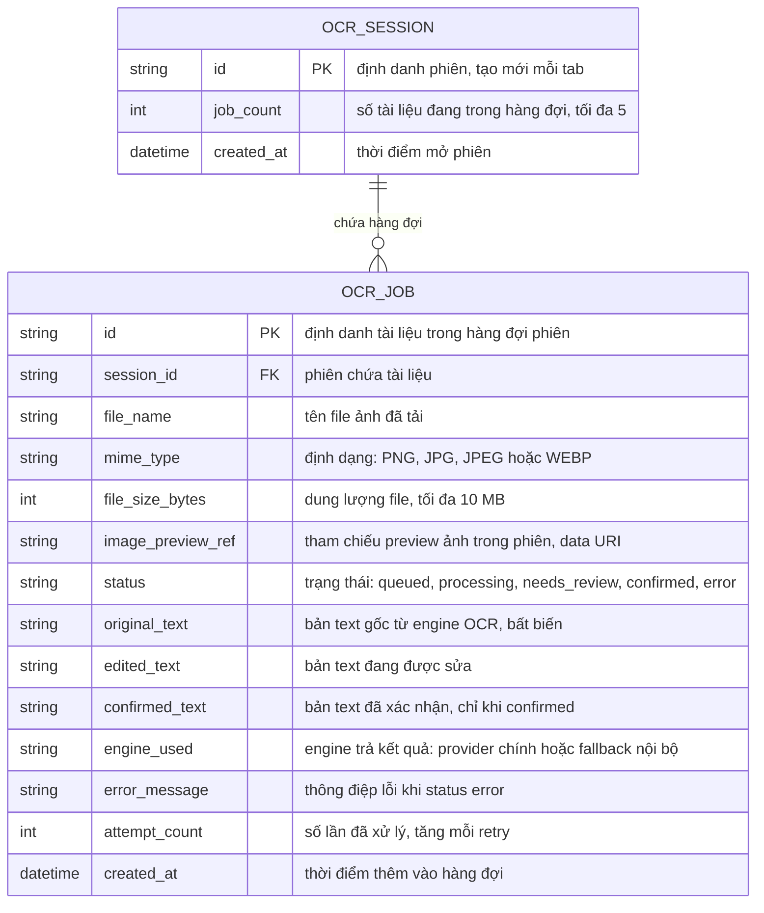

# vision-ocr — Entity Relationship Diagram

> Scope: domain model **transient** của module — chỉ tồn tại trong bộ
> nhớ phiên trình duyệt (in-memory), KHÔNG persist xuống database nào.
> Hai entity `OCR_SESSION` và `OCR_JOB` mô tả hàng đợi phiên và tài
> liệu trong hàng đợi; ba bản text là thuộc tính của `OCR_JOB`. Module
> không tham chiếu entity ngoài nào (Observed: source
> `modules/vision-ocr`).

## Diagram

## Entity Reference

| Entity | Purpose | Key attributes |
|--------|---------|----------------|
| OCR_SESSION | Phiên làm việc của một tab — gốc chứa hàng đợi; hủy khi đóng/refresh tab | id, job_count, created_at |
| OCR_JOB | Một tài liệu trong hàng đợi phiên — ảnh preview, trạng thái xử lý và ba bản text | status, original_text, edited_text, confirmed_text, engine_used, attempt_count |

## Notes & Assumptions

- **Không persistence:** hai entity này là mô hình domain trong bộ nhớ —
  không bảng database, không audit trail; refresh/đóng tab xóa toàn bộ
  (Observed: source `modules/vision-ocr`). Khi tích hợp pipeline sau
  gate PRD Mục 12, dữ liệu sẽ được đưa qua `INTAKE_DOCUMENT`/
  `PROCESSING_JOB` của `document-intake` thay vì giữ model này.
- `OCR_JOB` giữ ba bản text riêng trên cùng bản ghi: `original_text`
  bất biến sau khi engine trả; `edited_text` cập nhật khi HR sửa;
  `confirmed_text` chỉ tồn tại khi `status = confirmed` và bị hủy khi
  reopen (Observed: source `modules/vision-ocr`).
- `engine_used` ghi engine nào trả kết quả cuối (provider chính hay
  fallback nội bộ) — phục vụ nhãn nguồn đề xuất ở OQ-3; hiện module
  chưa lưu trường này, là **đề xuất bổ sung**.
- `OCR_SESSION.job_count ≤ 5` là ràng buộc thiết kế (MAX_QUEUE_SIZE);
  xử lý đồng thời tối đa một `OCR_JOB` ở `processing` trên mỗi phiên —
  hai ràng buộc này là invariant của hàng đợi tuần tự.
- Không có entity USER/AUTH: module chưa có đăng nhập — phiên là đơn vị
  quyền duy nhất; khi tích hợp, người dùng sẽ tham chiếu `USERS` của
  `org-governance`.
