# workforce-monitoring — Entity Relationship Diagram

> Scope: chính sách theo dõi vận hành minh bạch và vòng đời dữ liệu nó điều
> khiển — policy + version + phê duyệt, danh mục dữ liệu được công bố, sự
> kiện quy trình thu nhận được, số liệu tổng hợp, cảnh báo và quyết định
> xử lý, self-view phản hồi của nhân viên, access audit và retention.
> `USER`, `ORG_UNIT`, `ROLE` thuộc `org-governance`; `TASK` thuộc
> `kanban-workspaces` — chỉ khai tối thiểu để tham chiếu.

## Diagram

```mermaid
erDiagram
    USER ||--o{ MONITORING_POLICY : "soạn"
    USER ||--o{ POLICY_APPROVAL : "phê duyệt"
    USER ||--o{ WORK_EVENT : "phát sinh về"
    USER ||--o{ WORK_METRIC_SNAPSHOT : "có số liệu"
    USER ||--o{ MONITORING_ALERT : "là đối tượng của"
    USER ||--o{ ALERT_REVIEW : "xử lý"
    USER ||--o{ EMPLOYEE_FEEDBACK : "gửi phản hồi"
    USER ||--o{ EMPLOYEE_FEEDBACK : "xử lý phản hồi"
    USER ||--o{ DATA_ACCESS_LOG : "truy cập"
    USER ||--o{ DATA_ACCESS_LOG : "bị xem dữ liệu"
    MONITORING_POLICY ||--o{ POLICY_VERSION : "có nhiều phiên bản"
    POLICY_VERSION ||--o{ POLICY_SCOPE : "áp dụng cho"
    ORG_UNIT ||--o{ POLICY_SCOPE : "nằm trong phạm vi"
    POLICY_VERSION ||--o{ POLICY_DATA_CATEGORY : "cho phép loại"
    POLICY_VERSION ||--o{ POLICY_VIEWER_ROLE : "cho phép xem"
    ROLE ||--o{ POLICY_VIEWER_ROLE : "được cấp xem"
    POLICY_VERSION ||--o{ POLICY_APPROVAL : "được duyệt qua"
    POLICY_VERSION ||--o{ WORK_EVENT : "thu nhận theo"
    TASK ||--o{ WORK_EVENT : "sinh sự kiện"
    POLICY_VERSION ||--o{ WORK_METRIC_SNAPSHOT : "tổng hợp theo"
    ORG_UNIT ||--o{ WORK_METRIC_SNAPSHOT : "có số liệu nhóm"
    POLICY_VERSION ||--o{ MONITORING_ALERT : "tạo theo ngưỡng"
    MONITORING_ALERT ||--o{ ALERT_REVIEW : "được xử lý qua"
    ALERT_REVIEW }o--o| TASK : "tạo task xử lý"
    MONITORING_POLICY ||--o{ EMPLOYEE_FEEDBACK : "điều chỉnh bởi"

    MONITORING_POLICY {
        string policy_id PK "mã chính sách theo dõi"
        string organization_id FK "tổ chức sở hữu"
        string name "tên chính sách"
        string current_version_id FK "phiên bản đang hiệu lực"
        datetime created_at "thời điểm tạo"
        string created_by FK "admin soạn"
    }
    POLICY_VERSION {
        string version_id PK "mã phiên bản policy"
        string policy_id FK "chính sách gốc"
        int version_no "số thứ tự phiên bản"
        string purpose "mục đích sử dụng dữ liệu, ngôn ngữ nhân viên đọc được"
        string status "vòng đời: bản nháp, chờ duyệt, đã công bố, hết hiệu lực"
        int retention_event_days "hạn giữ sự kiện chi tiết theo ngày"
        int retention_aggregate_months "hạn giữ số liệu tổng hợp ẩn danh theo tháng"
        string self_view_mode "quyền xem của nhân viên: xem dữ liệu của mình hoặc chỉ số liệu nhóm"
        string feedback_owner_id FK "owner tiếp nhận phản hồi nhân viên"
        datetime published_at "ngày công bố, mốc bắt đầu thu thập"
        datetime created_at "thời điểm tạo phiên bản"
    }
    POLICY_SCOPE {
        string version_id FK "phiên bản policy"
        string unit_id FK "đơn vị/nhóm được áp dụng"
    }
    POLICY_DATA_CATEGORY {
        string version_id FK "phiên bản policy"
        string category "loại dữ liệu được thu thập: tiến độ task, quá hạn, workload, sự kiện quy trình"
    }
    POLICY_VIEWER_ROLE {
        string version_id FK "phiên bản policy"
        string role_id FK "vai trò được xem dữ liệu theo dõi"
    }
    POLICY_APPROVAL {
        string approval_id PK "mã quyết định duyệt"
        string version_id FK "phiên bản được duyệt"
        string approver_id FK "người duyệt: Head of HR hoặc DPO/legal"
        string approval_layer "lớp duyệt: nghiệp vụ hoặc privacy"
        string decision "quyết định: phê duyệt hoặc yêu cầu chỉnh"
        string note "ghi chú của người duyệt"
        datetime decided_at "thời điểm quyết định"
    }
    WORK_EVENT {
        string event_id PK "mã sự kiện quy trình"
        string version_id FK "phiên bản policy cho phép thu nhận"
        string event_type "loại sự kiện trong danh mục đã công bố"
        string task_id FK "task nguồn nếu sự kiện từ kanban"
        string person_id FK "nhân viên liên quan nếu có"
        string unit_id FK "phạm vi sự kiện"
        datetime occurred_at "thời điểm sự kiện phát sinh"
        datetime expires_at "hạn xóa theo retention của phiên bản"
    }
    WORK_METRIC_SNAPSHOT {
        string snapshot_id PK "mã bản tổng hợp"
        string version_id FK "phiên bản policy nguồn"
        string person_id FK "số liệu cá nhân, rỗng khi theo nhóm"
        string unit_id FK "số liệu theo đơn vị/nhóm"
        date period_start "đầu kỳ tổng hợp"
        date period_end "cuối kỳ tổng hợp"
        int task_open "số task đang mở"
        int task_overdue "số task quá hạn"
        int workload_count "tổng task đang gánh"
        boolean is_anonymized "đã ẩn danh sau retention cá nhân"
        datetime computed_at "thời điểm tổng hợp"
        datetime expires_at "hạn xóa số liệu"
    }
    MONITORING_ALERT {
        string alert_id PK "mã cảnh báo vận hành"
        string version_id FK "phiên bản policy chứa ngưỡng"
        string alert_type "loại: quá hạn, workload, quy trình đứng"
        string person_id FK "đối tượng cá nhân nếu có"
        string unit_id FK "phạm vi cảnh báo"
        decimal threshold_value "ngưỡng đã cấu hình tại thời điểm tạo"
        decimal measured_value "giá trị đo được vượt ngưỡng"
        string status "trạng thái: mới, đã xem, đã xử lý"
        datetime opened_at "thời điểm tạo cảnh báo"
        datetime sla_due_at "hạn xử lý theo SLA"
    }
    ALERT_REVIEW {
        string review_id PK "mã quyết định xử lý"
        string alert_id FK "cảnh báo được xử lý"
        string reviewer_id FK "manager ra quyết định"
        string decision "quyết định: xác nhận cần xử lý, đã biết có lý do, cảnh báo sai"
        string reason "lý do bắt buộc"
        string task_id FK "task xử lý được tạo nếu xác nhận"
        datetime decided_at "thời điểm quyết định"
    }
    EMPLOYEE_FEEDBACK {
        string feedback_id PK "mã phản hồi"
        string policy_id FK "policy đang hiệu lực khi gửi"
        string person_id FK "nhân viên gửi"
        string subject_ref "đối tượng dữ liệu phản hồi trỏ tới"
        string content "nội dung phản hồi hoặc yêu cầu đính chính"
        string owner_id FK "người xử lý phản hồi theo policy"
        string status "trạng thái: mới, đã xử lý"
        string resolution "kết quả trả lời nhân viên"
        datetime created_at "thời điểm gửi"
        datetime resolved_at "thời điểm xử lý xong"
    }
    DATA_ACCESS_LOG {
        string access_id PK "mã lượt truy cập"
        string accessor_id FK "người xem hoặc xuất dữ liệu"
        string subject_person_id FK "nhân viên có dữ liệu bị xem"
        string object_type "loại đối tượng: số liệu cá nhân, cảnh báo, export"
        string object_id "định danh đối tượng được xem"
        string surface "surface truy cập: dashboard, alert, self-view, export"
        datetime accessed_at "thời điểm truy cập"
    }
    USER {
        string user_id PK "mã người dùng, thuộc org-governance"
        string display_name "tên hiển thị"
    }
    ORG_UNIT {
        string unit_id PK "mã đơn vị/nhóm, thuộc org-governance"
        string name "tên đơn vị"
    }
    ROLE {
        string role_id PK "mã vai trò, thuộc org-governance"
        string name "tên vai trò"
    }
    TASK {
        string task_id PK "mã task, thuộc kanban-workspaces"
        string title "tên công việc"
    }
```

## Entity Reference

| Entity | Purpose | Key attributes |
|--------|---------|----------------|
| MONITORING_POLICY | Chính sách theo dõi của tổ chức — định danh và trỏ phiên bản hiệu lực | name, current_version_id |
| POLICY_VERSION | Một phiên bản chính sách — trạng thái vòng đời, mục đích, retention, quyền self-view, mốc công bố | status, purpose, retention_event_days, retention_aggregate_months, self_view_mode, published_at |
| POLICY_SCOPE | Đơn vị/nhóm mà phiên bản policy áp dụng | version_id, unit_id |
| POLICY_DATA_CATEGORY | Danh mục loại dữ liệu được phép thu thập — gate đầu vào cho WORK_EVENT | version_id, category |
| POLICY_VIEWER_ROLE | Vai trò được xem dữ liệu theo dõi theo phiên bản | version_id, role_id |
| POLICY_APPROVAL | Quyết định duyệt/yêu cầu chỉnh trên một phiên bản, tách lớp nghiệp vụ và privacy | approval_layer, decision, approver_id, decided_at |
| WORK_EVENT | Sự kiện quy trình đã công bố được thu nhận — chỉ loại trong POLICY_DATA_CATEGORY, có hạn xóa | event_type, person_id, occurred_at, expires_at |
| WORK_METRIC_SNAPSHOT | Số liệu tổng hợp theo người/nhóm/kỳ — ẩn danh hóa sau retention cá nhân | task_open, task_overdue, workload_count, is_anonymized, expires_at |
| MONITORING_ALERT | Cảnh báo vận hành — tín hiệu để manager kiểm tra, không phải kết luận | alert_type, threshold_value, measured_value, status, sla_due_at |
| ALERT_REVIEW | Quyết định của manager trên cảnh báo — bắt buộc lý do, link task xử lý | decision, reason, reviewer_id, task_id |
| EMPLOYEE_FEEDBACK | Phản hồi/đính chính của nhân viên về dữ liệu của mình | content, owner_id, status, resolution |
| DATA_ACCESS_LOG | Vết truy cập dữ liệu cá nhân/export — đổ về audit của `org-governance` | accessor_id, subject_person_id, surface, accessed_at |
| USER | Người dùng nội bộ — tham chiếu `org-governance` | user_id, display_name |
| ORG_UNIT | Đơn vị/nhóm trong phạm vi — tham chiếu `org-governance` | unit_id, name |
| ROLE | Vai trò được cấp xem — tham chiếu `org-governance` | role_id, name |
| TASK | Công việc nguồn sự kiện và đích xử lý cảnh báo — tham chiếu `kanban-workspaces` | task_id, title |

## Notes & Assumptions

- `POLICY_VERSION.published_at` là mốc bắt đầu thu thập: `WORK_EVENT` chỉ
  ghi nhận sự kiện `occurred_at >= published_at` của phiên bản đó (BR-003
  không tổng hợp ngược). Khi version mới công bố, version cũ chuyển "hết
  hiệu lực" và sự kiện của nó vẫn theo `expires_at` đã gán.
- `POLICY_APPROVAL.approval_layer` cho phép mô hình hai lớp duyệt đề xuất
  (Head of HR nghiệp vụ + DPO/legal privacy) trên cùng một phiên bản — chờ
  xác nhận tại OQ-1 của spec.
- `WORK_EVENT.expires_at` và `WORK_METRIC_SNAPSHOT.expires_at` được gán lúc
  ghi nhận từ retention của phiên bản policy — job retention chỉ cần quét
  hạn, không cần tra policy lúc xóa.
- `WORK_METRIC_SNAPSHOT.person_id` rỗng khi bản ghi là số liệu nhóm;
  `is_anonymized` đánh dấu bản ghi cá nhân đã qua ẩn danh hóa.
- `MONITORING_ALERT` gộp trùng theo (alert_type + person_id/unit_id +
  version_id) khi còn ở trạng thái mở — chỉ một cảnh báo mở cho cùng đối
  tượng + loại (BR-006).
- `ALERT_REVIEW.task_id` trỏ task trên `kanban-workspaces` được tạo khi
  quyết định là "xác nhận cần xử lý"; `TASK` thuộc feature đó, chỉ khai
  tối thiểu ở đây.
- `DATA_ACCESS_LOG` là bản ghi phía feature; việc đồng bộ vào audit store
  chung của `org-governance` là Assumption (spec Mục 11).
- `WORK_EVENT.person_id` cho phép rỗng vì một số sự kiện quy trình chỉ thuộc
  phạm vi (`unit_id`) chứ không gắn cá nhân — tôn trọng nguyên tắc chỉ thu
  dữ liệu cần thiết.

## develop-hieu physical additions

The face-attendance implementation adds the following concrete tables around
the generic workforce monitoring model.

### ATTENDANCE_SHIFT

Defines an expected working window.

- `shift_code`, `name`: shift identity.
- `start_time`, `end_time`: expected hours.
- `grace_minutes`: late/early tolerance.
- `is_active`: availability flag.

### ATTENDANCE_SESSION

Stores one biometric work session.

- `user_id`: employee/profile being checked in.
- `shift_id`: optional assigned shift.
- `check_in_at`, `check_out_at`: session timestamps.
- `check_in_method`, `check_out_method`: face or fallback method.
- `check_in_similarity`, `check_out_similarity`: face verification scores.
- `status`: open, completed, failed, or corrected.
- `metadata`: capture/model context without raw image payloads.

### ATTENDANCE_DAILY_SUMMARY

Stores the daily aggregate for reporting.

- `user_id`, `work_date`: summary key.
- `first_check_in_at`, `last_check_out_at`: day bounds.
- `worked_minutes`, `late_minutes`, `early_leave_minutes`: totals.
- `status`: present, late, absent, incomplete, or corrected.
- `metadata`: correction and calculation details.

### Relationship to face enrollment

`ATTENDANCE_SESSION` verification depends on registered embeddings from
`USER_FACE_EMBEDDING`. Face enrollment is intentionally separate from
attendance so a user can refresh biometric data without rewriting historical
attendance records.
